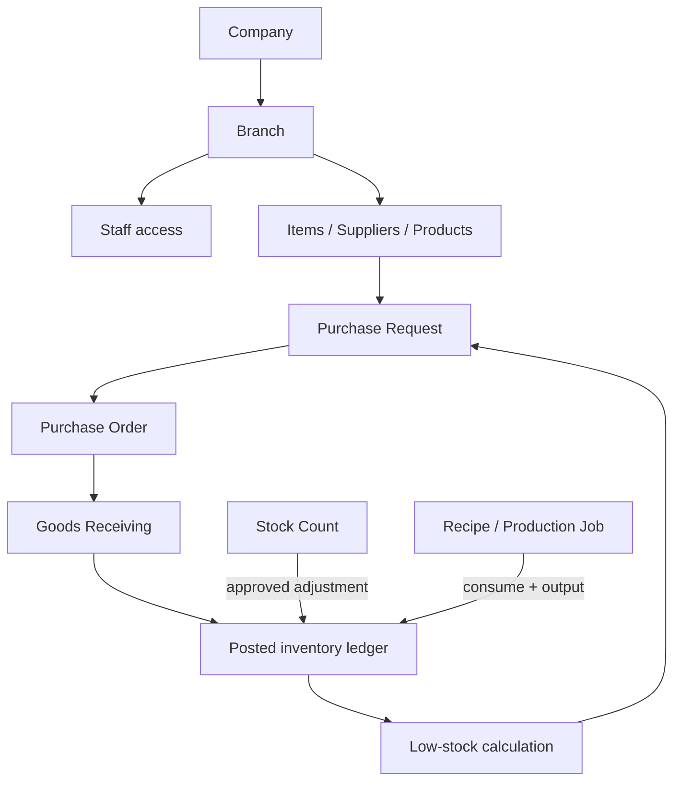

# Seri Bako OMS — 已确认的 Schema 收敛方向

> 业务确认时间：2026-07-23。此文件是后续重构的唯一业务基线。当前仅记录决定和实施顺序；**不删除表、不删除数据、不修改 Production**。

## Migration 账本协调（必须保留记录）

本地数据库的 `supabase_migrations.schema_migrations` 已记录一个 `090` 迁移，名称为 `permission_alias_and_identity_hardening`。该迁移正在另一条并行工作流中完成，因此当前工作树暂时未包含同名 SQL 文件；它不是遗失迁移，也不得在本工作流中覆盖或重建。后续新增迁移从 `091` 开始。最终合并/上线前，必须将 090 的已审查 SQL 文件一并合入仓库，并对比本地与 Production 的 migration ledger。

## 已确认决定

| 主题 | 已确认规则 | 结果 |
|---|---|---|
| 库存真相 | 以“已过账库存流水”作为唯一可计算余额来源；员工通过盘点得知实际库存，系统据此判断补货需求，员工再提交 PR | 不建立可直接编辑的库存余额表 |
| 盘点 | 盘点是实际数量检查；审核/过账后只产生一笔受控的库存调整流水 | `stock_counts` 不是余额真相，不能直接改余额 |
| 地点 | 权限和库存只需要到 `branch`；不再区分 cold room、dry store 等 `location` | `locations` 及地点授权进入废弃重构范围 |
| 条码 | 第一版不需要扫码/条码 | 已由迁移 091 从本地 Schema、类型、备份与维护路径移除 |
| 通知 | 仅对多人共同需要关注的事项发提醒，例如低库存、待审批、异常；个人动作不额外通知 | 以多收件人通知模型为准，页面操作结果留在当前页面 |

## 第一版目标数据模型

库存余额应为：同一 `company + branch + item` 的所有 `posted` 流水，按 `quantity_in - quantity_out` 汇总。库存不足的判断也必须读同一个余额来源。

## 不可直接删除的对象

| 对象 | 为什么不能直接删 | 正确处理方式 |
|---|---|---|
| `locations` | 收货、库存流水、生产、调拨、盘点和分店默认地点都仍引用它 | 先把所有写入/read path 改为 branch 级；迁现有地点资料；最后用新 migration 弃用/删除字段与表 |
| `staff_locations` | 仍是员工地点授权的外键表 | 先确认无运行时读取后停止写入，再归档/删除 |
| `branches.default_location_id` | 与 `locations` 形成循环关系 | 先删业务依赖，再移除该字段 |
| `stock_transactions.location_id`、`from_location_id`、`to_location_id` | 旧库存记录依赖地点维度 | 历史记录保留；新模型改为 branch 维度，必要时以迁移填充“legacy location”说明 |
| `barcode_mappings` | 条码/扫码确认不需要 | 已由迁移 091 删除；Production 应在受控发布窗口应用同一迁移 |
| `notifications` 旧收件人字段 | 当前存在单收件人与多收件人两种表达 | 先统一新写入只使用 `notification_recipients`，迁移旧资料后再删冗余列 |

## 分阶段实施顺序

### Phase A — 先让核心规则唯一

1. 固定库存余额视图：只从已过账流水计算 `company + branch + item`。
2. 固定盘点过账：盘点差异只通过原子库存调整写入流水。
3. 固定低库存：基于同一余额视图和物料补货点生成提示/PR 建议。
4. 关闭任何直接更新库存余额或直接写已过账流水的页面路径。

### Phase B — 地点退场，但保留历史资料

1. 所有新表单只选择分店，不再要求地点。
2. 新库存、收货、盘点、损耗、调拨、生产写入只使用 `branch_id`。
3. 旧 `locations` 只供历史记录读取，不再新增/编辑。
4. `staff_locations` 停止写入；权限只使用 `staff_branches`。
5. 在完成 Production 数据核对和备份后，才决定是否物理删除旧地点表/字段。

### Phase C — 非核心清理

1. 条码表暂停使用并审计数据/调用方。
2. 通知新写入统一使用 `notifications` + `notification_recipients`。
3. 迁移或下线 `profiles` 的兼容读取。
4. 收敛重复页面路由，不改动核心数据。

## 需要保留的通知

- 低库存需要补货；
- PR/PO/GRN/Invoice 进入某角色审批队列；
- 盘点差异或库存过账失败；
- 员工账号/权限需要处理。

不需要建立通知的情况：保存成功、个人页面操作成功、普通编辑、已在当前页面可见的单人待办。

## 下一步技术任务

Phase A 的第一轮只读核查已经完成：

| 发现 | 影响 | 处理结论 |
|---|---|---|
| `src/server/inventory/engine.ts` 仍有 `createInventoryMovement()`，会分两次直接写 `stock_transactions` 与 `stock_transaction_lines` | 它是旧的、非原子库存写入助手；当前核心 Action 契约已不使用它 | **强废弃候选**；先在完整调用图确认无运行时调用，再移除 |
| Opening Stock import 仍直接写 `stock_transactions` | 期初库存导入绕过统一库存 RPC | 必须在 Phase A 收敛到原子 opening-stock RPC |
| 收货、PR、退货、盘点、调拨、损耗、手工库存、生产表单都传递或解析 `location_id` | 地点模型横跨核心业务写入 | 不能一次删字段；需分模块改为只用 `branch_id` |
| `resolveDefaultLocation()` 被多处核心写入路径调用 | 当前以“每个分店自动选一个默认地点”维持旧模型 | 过渡期保留；Branch-only RPC 完成后移除 |
| `stock_transactions` 和 `stock_transaction_lines` 仍同时被备份、清理报表和旧引擎引用 | 双层库存模型尚未完全收敛 | 先制定并验证唯一读写契约，再决定是否保留行表 |

下一步是把上述调用点按模块（收货、盘点、调拨、损耗、生产、期初库存）拆成一张迁移清单，并只先改一个最小闭环：**Branch 级期初库存 + 库存余额 + 低库存提示**。确认清单后，才开始第一条 forward-only migration。
