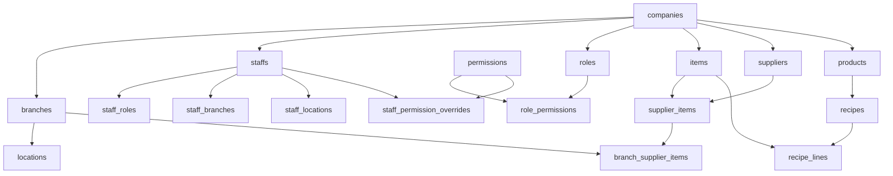
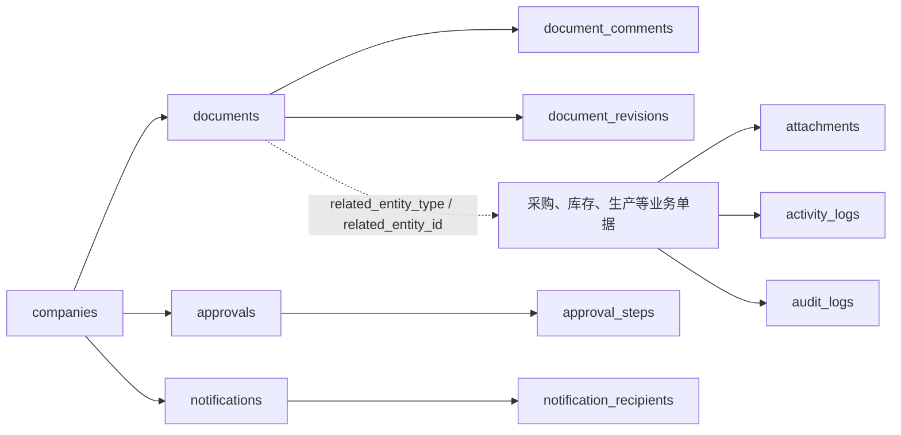
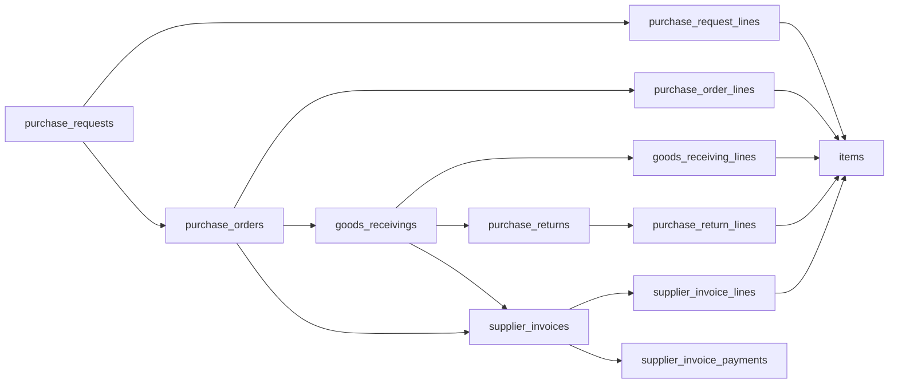
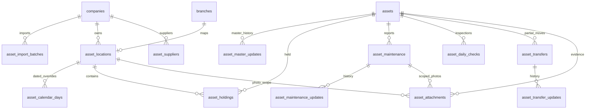

> Local candidate: migrations reviewed through `351`; forward-only migration 历史已到 `351`. Migration 350 adds versioned attendance confirmation and People-only payslips; 351 binds released-payroll protection into schedule refresh. Not applied to Production. Migration numbering 346–349 remains owned by other tasks.

> Local schedule-import candidate: migrations reviewed through `349`; forward-only migration 历史已到 `349`. Migration numbers 348/349 are allocated by the integration coordinator; 347 belongs to checklist and approval-flow migrations start at 350. Partial import receipts and append-only draft rows were validated only in the isolated synthetic database; no Production application.

> 2026-10-14 Wilson local candidate: migrations reviewed through `347`; forward-only migration 历史已到 `347`. Migration 347 connects checklist exceptions to scoped maintenance notifications and My Actions; 346/347 remain unapproved for Production.

> 2026-10-13 isolated release package: migrations reviewed through `346`; forward-only migration 历史已到 `346`. The only new migration in this package is 346 (general maintenance, scoped reporter permissions and private attachments), verified locally only. Migrations 343/344 are unchanged baseline files; 345 and all new schedule/import changes are excluded. Production migration requires separate approval.

> 2026-10-12 candidate: migrations reviewed through `344`; forward-only migration 历史已到 `344`. Migration 344 adds an explicit by-order demand basis. Prepared for isolated validation; not applied to Production.

> 2026-10-10 isolated schedule repair: repository migrations reviewed through `343`; forward-only migration 历史已到 `343`. Migration 343 makes version validation, destination save and submit atomic; Wilson approved application only to the isolated local test DB (341 migration rows, maximum 343). No grants changed. This is not evidence of Production schema or deployment changes.

## v9.2.103 approved release verification — 2026-10-09

The user approved migrations 340/341 and candidate builds on the existing Supabase and Vercel projects. Both migrations committed successfully; 13 asset ledger hashes are unchanged. Candidate register loading exposed repeated source-field reads; migration 342 batches the existing whitelisted metadata without broadening original-outlet visibility. Isolation tests pass. Migration 342 is awaiting explicit approval; the formal domain remains v9.2.102 until real-page acceptance passes. Shared interaction targets are now 44px and short-screen modal actions remain visible.

## Pending cohesive repair — 2026-10-09

Migrations 340/341 add full-day actual unpaid-leave reporting and a scoped asset register read model. They are locally verified; Production application and UI acceptance are pending. The previous deployed checkpoint below remains historical evidence, not acceptance of this repair.

## 2026-10-09 asset UI and scope rework (not deployed)

## Final asset interface checkpoint — v9.2.102 deployed, 2026-10-09

Formal system.seribako.com.my is on v9.2.102. Migration 339 remains applied; no business rows changed during subsequent UI releases. All 1,464 regressions passed and the hosted build completed type/lint checks. Daily Checklist filters now precede a compact status register, progress follows the selected location, and historical inspections are collapsed. Its final five-width screenshots show no root or table overflow and fully visible Inspect links. Phone submission remains fixed; the tablet toolbar stays fixed above navigation after scrolling at 820/1143px. Earlier v9.2.99 sticky-toolbar verification failed and is superseded. Both original photos opened after the privacy migration. Evidence and exact limits are in docs/qa/ASSET_SCOPE_UX_2026-10-09.md. Human visual approval, keyboard overlap and real business submission are not claimed; Penang confirmed configuration remains separate.

## 正式发布核验 — 2026-10-09 v9.2.98

339 已在正式 Supabase 项目执行，配套部署 dpl_8Nergf2V4zx62ZJkGBEDjEr3sBm1 已提升至 system.seribako.com.my。员工、经理及主管均受所属／获授权门店限制；Overview 与 Maintenance 限 Super Admin、Manager、Supervisor。Super Admin 保留公司范围访问。

正式迁移后 13 张资产业务表的行数及整行指纹全部与冻结快照相符：445 个编号、已知数量 2,080、31 项未知数量，21,988 条历史检查与 2 份已验证附件均保留。八种现有角色身份的线上 SQL 只读验证通过：门店范围、完整历史范围、管理功能限制、原始字段与私人 Storage 隔离、直接写入拒绝。这不是八个独立浏览器登录验收。

预览实际登录后检查了 390／430／820／1143／1440 五个概览宽度，根页面无横向溢出，两张趋势图均为 200px。实际验证桌面右 Console、ALMA 筛选返回 73 项及名称排序、紧凑维修队列、ALMA 检查完整载入 73 项、手机全部勾选／撤销、异常展开和未保存丢弃保护；390px 提交栏固定。正式域名已确认 v9.2.98 与资产数量。截图保存于 outputs/asset-migration-private/2026-10-09/rework-339/。

未宣称完成项：正式检查提交被自动审批阻止，以免测试写入真实业务记录；提交负载与数据库生命周期由隔离测试覆盖。独立员工浏览器会话、每个明细在每个宽度的交互及键盘遮挡尚待完整验收。Penang 厨师长确认资料仍未齐，不应将发布当作整个三批计划收口。原先 v9.2.97 和未应用 339 的记载作为历史阶段保留，以本段为最新状态。

Repository migrations reviewed through `342`; forward-only migration 历史已到 `342` (repository sequence, not applied Production schema). Production asset foundation and read optimization 337/338 are applied, and the reconciled final asset batch has completed activation. The interface was subsequently rejected; its visual and operational acceptance is reopened. Migration 339 is applied to Production after explicit owner authorization and hosted rollback rehearsal. It restricts non-Owner asset locations to assigned branches, gates management overview and maintenance by management roles, separates employee checklist summaries, and protects imported JSON and unlocated legacy attachments. No asset source row is deleted or rewritten by this migration. Eight-role live identity checks and both original attachment routes passed after application. The 8 October entries below describe historical staging, not the current activation state.

## 2026-10-08 implementation in progress

Repository migrations reviewed through `338`; forward-only migration 历史已到 `338` (repository sequence, not proof of applied Production schema). Migration 337 is an isolated asset foundation applied alone to Production on 8 October 2026 with owner authorization. The reviewed source is staged and reconciled; its asset batches remain inactive, so this is not formal cutover. Source asset quantities can be unknown: preserve them as NULL and prevent transfers until confirmed. Assets use original IDs with per-location holdings and in-transit quantities. Child references are constrained by company. The thirteen asset tables are included in company-scoped backups. Migration 338 is a reviewed asset read-policy optimization; it is applied to Production with stored migration source verified. It reuses the same RLS-filtered accessible location set without changing mutation helpers or grants.

Daily Records removes stockout entry while preserving historical fields; quantity-proxy-v3 prevents automatic decreases when stockout observations are unknown. Desktop details share the product row; phone details expand on demand. Last-counted packaging balances retain their recorded dates and age. Planning configuration changes now participate in unsaved-navigation protection. Authenticated acceptance, Penang chef confirmation and final asset cutover remain separate outstanding gates.

## v9.2.86 (deployed) — annotated operational density correction

The owner's 2026-10-04 annotations supersede the previous 44px desktop Planning treatment: operational query and Planning controls are 36px from 768px; normal WorkspaceTabs use 36px tabs and a 46px outer surface. Phone controls retain 44px. Planning's desktop Adjust is a 23px visual command in the requested #7c9b8d with white text; other primary actions retain the OMS green. View commands share #e7f1eb / #084b37. This applies through the existing shared owners, including Daily Records and Insights; Packaging's approved compact filter composition is preserved. SAP Fiori's compact/cozy distinction is a category reference, not a copied theme: https://www.sap.com/design-system/fiori-design-web/v1-136/foundations/visual/cozy-compact.

The worksheet fixes outlet tracks at 112px rather than distributing unused width between inputs. A 32px indexed lead column and 200px product identity remain frozen; the 136px read-only summary shows unknown values as a dash, never zero. Separate borders and opaque header cells establish stable vertical/horizontal stacking. Adjust opens the existing focus-managed ModalShell, with local trays/reason editing, Apply/Automatic/Cancel; cancelling leaves production unchanged. The unsaved-switch dialog uses a 448px maximum instead of 1024px. Settings uses two vertically stacked shared surfaces in the same form and removes the annotated paragraph. Insights date is capped at 168px, count joins the action group, and Received/Wastage/Rate toggle numeric sorting with aria-sort, stable name ties and unknown values last. Only the two needed aggregate lists cross the server/client boundary.

Source verification: `01.SERI BAKO ALL KUIH ORDER.xlsx`, coded V2 sheets and matching explicit original yield column, confirms SC01/SC02/SC15/SC16 = 16, SC07 = 28, and SC03–SC06/SC08–SC14 = 32. PJS10's previously empty configuration was populated for these 16 products through the normal Manager Settings action, recorded by its audit, with demand basis manual, minima unfilled, automation disabled. Existing 2026-10-05 PJS10 v1 was found in draft with zero entered allocation/production values; normal Recalculate refreshed its yield snapshots. No new plan, formal order, approval, dispatch or inventory transaction was created. Alma and other products have no confirmed kitchen-specific source in this workbook and are not inferred. The workbook's variable daily allocations are not minimums or new demand orders. Database schema remains reviewed through 332; permission-warning closure, wider cold/tail latency and historical Packaging closing provenance remain separately tracked.

Strict TypeScript, lint, 1,406 regressions and 85 isolated PostgreSQL checks pass. Final v9.2.86 deployment CPtQ5g5r5s8jtDHkhakozG112hsY (8559a57a) is READY and aliased to the formal domain, with sin1 independently inspected. Formal responsive and interaction evidence, including the final row-divider follow-up deployment, is recorded in docs/qa/OMS_PRODUCTION_REWORK_2026-10-04.md.

## v9.2.85 (deployed) — measured outlet reporting performance

Migration 330 is applied: Daily Records resolves the original authorized branch predicate once per statement; child lines inherit the same parent SELECT RLS via a set. No persistent permission cache, changed company/outlet access, write policies, operational values or stock posting. Live rollback comparison across eight active role categories returned identical parent/line/report results. Same Owner, date and 30-day Packaging EXPLAIN ANALYZE: 3,277.739ms before, 151.633ms after (95.4% reduction); this is database execution time, not full browser latency. Migration 325 remains pending and unrelated Advisor findings are not claimed cleared.

Packaging uses request-scoped React cache deduplication only, keeping fresh RLS across requests; local chart series are memoized and grouped in one pass. Insights cost and report reads run independently in parallel. Shared IntentPrefetchLink warms opted-in Planning/Daily Records/Insights tabs only on pointer or keyboard intent, with duplicate warming suppressed; no eager viewport loading of every report. Successful daily save/post/void and Planning writes invalidate Insights and Packaging route data. Forecast results continue to be persisted in plan versions; no new materialized inventory or historical confirmations are introduced. Cross-request report TTL caching is deliberately not enabled without a verified permission/freshness version key. Source convention follows Next.js request/route caching and PostgreSQL statement-level RLS semantics.

Vercel functions are configured in sin1 to colocate with the confirmed ap-southeast-1 database; build location is not used as runtime-region evidence. Deployment 2Fj2GWKnfE47gAiEAWqLgEYbghpq (af6ec8d9) is READY and aliased to https://system.seribako.com.my; inspect independently confirms serverless functions in sin1. Authenticated Packaging and Insights show v9.2.85 and load their reports without browser errors. Browser reload-to-visible observations include automation overhead and are not a precise end-to-end benchmark. Isolated scope tests cover company A/B, outlet, routed kitchen, missing assignment/identity, denied permission, immediate scope changes and orphan/anonymous denial. Final test/build counts and screenshots belong to docs/qa/OMS_PRODUCTION_REWORK_2026-10-04.md.

## Current repository / database distinction

forward-only migration 历史已到 `337`。Migration 329 applied in a source-guarded transaction and was independently read back. Applied ledger: 324, 326, 327, 328, 329; 325 remains pending. Existing product rows receive NULL tray_mode without changing trays or snapshots. Authenticated Manager/Owner resolve_production_event_supply reads only their company; PUBLIC and anon execution is revoked. Existing transactional function ACLs/owners are preserved.

## v9.2.84 (deployed) — compact Planning and explicit query actions

Current release is v9.2.84; final deployment 6uZJm6wU86VskGmYcA3X79BFR2ke (commit 265580f6) completed and aliased to https://system.seribako.com.my. The scoped control-density follow-up is independently verified on the formal page: 44px controls, 200px product column and 136px system summary. v9.2.83 procurement fixes remain included. v9.2.82 also deployed successfully (AxE6dgNLNZYeBPdwapb5TTg9aEuz); its UI acceptance was superseded by the approved layout rework. This version reuses WorkspaceGrid, WorkspaceTabs, FilterBar, Table, SelectControl, Input, Button and ModalShell. No new visual foundation or decorative motion.

Planning and Insights use the backward-compatible FilterBar actions slot; fields precede a right-aligned submit action. Planning scopes 44px controls to its workspace and portal actions. Product identity (200px) and calculated summary (136px) precede outlet quantities (112px) and kitchen retention (96px). ResizeObserver groups outlets using actual container width; full overview scrolls within the worksheet. At <768px the shared responsive-field owner disables the hidden matrix and provides one-outlet cards; at 768–1023px the rail stays in More to preserve editing width; landscape tablets use the existing split rail. Search, category and group changes retain parent-owned unsaved inputs. Existing consumers retain the 1280px responsive-field default. Date/kitchen/version and workspace-tab navigation use the shared confirmation modal for save/discard/cancel.

Automatic trays = ceil((approved outlet demand + independent event quantity)/yield); retention allocates surplus and never manufactures demand. Manual override is explicit and reasoned, with Restore automatic. Migration 329 adds nullable tray_mode, recomputes automatic drafts in SQL, validates review snapshots and preserves legacy NULL modes, old clients and approved versions. Event Details and Products & Quantities are separate visible shared surfaces in one form; Scheduled Events moves to the right rail and below the form on portrait/mobile. Destination/date supply resolution is permission-gated and company-scoped; missing/conflicting effective primary routes block confirmation. Saving rechecks the route. Corporate events require explicit kitchen selection.

Repository migrations reviewed through `329`; applied Production migrations include 324, 326, 327 and the independent Goods Receiving fix 328. Migration 329 is applied with its function definitions and preserved ACLs independently verified; all 52 historical product rows keep NULL mode and unchanged quantities. 325 remains pending explicit permission approval. No local Supabase, fabricated Production orders, approvals, dispatches or inventory writes. Strict TypeScript, lint, 1,404 regressions and 85 isolated PostgreSQL checks pass; Hosted build succeeded. Authenticated Planning and Insights at 390/820/1180/1440px have no root horizontal overflow; screenshot evidence is recorded in the QA ledger. Final Events and shared-consumer acceptance remain pending after the session expired again. Login was restored for the completed checks. Initial read-only checks verified search/overview preserve zero, unsaved switching exposes all three choices, Cancel restores focus to View plan, and test values were discarded without saving. Permissions warnings, 30-day Packaging query performance and verified closing-stock provenance remain open in the QA ledger.

当前 forward-only migration 历史已到 `328`：Goods Receiving 字段歧义热修复已应用；325 仍待单独批准。此条不更新以下历史快照。

## v9.2.82 (deployed; acceptance superseded) — actionable plan review groups

The existing Plan checks console composes shared ConsoleSection/Button with native disclosure groups for Settings, quantities, Manager reasons and production balance. Exact product/outlet messages remain accessible, and the current-date/kitchen Settings link is shown only when configuration is incomplete. Unsaved edits never display Ready for review. Review and database gates are unchanged; no CSS, motion, permission or database changes. The business composition lives in production-planning-review-checks.tsx; generic components retain their existing ownership. Production remains v9.2.81 with 324, 326 and 327 applied, 325 pending. Formal v9.2.82 verification is not yet complete.

## v9.2.81 (deployed) — partial manual drafts / migration 327 applied

Draft save preserves unknown allocation quantities and tray counts as NULL, separately from explicit zero; submit/release remain blocked until quantities, minimums, yields and whole-tray balance are complete. Invalid numeric ranges and fractional trays are rejected at the action and database boundaries. The transactional function preserves its permission checks, locking, idempotency, audit and strict review rules. Manual-only generation skips unusable eight-week history; mixed same-day plans retain full food-record completeness checks. No grant or RLS policy change. Production is v9.2.81 with migrations 324, 326 and 327 applied; 325 remains unapproved. Guarded migration 327 applied independently after live function/source comparison, preserving ACLs, SECURITY DEFINER and owner. The old function reproduced the failure; 63 isolated PostgreSQL flow checks and 1,387 regressions pass. No local Supabase or production operational UAT writes. Deployment 8ZTxPzEZnK9tbjGiQJpb18TWrhPq completed successfully and is aliased to https://system.seribako.com.my. Authenticated Owner Planning reports v9.2.81; unknown quantities remain blank and review stays blocked. At 390/820/1180/1440px the document has no root horizontal overflow. No operational records were written.

## v9.2.80 (deployed) — selected-period Packaging reads

Packaging requests only the selected 7/30-day report once; outlet/product filters remain local. A period change performs server navigation, preserves client filter identity, and shows shared loading states instead of treating an unrequested month as missing or zero. Failures use ErrorState with the shared RetryButton, preserving the workspace URL. Latest closing stock remains independently returned by the existing report RPC, including records older than the selected period. No RLS, grant or inventory change. Deployment 2zJb5RgYqK5DR4haWDXcBwBGtrwS succeeded and is aliased to https://system.seribako.com.my. Database 324 and 326 are applied; 325 remains pending. Strict TypeScript, lint, hosted build and 1,385 regressions passed.

## 2026-10-04 current verified release — v9.2.79 / database 324 + 326 (325 pending)

Deployment `6DUNX69vZnWaH7RBRZAuisokn4WX` succeeded and the formal alias is https://system.seribako.com.my. Commit `0103a2f9` passed strict TypeScript, lint, hosted build and 1,381 regressions. Owner-authenticated checks verified the corrected Plan phone drawer, product-order guidance and focus restoration, and Packaging at 390/820/1180/1440px without root overflow. The phone inline filter card is 130px high with no empty primary row. Earlier release evidence below is historical; the larger QA goal remains open, including database performance/permissions, provenance and complete workflow/a11y acceptance.

## Database eligibility follow-up — migration 326 applied independently

Repository migrations reviewed through `327`; forward-only migration 历史已到 `327` (repository sequence, not applied Production schema); production applied ledger includes 324 and 326; 325 remains unapproved.

A disposable PostgreSQL fixture reproduced expired-but-active staff reading and configuring Planning through the legacy helpers. Migration 326 aligns planning_manager, planning_branch_access and planning_require_manager with the existing current_staff_id eligibility gate; Malaysia employment end dates remain inclusive. It changes no ACL, policy declaration or operational quantity. The fixture verifies ended/inactive/anonymous denial, eligible current-day/open-ended staff, and unchanged ACLs, SECURITY DEFINER flags and ownership. The production-planning integration suite passes 52 checks with 326. Migration 326 was applied in a guarded transaction and independently read back. Original function hashes matched preflight; ACLs, SECURITY DEFINER flags and owners were unchanged. The authenticated Owner still opens the editable draft. Production is application v9.2.79 with 324 and 326 applied; 325 remains unapproved. Future approved db push must include the earlier 325 with --include-all; do not assume a contiguous applied-through version.

## 2026-10-04 verified production authority — v9.2.78 / database 324

Deployment `D2xa7BFBHrLG57s2d9n8SHNypRhB` succeeded and is aliased to https://system.seribako.com.my. Owner-authenticated production checks covered Plan, Settings, Events, Daily Records, Insights, the canonical DO list and Packaging at 390/820/1180/1440px without root overflow. Phone Plan actions opened successfully; Escape closed the drawer and restored trigger focus. Strict TypeScript, lint, hosted build and 1,377 regressions passed. These are surface checks, not complete workflow or WCAG certification. See docs/qa/OMS_PRODUCTION_REWORK_2026-10-04.md for evidence and unclosed gates. Database remains 324; prepared 325 and the live packaging RLS experiment are pending specific permission authorization.

## v9.2.79 (deployed) — provenance and shared phone filters

Candidate removes the blank primary row from shared inline phone filters, keeps unconfirmed packaging usage blank, and orders review checks by the displayed product/outlet sequence. Actual component render tests distinguish explicit zero from absent confirmation and preserve zero result counts. No database policy, grant, quantity or inventory change is included. This candidate was deployed and verified as recorded in the current release authority above.

## 2026-10-04 internal-table access verification

Production schema remains applied through 324. Read-only catalog and actual anon/authenticated SELECT tests verified the eight zero-policy RLS tables deny client row access. Four supplier audit tables retain old client grants despite RLS denial; caller review and specific approval precede tightening them. No permissive policies were added to hide Advisor Info. Migration 325 remains prepared and unapproved; application v9.2.78 changes do not depend on its permission changes. Detailed evidence and remaining reviews are in docs/qa/OMS_PRODUCTION_REWORK_2026-10-04.md.

## 2026-10-04 authenticated closure authority — v9.2.76

Repository migrations reviewed through `325`; forward-only migration 历史已到 `325`. Migration 325 is prepared and rollback-tested but NOT applied: explicit production permission approval is pending. Production remains applied through 324. Migration 324 repairs draft-recalculation SQL aliases without changing authorisation or workflow. Owner UAT identified the failure; the expanded isolated fixture now covers recalculation, removal of obsolete allocations and preservation of reasoned manual quantities/trays. Production v9.2.76 is deployed (8u2otQahGNK3w3XXh7hdbat2mLtx); migration 324 is applied and live draft recalculation passed. Authenticated Owner surface checks and outstanding configuration dependencies are recorded in docs/qa/OMS_FEATURE_CLOSURE_2026-10-04.md; historical entries below do not define current deployment state.

> Current authority 2026-10-04: forward-only migration 历史已到 `323`; repository migrations reviewed through `323`; linked Production ledger applied through `323`. Migration 322 is the security-invoker packaging report; 323 adds an explicit same-day/manual forecast basis to batch rules. Older version entries below are historical snapshots.

> 2026-10-03 repository authority：forward-only migration 历史已到 `322`。`319–320` 新增生产配货、版本审核、DO 与 Daily Record 来源锁定；`321` 允许跨日报废和包装使用量，并保存包装实际结余。隔离 PostgreSQL fixture 验证不等同于已部署 Production。

Current repository forward-only migration 历史已到 `318`; the linked Production migration ledger is verified through `311` on 2026-09-19. Migrations `312–318` are repository-only until the target database is explicitly verified; 312–313 repair part-time punch policy, 314 restricts outlet compliance, 315 adds management email delivery logs, and 316 retires sensitive payroll access, 317 exposes staff home outlets in the schedule RPC, and 318 introduces explicit packaging product-to-inventory SKU links. Migration 311 restricts the live Attendance exception summary to distinct affected current calculation revisions and adds the corresponding tenant-scoped partial index; multiple flags remain available in detail and superseded rows remain immutable audit evidence. Migration 310 adds one constant-size, security-invoker Outlet Daily Today summary; its function, grants, PostgREST schema reload and current summary values were applied and read back successfully. Migration 309 adds one constant-size, security-invoker Stock Count queue summary. Migration 308 grants People Operations guarded schedule read and draft access for workbook import without submission or approval. Migration 307 adds the bounded attendance-review indexes. Migration 306 hardens incomplete-punch evidence and inference. Migration 305 retires BOMBA as a duplicate of Fire Extinguisher across outlet checklists while preserving historical compliance records and attachments. Migrations 298–311 are Production applied; application deployment evidence remains tracked separately. See `docs/qa/SYSTEM_CLOSURE_2026-09-16.md`.

Current repository forward-only migration 历史已到 `287`; linked Production migration ledger 已到 `287` (Kitchen schedule eligibility), verified 2026-09-14. All four resulting function bodies match the committed migration; ALMA and PJS10 show 8 and 12 roster staff. Application v9.2.69 remains a separate Preview verification gate. See `docs/qa/SYSTEM_QUALITY_2026-09-14.md`.

# Seri Bako OMS — Schema 与 Table 关系地图

> Repository review 2026-09-14: forward-only migration 历史已到 `286`. The v9.2.68 performance patch changes application read orchestration only and adds no database migration. Production schema verification remains separate from this source review.

> Current repository and Production authority 2026-09-14: forward-only migration 历史与 Production ledger 已到 `286`. Migration `284` adds one tenant-bound historical schedule-eligibility authority; migration `285` preserves immutable employee-day ownership during parser-versioned workbook replay; migration `286` makes every immutable cross-outlet disposition satisfy employee-day completeness. The linked dry-run reports the remote database as current; authenticated workbook UAT remains recorded separately in `docs/audits/2026-09-13-roster-integrity-closure.md`.

> Current repository authority 2026-09-12: forward-only migration 历史已到 `281`. Migration `281` recalculates finalised raw-punch batches after a later Schedule publication and exposes a permission-gated company employee candidate list for week-scoped outlet rostering. It does not change immutable punch evidence or permanent staff outlet ownership. Database application and Production verification remain separate evidence.

> Current repository authority 2026-09-11: forward-only migration 历史已到 `280`. Migration `280` repairs composite schedule-row handling across save, submit, copy, approval and workbook-import RPC wrappers; it also aligns active Attendance adjustment/OT-decision RPCs with the released result schema and removes the superseded Timecard finaliser. The isolated local stack returns the intended actionable business blocker; linked database application and Production verification remain separate authorised steps.

> Current repository authority 2026-09-10: forward-only migration 历史已到 `279`. Migration `279` adds atomic Schedule save-submit, reason-required Manager return/edit-and-publish revisions, and an idempotent Draft-only workbook import ledger. This is repository evidence only until the linked migration is applied.

> Current repository authority 2026-09-10: forward-only migration 历史已到 `278`. Migration `278` reapplies each batch's immutable raw-punch coverage map after manual recalculation, so absent or incomplete dates cannot create inferred missing-punch results without punch evidence. This is repository evidence only until the linked migration is applied.

> Current repository authority 2026-09-10: forward-only migration 历史已到 `277`. Migration `277` allocates attendance calculation revisions from complete immutable history under a per-staff-day transaction lock, so superseded rows cannot cause duplicate revision numbers. This is repository evidence only until the linked migration is applied.

> Current repository authority 2026-09-10: forward-only migration 历史已到 `276`. Migration `276` keeps ordinary non-holiday attendance recalculation valid by recording a nullable scalar pay-rule identifier instead of dereferencing an unassigned holiday-only record. This is repository evidence only until the linked migration is applied.

> Current repository authority 2026-09-10: forward-only migration 历史已到 `275`. Migration `275` restores attendance recalculation for published direct-time schedules by using custom and revision snapshot times before optional Shift Template defaults. This is repository evidence only until the linked migration is applied.

> Current repository authority 2026-09-09: forward-only migration 历史已到 `273`. Migration `273` adds structured Schedule validation, restores branch-scoped staff reads for People Operations, makes raw Punch files multi-week, and excludes Timecard-derived events from attendance calculation. This is repository evidence only until the linked migration is applied.

> Current repository authority 2026-09-08: forward-only migration 历史已到 `272`. Migration `272` separates presence, worked, payable and approved OT time, applies Full-time and Part-time break rules, and adds branch public holidays with effective-dated payroll-equivalent multipliers. This is repository evidence only until the linked migration is applied.

> Current repository authority 2026-09-07: forward-only migration 历史已到 `268`. Migration `268` adds Manager roster ownership, NGTeco Timecard Report import provenance, and active Outlet/Central Kitchen device mapping. This is repository evidence only until the linked migration is applied.

> Current repository authority 2026-09-07: forward-only migration 历史已到 `267`. Migration `267` grants Finance the existing purchase-request correction permission required by the audited Finance-to-Purchasing return RPC. This is repository evidence only until the linked migration is applied.

> Current repository authority 2026-09-07: forward-only migration 历史已到 `266`. Migration `266` aligns Finance read access with visible Inventory navigation and adds an audited Finance-to-Purchasing correction return. This is repository evidence only; it does not prove migration application in Production.

> Current repository authority 2026-09-07: forward-only migration 历史已到 `265`. Migration `265` separates immutable published schedules from daily attendance reports, adds the approved compensatory-time ledger, preserves attendance-result revisions, and makes NGTeco mapping changes auditable. This is repository evidence only; it does not prove migration application in Preview or Production.

> Current repository authority 2026-09-05: forward-only migration 历史已到 `264`. Migration `260` introduces the permission-gated Outlet Daily `post` transition, retains `evening_completed` as Ready to post, and uses the historical `reviewed` enum value as the durable Posted state. Migration `261` makes Compliance type creation and active-site requirement rollout atomic through a tenant-scoped RPC. Migration `262` keeps sales reconciliation optional so blank or mismatched sales never blocks wastage completion or posting. Migration `264` preserves Owner self-updates across atomic role replacement and audits the one-time closure of historical Ready-to-post records before 2026-09-05. This is repository evidence only; it does not prove migration application in Preview or Production.

> Current repository and Production authority 2026-09-04: forward-only migration 历史已到 `259`; Production ledger 亦已到 `259`. Migration `259` retires DBKL from the company checklist and assigns Pest Control to every active Outlet and Central Kitchen. Production verification reported migration ceiling `259`, zero active DBKL types, zero required DBKL sites, and Pest Control assigned to all 12/12 eligible active sites. The authenticated v9.2.26 Compliance detail rerun showed Pest Control and no DBKL entry.

> Current repository authority 2026-09-04: forward-only migration 历史已到 `257`. Migration `255` retires Outlet Daily review approval while preserving legacy audit fields and activity. Migration `256` corrects the exact AutoCount PO number to `PO-000207`. Migration `257` adds named multi-attachment compliance evidence and includes Central Kitchen while excluding Office. Repository evidence is not proof of Preview or Production state.

> Current repository authority 2026-09-03: forward-only migration 历史已到 `251`. Migration `251` adds nullable, length-bounded Purchase Order line remarks and updates atomic PO creation to retain them. It is repository evidence only and remains unapplied; this is not proof of Preview or Production schema state.

> Current repository authority 2026-09-03: forward-only migration 历史已到 `250`. Migrations `241–250` add branch-scoped dynamic scheduling, Outlet Supervisor access, active/invited outlet-role roster visibility, PH/EL and direct-time rosters with audited clearing, immutable NGTeco punch imports, exact-second attendance, Purchasing outlet follow-up, configurable outlet compliance, audited Finance closure for posted receivings, and optional sales difference notes with a persistent back-office attention state. Preview Supabase remains separate from Production; migrations 249–250 remain unapplied.

> Current repository authority 2026-09-02: forward-only migration 历史已到 `240`. Migration `240` adds controlled over-receipt reasons, aligns GRN creation and Draft editing, retains `grn.post` and branch access as the inventory-posting boundary, and keeps repeated Post calls idempotent. This is repository evidence only; it is not proof that migration 240 has been applied remotely or in Production.

> Current repository authority 2026-09-01: forward-only migration 历史已到 `235`. Migration `228` adds the initial Compliance & Staff Operations substrate. Migration `229` separates Outlet Management and People authorization, adds template-backed outlet requirements and cashless sales reconciliation. Migration `230` adds the audited PR withdraw-to-Draft correction boundary and aligns Kitchen PR cancel and Goods Receiving post grants. Migration `231` restricts pre-Manager revoke to the original requester or Owner and records the transition as an atomic document revision. Migration `232` keeps sales reconciliation optional during progressive Daily Record saves while requiring POS Total at completion. Migration `233` locks unresolved PR item matching to the PR canonical supplier, branch, and requested UOM, with deterministic legacy supplier recovery only. Migration `234` restores the canonical People Operations role and workspace grants idempotently so authenticated users have a finite permitted landing. Migration `235` adds FOSIM as a required outlet compliance type and backfills every active outlet requirement idempotently. Migrations 229–235 are not remotely or Production applied; this does not turn the historical catalog snapshot below into current Production schema proof.

> Repository update 2026-08-27: forward-only migration 历史已到 `226`. Migration `206` adds tenant-scoped operation requests, draft revisions, incident aggregation/events, Owner-only RLS, and acknowledgement/escalation RPCs. Migration `207` aligns Stock Count seed/read balance authority. Migration `208` adds posting-time reconciliation and branch scope actions. Migrations `209–210` add the void state, immutable reversal record, impact fingerprint preview, and idempotent atomic ledger reversal. Migration `211` preserves committed PO line locking while adding the narrow Owner hard-delete bypass required for eligible cancelled POs. Migrations `212–215` close every error and warning reported by executable schema lint, including retired Location/barcode identities, recipe identity, notification columns, and ambiguous Production/Item references. Migration `216` reconciles the canonical `audit_logs` schema; migration `217` aligns Finance master-data reads; migration `218` removes historical Manager PR authoring grants while restoring the intended stock read authority; migration `219` permits the active Manager or Purchasing reviewer to add a supplier-scoped PR line while preserving tenant, supplier, idempotency and audit guards; migration `220` makes Finance approval and PO creation atomic and aligns PO-send aliases; migration `221` reconciles historical Ready-stage PRs only to exact matching unlinked POs; migration `222` reuses an orphan active PO document only when no Purchase Order owns it; migration `223` reuses the existing supplier-item identity during PR-to-PO conversion even when the requested purchase UOM differs, preventing provisional mapping code collisions; migration `224` grants Purchasing the intended unposted-PR cancellation permission, repairs two exact audited PJS10 sourcing defects, and inherits active PO attachments into a newly created Goods Receiving document; migration `225` synchronizes late PO attachment uploads to existing linked GRN documents and backfills missing evidence idempotently; migration `226` lets AutoCount confirmation retain Item Master rows without Main Supplier while continuing to fail closed for invalid supplier mappings. Migrations `216–226` are locally applied and schema-verified; linked application remains separate evidence.

> Current repository authority: forward-only migration 历史已到 `205`; migration `170` adds recoverable PR and Stock Count line revisions plus committed PO line locking, migrations `171–195` retain the previously documented AutoCount, supplier, PR, PO, receiving, and Outlet Daily repairs, migrations `196–198` repair UAT cleanup dependencies and PR presentation, migration `199` grants Purchasing its scoped submitter identity and PO-send access, stores the AutoCount PO number before Finance, blocks progress with pending line revisions, and provides an audited add-line operation, migration `200` performs the exact manifested Production UAT PR cleanup through the existing guarded Owner RPC, migration `201` permits the original submitter or Super Admin to correct rejected/returned PRs without advancing their workflow status, migration `202` keeps user-cancelled unposted purchase orders recoverable while guarding downstream and replacement-PO conflicts, migration `203` introduces branch-owned Stock Count item lifecycle, frozen retirement requests, zero-movement eligibility, and exact PJS canonical scope reconciliation, migration `204` grants approved-PO sending to Purchasing/Finance plus guarded Owner deletion of cancelled POs without downstream records, and migration `205` repairs cancelled-PO restoration with explicit enum casts. Remote application and workflow evidence remain separately recorded in the repair ledger.

> Migration `195` adds a narrow company-scoped read policy for outlet branch labels when the existing Outlet Daily visibility permission is present; it does not grant generic branch administration. Remote application and workflow evidence remain separately recorded in the repair ledger.

> 2026-08-19 release authority：仓库 forward-only migration 历史已到 `169`；migrations `152–154` 依次新增 lossless non-catalog Purchase Request lines、按 supplier 原子拆分 PR，以及由 Item Master 统一 supplier-item identity；migrations `155–156` 分别收紧库存 opening 读取边界与 Outlet Daily receipt provenance；migration `157` 收紧 PR 三段审批的角色职责分离；migration `162` 允许无 branch override 时回退 Item Master supplier；migration `163` 只补全唯一、确定性的 stock-take supplier category 匹配；migrations `164–165` 修复 supplier split ordering 与 PO conversion idempotency；migration `166` 只对 branch + item + UOM 能确定唯一 supplier 的旧 PR line 回写 supplier snapshot，歧义项保持待 Purchasing 处理；migration `167` 将 Outlet Daily 超量损耗校验锚定到具体产品行；migration `168` 以单一安全 RPC 原子创建 Item Master 及可选 supplier/branch sourcing；migration `169` 新增 tenant-scoped AutoCount import jobs、staging rows、supplier external references 与单次原子确认，而且不从 AutoCount snapshot 写入库存 movement。此记录只证明 repository authority，不证明应用版本已部署到 Production。

> 读取时间：2026-07-23。来源为本机运行中的 Supabase/PostgreSQL `public` schema，**不是 Production 线上库**。
>
> 2026-07-23 原始读取结果：61 张基础表、5 个只读库存视图，当时仓库迁移到 089。本文件仍是历史实库快照，不是当前 Production schema 证明。
>
> 2026-08-22 仓库核对：forward-only migration 历史已到 `195`。权威顺序为：目标数据库的 `schema_migrations` 与实际 catalog → 仓库 `supabase/migrations/` → 本历史关系图。不要仅凭本文件执行删除、重命名或 Production 变更。

> 2026-08-21 repository update: migration `176` adds nullable `items.brand_name` and updates the Item workspace, operational item creation, and AutoCount Confirm to preserve only explicit Brand/Brand Name/品牌 source values. This remains repository evidence, not linked Production evidence.

## 2026-08-19 repository 增量（migrations 128–168）

以下只记录从 migration 文件直接验证到的结构/读模型变化，不声称这些 migration 已部署到任何特定 Production 项目：

- `152` 新增 `purchase_request_unresolved_lines`，使 non-catalog/free-text PR 行在尚未匹配 Item Master 或 supplier mapping 时仍可原样保存；Purchasing Review 可审计地完成匹配，提交阶段不再静默丢弃未解析行。

- `153` 把已批准的 Purchase Request 按 supplier 原子拆成不同 PR/PO 工作单元，避免旧 RPC 强制单一 supplier 并保留审计关系。

- `154` 取消独立 supplier item code/name 权威；supplier-item mapping 复用 Item Master code/name，并保留 purchase UOM 与 branch availability。

- `167` 将 Outlet Daily 超量损耗校验绑定到具体产品行，错误可定位到需要补充 remark 的输入。

- `168` 通过带权限和租户边界的事务 RPC 原子创建 Item Master，并可在同一次操作中建立 supplier item 与 branch availability；返回 master-only、supplier-ready 或 branch-ready readiness。

- `174` 为 supplier master 增加 `supplier_group` 显示字段，将 AutoCount creditor reference 作为内部 `supplier_code`，并更新原子导入确认以按 Item Group 解析 item 与 branch mapping。该文件只证明 repository authority，不证明 linked Production 已应用。

- `175` 保留 PO/GRN/退货上的 supplier purchase UOM，并在库存 posting 时按 active supplier-item conversion 转成 item base unit；缺少非 1:1 conversion 时 fail closed。该文件只证明 repository authority，不证明 linked Production 已应用。

- `150` 为 inventory read reliability hardening：为 posted ledger 的日期范围查询、stock transaction lines、posted stock counts 与 variance lines 增加选择性索引，针对 `57014` statement timeout；不改变 RLS、租户边界或 running-balance 语义。

- `151` 为 Outlet Daily received provenance 与 bounded list read 支撑：received 使用独立来源标记，并补充日期、状态、branch 的列表索引；sent source 不再决定 received 是否可信。

- `155` 将 Stock Card 的历史 opening balance 改为由 `inventory_daily_summary` 有界聚合，并让 Movement Ledger 复用同一 bounded RPC，避免全历史 raw transaction 扫描触发 statement timeout。

- `156` 将 Outlet Daily 的 `morning_received_provided` 从推导列改为显式存储事实；授权用户输入的 `0` 可验证显示，缺失/旧数据继续 fail closed。
- `157` 删除非职责角色遗留的 PR Manager、Purchasing 与 Finance 审批授权，保留 `super_admin` 的受控 break-glass 能力。
- `162` 统一 Purchase Request supplier 解析：branch supplier mapping 仍优先，没有 branch override 时允许使用 Item Master 的 active supplier；数据库 guard 与 transition validation 保持同一规则。
- `163` 对 supplier 为空且 category 能唯一规范化匹配 active supplier code/name 的 Item Master 项目补回 supplier；多候选或无候选项目保持未配置，避免猜错供应商。
- `164` 修复 supplier split transition 使用不存在的 `supplier.code` 字段，改为真实的 `supplier.supplier_code`。
- `165` 让 PR → PO conversion 写入 `purchase_orders.idempotency_key`，满足已存在的 authenticated insert trigger，避免供应商资料正确却仍无法转换 PO。
- `166` 在 PR 进入审批前解析旧 line 的 supplier snapshot；仅在 branch + item + UOM 唯一（或唯一 preferred）时自动回写，多个候选不猜测并保留为 Purchasing 的明确待办。

- `128` 新增 RLS 保护的 `stock_balances_summary` 预聚合表及刷新函数，并提供 bounded Inventory Dashboard summary。
- `129–137` 增加或迭代 Goods Receiving、Items workspace、Stock Card、Stock Ledger、Dashboard、Payables attention 等有界 RPC/read models。
- `138` 新增 RLS 保护的 `inventory_daily_summary` 与刷新函数，并扩展 Inventory Dashboard summary。
- `139–143` 修复 authenticated grants、Dashboard master reads、Outlet Staff access 与 bounded stock-card reference/read behavior；这些是权限/函数修复，不应被误记为新业务表。
- `144` 是范围明确的数据 reconciliation；它不是通用 schema ownership 变更。
- `145` 新增 `branch_supply_routes`，为 `outlet_daily_records` 增加 `source_branch_id`，并为 `outlet_daily_record_lines` 增加 `qty_sent_estimated`、`qty_sent_confirmed` 与 `qty_sent_source` provenance。
- `146` 增加原子替换 branch supply routes 的管理函数。
- `147` 扩展 Purchasing 对 Outlet Daily Records 的受控管理权限；不改变 Outlet Daily 数量公式。
- `148` 新增最多 31 行的 Inventory daily movement 只读 RPC；它按 MYT 日历日汇总 `inventory_daily_summary.movement_count` 的 inbound/outbound entries，不跨不同 UOM 相加数量，也不扫描 raw ledger。
- `149` 新增最多 46 行的 Stock Count variance 只读 RPC；它只统计最近 30 个 MYT 日历日内 posted lines 超过各自 count 保存容差的 occurrence，按 shortage/overage、item 与 branch 呈现，不跨 UOM 汇总 variance quantity。

完整字段、约束、RLS 与函数签名必须回到对应 migration 和实际数据库 catalog 核对。

## 先看全局结构

公司是所有业务资料的租户根；分店属于公司；地点属于分店。员工、物料、供应商、产品、采购单据和库存单据都应在同一公司下。

## 1. 租户、组织与权限（12 表）

| Table | 用途 | 主要关系 |
|---|---|---|
| `companies` | 公司/租户根节点 | 1→N `branches`、`staffs`、主数据与所有业务单据 |
| `branches` | 分店/中央厨房/业务单位 | N→1 `companies`；1→N `locations`；有 `default_location_id` 回指地点 |
| `locations` | 分店内的库存地点 | N→1 `branches`、N→1 `companies`；被库存、收货、生产等使用 |
| `staffs` | 业务员工主档，实际公司身份来源 | N→1 `companies`；可连到 `auth.users`；默认分店；被几乎所有 `created_by`/`posted_by` 引用 |
| `profiles` | Auth 用户的旧/兼容 Profile | 1→1 `auth.users`；不带 `company_id` |
| `roles` | 公司角色 | N→1 `companies`；1→N `staff_roles`、`role_permissions` |
| `permissions` | 全局能力字典，如 `production.post` | 1→N `role_permissions`、`staff_permission_overrides` |
| `role_permissions` | 角色拥有的能力 | N→1 `roles`、N→1 `permissions` |
| `staff_roles` | 员工角色指派（含主角色、生效区间、分店） | N→1 `staffs`、`roles`、可选 `branches` |
| `staff_branches` | 员工可进入哪些分店 | N→1 `staffs`、`branches` |
| `staff_locations` | 员工可进入哪些库存地点 | N→1 `staffs`、`locations` |
| `staff_permission_overrides` | 对单一员工额外允许/拒绝的能力 | N→1 `staffs`、`permissions` |

### 需要特别留意

- `staff_roles.branch_id`、`staff_branches` 与 `staff_locations` 都在表达“员工范围”。三者不是天然重复，但规则必须明确：**角色是什么、可进哪间分店、可操作哪个地点**。
- `branches.default_location_id` 与 `locations.branch_id` 形成循环引用。这是可用设计，但新增/删除或重置数据时必须分两步处理。
- `profiles` 不是当前公司权限的权威来源；当前代码仍有兼容读取，不能直接删除。

## 2. 主数据、产品与配方（10 表）

| Table | 用途 | 主要关系 |
|---|---|---|
| `items` | 库存物料/原料/可采购项目 | N→1 `companies`；可选默认 `supplier_id`；被采购、库存、配方、生产引用 |
| `suppliers` | 供应商 | N→1 `companies`；1→N `supplier_items`、采购订单、收货、发票 |
| `supplier_items` | “某供应商可供某物料”的公司级映射 | N→1 `items`、`suppliers`，同公司复合外键 |
| `branch_supplier_items` | 特定分店可用的供应商物料映射 | N→1 `branches`、`items`，并复合关联 `supplier_items` |
| `uom_conversions` | 物料单位换算 | N→1 `items`，同公司复合外键 |
| `products` | 成品/销售产品 | N→1 `companies`；1→N 包装、配方、门店日记录、生产产出 |
| `product_packaging` | 产品包装/销售单位 | N→1 `products` |
| `recipes` | 产品配方头 | N→1 `companies`、`products`；1→N `recipe_lines`、`recipe_cost_snapshots` |
| `recipe_lines` | 配方原料行 | N→1 `recipes`、`items` |
| `recipe_cost_snapshots` | 配方成本快照 | N→1 `recipes`，并记录捕获员工 |

`barcode_mappings` 已由迁移 `091_remove_barcode_support.sql` 移除；条码不属于当前 OMS 核心范围。

## 3. 通用文档、审批、附件与审计（14 表）

| Table | 用途 | 关系/注意点 |
|---|---|---|
| `documents` | 所有业务单据的通用外壳、编号、状态与流程摘要 | N→1 `companies`；使用 `related_entity_type + related_entity_id` 指向实际业务表，**不是数据库外键** |
| `document_comments` | 文档评论 | N→1 `documents`，级联删除 |
| `document_revisions` | 文档修订历史 | N→1 `documents`，级联删除 |
| `approvals` | 审批实例 | N→1 `companies`；用 `entity_type + entity_id` 关联业务对象，**不是外键** |
| `approval_steps` | 审批步骤 | N→1 `approvals`、可选审批员工 |
| `attachments` | 文件附件元数据 | N→1 `companies`、上传员工；使用 `entity_type + entity_id`，**不是外键** |
| `activity_logs` | 给用户看的业务动态/时间线 | N→1 `companies`；`entity_type + entity_id` 多态关联 |
| `audit_logs` | 变更审计前后数据 | N→1 `companies`；记录 `table_name`、`record_id`、JSON 前后值 |
| `notifications` | 通知本体 | N→1 `companies`、可选员工；含实体类型、实体 ID、角色、分店等旧/新字段 |
| `notification_recipients` | 一条通知的多收件人及读取状态 | N→1 `notifications`，级联删除 |
| `document_sequences` | 公司各单据类型的编号规则 | N→1 `companies` |
| `document_sequence_periods` | 按月份/周期的当前编号计数器 | N→1 `companies` |
| `user_preferences` | 用户在公司内的个人偏好 | N→1 `companies`；`user_id` 指 Auth 用户，没有外键 |
| `permanent_deletion_tombstones` | 永久删除的留痕 | N→1 `companies`、执行员工；不应删除 |

### 结构风险，不等于要删除

多态关联（`entity_type + entity_id`）很灵活，但数据库无法自动阻止“对象已删、附件/日志仍指向旧 ID”。后续应该统一由服务层/RPC 管理，而不是为每一种业务关系胡乱新增外键。

## 4. 采购 → 收货 → 退货 → 发票（10 表）

| Table | 用途 | 主要关系 |
|---|---|---|
| `purchase_requests` / `_lines` | 采购申请头/行 | 头属于公司、分店、地点、文档；行连物料与建议供应商 |
| `purchase_orders` / `_lines` | 采购订单头/行 | PO 可来自 PR；属于公司、分店、供应商、文档；行连物料 |
| `goods_receivings` / `_lines` | 收货单头/行 | 连 PO、供应商、分店、地点、文档；行可回连 PO 行 |
| `purchase_returns` / `_lines` | 采购退货头/行 | 连收货、PO、供应商、分店、地点、文档；行可连收货行、PO 行和库存交易 |
| `supplier_invoices` / `_lines` | 供应商发票头/行 | 连 PO、收货、供应商、文档；行可精确连 PO/GRN 的头和行 |
| `supplier_invoice_payments` | 发票付款记录 | N→1 `supplier_invoices`；也带 `company_id` 和创建员工 |

业务主线应固定为：**PR → PO → GRN → Supplier Invoice → Payment**。退货从 GRN/PO 分支出去；它会产生库存影响，但不应直接绕过库存原子过账入口。

## 5. 库存与生产（11 表 + 5 视图）

| Table / View | 用途 | 主要关系 |
|---|---|---|
| `stock_transactions` | 库存流水头/当前主要过账记录；每行有物料、地点、入/出数量 | 连物料、分店、地点、来源/去向地点、文档、创建/过账员工 |
| `stock_transaction_lines` | 库存流水明细行，支持一头多行及产品维度 | N→1 `stock_transactions`；亦连物料、产品、分店、地点 |
| `stock_counts` / `_lines` | 盘点头/行 | 连公司、分店、地点、文档；行连物料 |
| `stock_transfers` / `_lines` | 调拨头/行 | 头连公司、来源/目标分店与地点、文档；行连物料 |
| `stock_wastage` / `_lines` | 损耗/报废头/行 | 头连公司、分店、地点、文档；行连物料 |
| `production_jobs` | 生产任务头 | 连公司、分店、地点、产品/产出物料、配方、文档和最终库存交易 |
| `production_job_ingredient_lines` | 生产原料消耗行 | N→1 `production_jobs`、N→1 `items` |
| `production_job_output_lines` | 生产产出行 | N→1 `production_jobs`；可连产品或物料 |
| `stock_balances_view` | 由已过账流水计算余额 | 只读视图，不是独立真相表 |
| `item_location_stock_balances` | 物料+地点余额 | 只读视图 |
| `stock_ledger_view` | 库存分类账 | 只读视图 |
| `inventory_valuation_view` | 库存价值 | 只读视图 |
| `low_stock_items` | 低库存清单 | 只读视图 |

### 这是最需要先定规则的地方

当前同时存在 `stock_transactions`（头/单行库存记录）和 `stock_transaction_lines`（一头多明细）。它们不一定是重复，但必须写清楚：

- 哪些业务只写 `stock_transactions`；
- 哪些业务必须同时写行；
- 余额与报表到底读取哪一套；
- 禁止任何页面直接 INSERT/UPDATE 已过账流水。

在没有这条“唯一库存真相”规则之前，**不能删除其中任一张表**。

## 6. 门店日记录（2 表）

| Table | 用途 | 主要关系 |
|---|---|---|
| `outlet_daily_records` | 门店每天的记录头 | 连公司、分店及创建/提交/审核/作废员工 |
| `outlet_daily_record_lines` | 每种产品的日记录行 | N→1 日记录，N→1 `products` |

这组表范围最清楚；目前设计是记录运营数据，不直接写库存或财务。

## 删除/合并候选：先查证，再决定

| 对象 | 当前判断 | 建议动作 |
|---|---|---|
| `barcode_mappings` | 条码/扫码已明确不需要 | **已移除（迁移 091）**：表、物料/产品条码字段、库存行条码字段、权限、备份和重置引用均已删除 |
| `profiles` | 旧 Auth Profile；当前仍被 `src/server/queries/common.ts` 兼容读取，备份也明确排除 | **候选，不可直接删**：先把显示名称/身份读取迁至 `staffs` 或 Auth，再移除调用 |
| `staff_locations` | 与 `staff_branches`、`staff_roles.branch_id` 形成三层范围模型 | **待业务确认**：若实际只按分店授权，可规划废弃；若仓库/冷库要单独授权则保留 |
| `stock_transaction_lines` | 仍被库存引擎、备份和清理报表引用 | **不可直接删**：需先完成“库存头/行”唯一模型设计与历史数据迁移 |
| `documents` 泛型入口 | 业务单据已有各自详情页，但通用文档仍承载评论/附件/编号 | **保留表，收敛入口**：不建议删除；继续把 UI 导向对应业务单据页 |
| `notifications` 的多个收件人字段 | 同时有 `staff_id`、`recipient_*` 字段和 `notification_recipients` 表 | **重构候选**：选定“单收件人字段”或“收件人子表”之一，需先迁历史数据 |
| `activity_logs` 与 `audit_logs` | 一个是业务时间线，一个是变更审计 | **都保留**：名称相近，但用途不同 |
| `stock-balance` / `stock-balances` 页面 | 这是路由重复，不是 table 重复 | 先收敛为一个入口，随后才移除兼容路由 |

## 建议的 Schema 收敛顺序

已确认的业务决定和分阶段迁移策略见 [SCHEMA_CONSOLIDATION_PLAN_2026-07-23.md](SCHEMA_CONSOLIDATION_PLAN_2026-07-23.md)。

1. 先冻结新增表和新增“兼容字段”。
2. 先确认库存唯一真相：交易头/交易行/余额视图的读写规则。
3. 明确员工授权只按“角色 + 分店”，还是还要按“地点”。
4. 明确通知采用单收件人还是收件人子表。
5. 对 `barcode_mappings`、`profiles` 做 Production 使用量与调用方审计。
6. 每一项通过**新的 forward-only migration**处理；绝不改或删除已经上线过的历史 migration。

Migration `263` adds atomic compliance renewal with history. Source reviewed locally; database execution and remote application are pending.
> Current repository authority 2026-09-09: forward-only migration 历史已到 `274`. Migration `274` adds People-owned OT decisions, schedule-bound RO reservations, FIFO ledger allocations, protected employment details and the atomic weekly close. This repository record and linked dry-run do not prove Production application.
> Current repository authority 2026-09-13: forward-only migration 历史已到 `282`. Migration `282` keeps each shift canonical in its destination outlet roster, adds a permission-gated read-only projection for the employee's home outlet, blocks unresolved full-time staff days, and permits reason-bound correction of published schedules until Attendance lock. Repository, linked database and Production verification are separate evidence.

## Product supply periods — migration 331

`products.available_from` and `available_until` are nullable inclusive dates, independent of master status. Dates control new planning products and events, while historical receiving/dispatch records remain readable. Manager settings use optimistic expected dates to prevent stale cross-kitchen overwrites.

Migration 332 adds the security-invoker completed-only historical summary; authenticated execution only, unchanged table RLS.

## Asset relationships — migration 337 (applied; staged, not live)

Thirteen independent asset tables use company constraints. Location overrides use Kuala Lumpur dates; branches default daily, Event defaults inactive. The migration remains unapplied to Production. Permission checks and RLS restrict all operational access to the OMS company and accessible locations.
