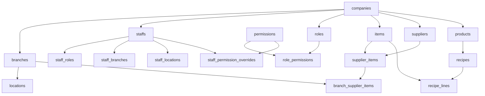
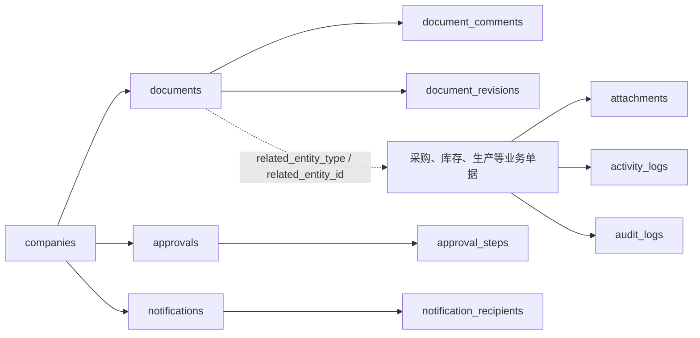
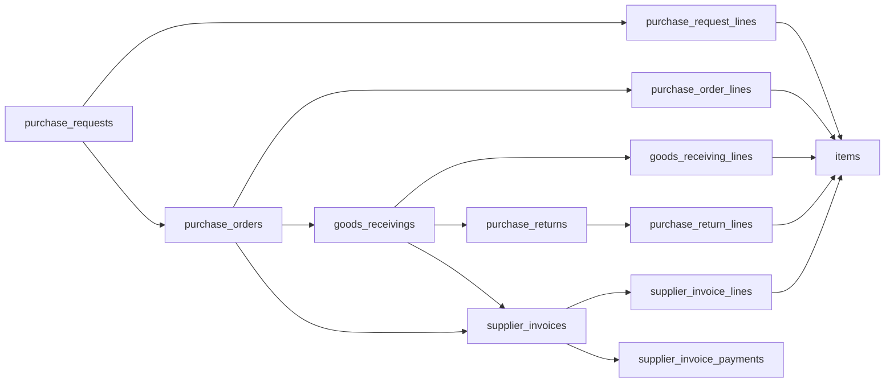

# Seri Bako OMS — Schema 与 Table 关系地图

> 读取时间：2026-07-23。来源为本机运行中的 Supabase/PostgreSQL `public` schema，**不是 Production 线上库**。
>
> 2026-07-23 原始读取结果：61 张基础表、5 个只读库存视图，当时仓库迁移到 089。本文件仍是历史实库快照，不是当前 Production schema 证明。
>
> 2026-08-15 仓库核对：forward-only migration 历史已到 `149`。权威顺序为：目标数据库的 `schema_migrations` 与实际 catalog → 仓库 `supabase/migrations/` → 本历史关系图。不要仅凭本文件执行删除、重命名或 Production 变更。

## 2026-08-15 repository 增量（migrations 128–149）

以下只记录从 migration 文件直接验证到的结构/读模型变化，不声称这些 migration 已部署到任何特定 Production 项目：

- `128` 新增 RLS 保护的 `stock_balances_summary` 预聚合表及刷新函数，并提供 bounded Inventory Dashboard summary。
- `129–137` 增加或迭代 Goods Receiving、Items workspace、Stock Card、Stock Ledger、Dashboard、Payables attention 等有界 RPC/read models。
- `138` 新增 RLS 保护的 `inventory_daily_summary` 与刷新函数，并扩展 Inventory Dashboard summary。
- `139–143` 修复 authenticated grants、Dashboard master reads、Outlet Staff access 与 bounded stock-card reference/read behavior；这些是权限/函数修复，不应被误记为新业务表。
- `144` 是范围明确的数据 reconciliation；它不是通用 schema ownership 变更。
- `145` 新增 `branch_supply_routes`，为 `outlet_daily_records` 增加 `source_branch_id`，并为 `outlet_daily_record_lines` 增加 `qty_sent_estimated`、`qty_sent_confirmed` 与 `qty_sent_source` provenance。
- `146` 增加原子替换 branch supply routes 的管理函数。
- `147` 扩展 Purchasing 对 Outlet Daily Records 的受控管理权限；不改变 Outlet Daily 数量公式。
- `148` 新增最多 31 行的 Inventory daily movement 只读 RPC；它按 MYT 日历日汇总 `inventory_daily_summary.movement_count` 的 inbound/outbound entries，不跨不同 UOM 相加数量，也不扫描 raw ledger。
- `149` 新增最多 46 行的 Stock Count variance 只读 RPC；它只统计最近 30 个 MYT 日历日内 posted lines 超过各自 count 保存容差的 occurrence，按 shortage/overage、item 与 branch 呈现，不跨 UOM 汇总 variance quantity。

完整字段、约束、RLS 与函数签名必须回到对应 migration 和实际数据库 catalog 核对。

## 先看全局结构

公司是所有业务资料的租户根；分店属于公司；地点属于分店。员工、物料、供应商、产品、采购单据和库存单据都应在同一公司下。

## 1. 租户、组织与权限（12 表）

| Table | 用途 | 主要关系 |
|---|---|---|
| `companies` | 公司/租户根节点 | 1→N `branches`、`staffs`、主数据与所有业务单据 |
| `branches` | 分店/中央厨房/业务单位 | N→1 `companies`；1→N `locations`；有 `default_location_id` 回指地点 |
| `locations` | 分店内的库存地点 | N→1 `branches`、N→1 `companies`；被库存、收货、生产等使用 |
| `staffs` | 业务员工主档，实际公司身份来源 | N→1 `companies`；可连到 `auth.users`；默认分店；被几乎所有 `created_by`/`posted_by` 引用 |
| `profiles` | Auth 用户的旧/兼容 Profile | 1→1 `auth.users`；不带 `company_id` |
| `roles` | 公司角色 | N→1 `companies`；1→N `staff_roles`、`role_permissions` |
| `permissions` | 全局能力字典，如 `production.post` | 1→N `role_permissions`、`staff_permission_overrides` |
| `role_permissions` | 角色拥有的能力 | N→1 `roles`、N→1 `permissions` |
| `staff_roles` | 员工角色指派（含主角色、生效区间、分店） | N→1 `staffs`、`roles`、可选 `branches` |
| `staff_branches` | 员工可进入哪些分店 | N→1 `staffs`、`branches` |
| `staff_locations` | 员工可进入哪些库存地点 | N→1 `staffs`、`locations` |
| `staff_permission_overrides` | 对单一员工额外允许/拒绝的能力 | N→1 `staffs`、`permissions` |

### 需要特别留意

- `staff_roles.branch_id`、`staff_branches` 与 `staff_locations` 都在表达“员工范围”。三者不是天然重复，但规则必须明确：**角色是什么、可进哪间分店、可操作哪个地点**。
- `branches.default_location_id` 与 `locations.branch_id` 形成循环引用。这是可用设计，但新增/删除或重置数据时必须分两步处理。
- `profiles` 不是当前公司权限的权威来源；当前代码仍有兼容读取，不能直接删除。

## 2. 主数据、产品与配方（10 表）

| Table | 用途 | 主要关系 |
|---|---|---|
| `items` | 库存物料/原料/可采购项目 | N→1 `companies`；可选默认 `supplier_id`；被采购、库存、配方、生产引用 |
| `suppliers` | 供应商 | N→1 `companies`；1→N `supplier_items`、采购订单、收货、发票 |
| `supplier_items` | “某供应商可供某物料”的公司级映射 | N→1 `items`、`suppliers`，同公司复合外键 |
| `branch_supplier_items` | 特定分店可用的供应商物料映射 | N→1 `branches`、`items`，并复合关联 `supplier_items` |
| `uom_conversions` | 物料单位换算 | N→1 `items`，同公司复合外键 |
| `products` | 成品/销售产品 | N→1 `companies`；1→N 包装、配方、门店日记录、生产产出 |
| `product_packaging` | 产品包装/销售单位 | N→1 `products` |
| `recipes` | 产品配方头 | N→1 `companies`、`products`；1→N `recipe_lines`、`recipe_cost_snapshots` |
| `recipe_lines` | 配方原料行 | N→1 `recipes`、`items` |
| `recipe_cost_snapshots` | 配方成本快照 | N→1 `recipes`，并记录捕获员工 |

`barcode_mappings` 已由迁移 `091_remove_barcode_support.sql` 移除；条码不属于当前 OMS 核心范围。

## 3. 通用文档、审批、附件与审计（14 表）

| Table | 用途 | 关系/注意点 |
|---|---|---|
| `documents` | 所有业务单据的通用外壳、编号、状态与流程摘要 | N→1 `companies`；使用 `related_entity_type + related_entity_id` 指向实际业务表，**不是数据库外键** |
| `document_comments` | 文档评论 | N→1 `documents`，级联删除 |
| `document_revisions` | 文档修订历史 | N→1 `documents`，级联删除 |
| `approvals` | 审批实例 | N→1 `companies`；用 `entity_type + entity_id` 关联业务对象，**不是外键** |
| `approval_steps` | 审批步骤 | N→1 `approvals`、可选审批员工 |
| `attachments` | 文件附件元数据 | N→1 `companies`、上传员工；使用 `entity_type + entity_id`，**不是外键** |
| `activity_logs` | 给用户看的业务动态/时间线 | N→1 `companies`；`entity_type + entity_id` 多态关联 |
| `audit_logs` | 变更审计前后数据 | N→1 `companies`；记录 `table_name`、`record_id`、JSON 前后值 |
| `notifications` | 通知本体 | N→1 `companies`、可选员工；含实体类型、实体 ID、角色、分店等旧/新字段 |
| `notification_recipients` | 一条通知的多收件人及读取状态 | N→1 `notifications`，级联删除 |
| `document_sequences` | 公司各单据类型的编号规则 | N→1 `companies` |
| `document_sequence_periods` | 按月份/周期的当前编号计数器 | N→1 `companies` |
| `user_preferences` | 用户在公司内的个人偏好 | N→1 `companies`；`user_id` 指 Auth 用户，没有外键 |
| `permanent_deletion_tombstones` | 永久删除的留痕 | N→1 `companies`、执行员工；不应删除 |

### 结构风险，不等于要删除

多态关联（`entity_type + entity_id`）很灵活，但数据库无法自动阻止“对象已删、附件/日志仍指向旧 ID”。后续应该统一由服务层/RPC 管理，而不是为每一种业务关系胡乱新增外键。

## 4. 采购 → 收货 → 退货 → 发票（10 表）

| Table | 用途 | 主要关系 |
|---|---|---|
| `purchase_requests` / `_lines` | 采购申请头/行 | 头属于公司、分店、地点、文档；行连物料与建议供应商 |
| `purchase_orders` / `_lines` | 采购订单头/行 | PO 可来自 PR；属于公司、分店、供应商、文档；行连物料 |
| `goods_receivings` / `_lines` | 收货单头/行 | 连 PO、供应商、分店、地点、文档；行可回连 PO 行 |
| `purchase_returns` / `_lines` | 采购退货头/行 | 连收货、PO、供应商、分店、地点、文档；行可连收货行、PO 行和库存交易 |
| `supplier_invoices` / `_lines` | 供应商发票头/行 | 连 PO、收货、供应商、文档；行可精确连 PO/GRN 的头和行 |
| `supplier_invoice_payments` | 发票付款记录 | N→1 `supplier_invoices`；也带 `company_id` 和创建员工 |

业务主线应固定为：**PR → PO → GRN → Supplier Invoice → Payment**。退货从 GRN/PO 分支出去；它会产生库存影响，但不应直接绕过库存原子过账入口。

## 5. 库存与生产（11 表 + 5 视图）

| Table / View | 用途 | 主要关系 |
|---|---|---|
| `stock_transactions` | 库存流水头/当前主要过账记录；每行有物料、地点、入/出数量 | 连物料、分店、地点、来源/去向地点、文档、创建/过账员工 |
| `stock_transaction_lines` | 库存流水明细行，支持一头多行及产品维度 | N→1 `stock_transactions`；亦连物料、产品、分店、地点 |
| `stock_counts` / `_lines` | 盘点头/行 | 连公司、分店、地点、文档；行连物料 |
| `stock_transfers` / `_lines` | 调拨头/行 | 头连公司、来源/目标分店与地点、文档；行连物料 |
| `stock_wastage` / `_lines` | 损耗/报废头/行 | 头连公司、分店、地点、文档；行连物料 |
| `production_jobs` | 生产任务头 | 连公司、分店、地点、产品/产出物料、配方、文档和最终库存交易 |
| `production_job_ingredient_lines` | 生产原料消耗行 | N→1 `production_jobs`、N→1 `items` |
| `production_job_output_lines` | 生产产出行 | N→1 `production_jobs`；可连产品或物料 |
| `stock_balances_view` | 由已过账流水计算余额 | 只读视图，不是独立真相表 |
| `item_location_stock_balances` | 物料+地点余额 | 只读视图 |
| `stock_ledger_view` | 库存分类账 | 只读视图 |
| `inventory_valuation_view` | 库存价值 | 只读视图 |
| `low_stock_items` | 低库存清单 | 只读视图 |

### 这是最需要先定规则的地方

当前同时存在 `stock_transactions`（头/单行库存记录）和 `stock_transaction_lines`（一头多明细）。它们不一定是重复，但必须写清楚：

- 哪些业务只写 `stock_transactions`；
- 哪些业务必须同时写行；
- 余额与报表到底读取哪一套；
- 禁止任何页面直接 INSERT/UPDATE 已过账流水。

在没有这条“唯一库存真相”规则之前，**不能删除其中任一张表**。

## 6. 门店日记录（2 表）

| Table | 用途 | 主要关系 |
|---|---|---|
| `outlet_daily_records` | 门店每天的记录头 | 连公司、分店及创建/提交/审核/作废员工 |
| `outlet_daily_record_lines` | 每种产品的日记录行 | N→1 日记录，N→1 `products` |

这组表范围最清楚；目前设计是记录运营数据，不直接写库存或财务。

## 删除/合并候选：先查证，再决定

| 对象 | 当前判断 | 建议动作 |
|---|---|---|
| `barcode_mappings` | 条码/扫码已明确不需要 | **已移除（迁移 091）**：表、物料/产品条码字段、库存行条码字段、权限、备份和重置引用均已删除 |
| `profiles` | 旧 Auth Profile；当前仍被 `src/server/queries/common.ts` 兼容读取，备份也明确排除 | **候选，不可直接删**：先把显示名称/身份读取迁至 `staffs` 或 Auth，再移除调用 |
| `staff_locations` | 与 `staff_branches`、`staff_roles.branch_id` 形成三层范围模型 | **待业务确认**：若实际只按分店授权，可规划废弃；若仓库/冷库要单独授权则保留 |
| `stock_transaction_lines` | 仍被库存引擎、备份和清理报表引用 | **不可直接删**：需先完成“库存头/行”唯一模型设计与历史数据迁移 |
| `documents` 泛型入口 | 业务单据已有各自详情页，但通用文档仍承载评论/附件/编号 | **保留表，收敛入口**：不建议删除；继续把 UI 导向对应业务单据页 |
| `notifications` 的多个收件人字段 | 同时有 `staff_id`、`recipient_*` 字段和 `notification_recipients` 表 | **重构候选**：选定“单收件人字段”或“收件人子表”之一，需先迁历史数据 |
| `activity_logs` 与 `audit_logs` | 一个是业务时间线，一个是变更审计 | **都保留**：名称相近，但用途不同 |
| `stock-balance` / `stock-balances` 页面 | 这是路由重复，不是 table 重复 | 先收敛为一个入口，随后才移除兼容路由 |

## 建议的 Schema 收敛顺序

已确认的业务决定和分阶段迁移策略见 [SCHEMA_CONSOLIDATION_PLAN_2026-07-23.md](SCHEMA_CONSOLIDATION_PLAN_2026-07-23.md)。

1. 先冻结新增表和新增“兼容字段”。
2. 先确认库存唯一真相：交易头/交易行/余额视图的读写规则。
3. 明确员工授权只按“角色 + 分店”，还是还要按“地点”。
4. 明确通知采用单收件人还是收件人子表。
5. 对 `barcode_mappings`、`profiles` 做 Production 使用量与调用方审计。
6. 每一项通过**新的 forward-only migration**处理；绝不改或删除已经上线过的历史 migration。
