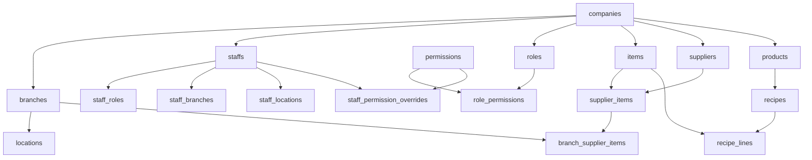
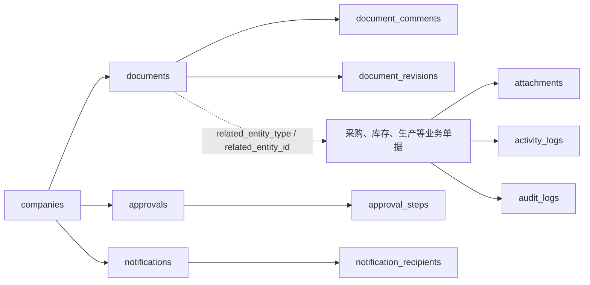
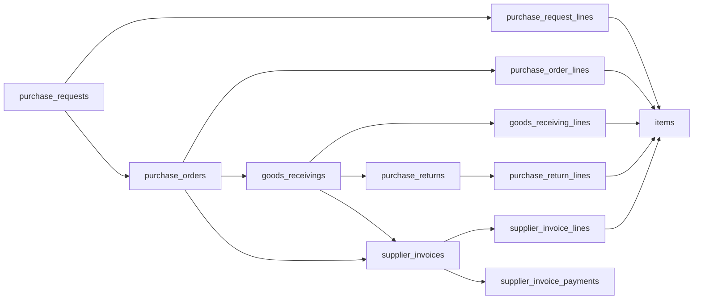

Current repository forward-only migration 历史已到 `301`; the linked Production migration ledger is verified through `300` on 2026-09-16. Migration 301 makes Recipe lifecycle transitions tenant-scoped and atomic across Recipe, universal Document, revisions, activity, and the single-active-version invariant; it remains repository evidence until linked application is verified. Migration 300 adds one filtered Stock Balance summary authority for paginated list and Movement Ledger totals. Migration 299 adds aggregate summaries for Stock Transfers and Stock Wastage. Their three functions were read back as security-invoker, executable by `authenticated` and unavailable to `anon`. Migration 298 adds the bounded Purchase Return read model. Migration 297 writes outlet transfers to the destination roster as the canonical shift and converts matching legacy free-text outlet assignments. Migration 296 restores PJS10 Stock Count eligibility for verified Oi Yin and Quik items, aligns the affected Quik item and supplier units to KG without changing posted quantities, and requires zero final physical stock before retirement. See `docs/qa/SYSTEM_CLOSURE_2026-09-16.md`.

Current repository forward-only migration 历史已到 `287`; linked Production migration ledger 已到 `287` (Kitchen schedule eligibility), verified 2026-09-14. All four resulting function bodies match the committed migration; ALMA and PJS10 show 8 and 12 roster staff. Application v9.2.69 remains a separate Preview verification gate. See `docs/qa/SYSTEM_QUALITY_2026-09-14.md`.

# Seri Bako OMS — Schema 与 Table 关系地图

> Repository review 2026-09-14: forward-only migration 历史已到 `286`. The v9.2.68 performance patch changes application read orchestration only and adds no database migration. Production schema verification remains separate from this source review.

> Current repository and Production authority 2026-09-14: forward-only migration 历史与 Production ledger 已到 `286`. Migration `284` adds one tenant-bound historical schedule-eligibility authority; migration `285` preserves immutable employee-day ownership during parser-versioned workbook replay; migration `286` makes every immutable cross-outlet disposition satisfy employee-day completeness. The linked dry-run reports the remote database as current; authenticated workbook UAT remains recorded separately in `docs/audits/2026-09-13-roster-integrity-closure.md`.

> Current repository authority 2026-09-12: forward-only migration 历史已到 `281`. Migration `281` recalculates finalised raw-punch batches after a later Schedule publication and exposes a permission-gated company employee candidate list for week-scoped outlet rostering. It does not change immutable punch evidence or permanent staff outlet ownership. Database application and Production verification remain separate evidence.

> Current repository authority 2026-09-11: forward-only migration 历史已到 `280`. Migration `280` repairs composite schedule-row handling across save, submit, copy, approval and workbook-import RPC wrappers; it also aligns active Attendance adjustment/OT-decision RPCs with the released result schema and removes the superseded Timecard finaliser. The isolated local stack returns the intended actionable business blocker; linked database application and Production verification remain separate authorised steps.

> Current repository authority 2026-09-10: forward-only migration 历史已到 `279`. Migration `279` adds atomic Schedule save-submit, reason-required Manager return/edit-and-publish revisions, and an idempotent Draft-only workbook import ledger. This is repository evidence only until the linked migration is applied.

> Current repository authority 2026-09-10: forward-only migration 历史已到 `278`. Migration `278` reapplies each batch's immutable raw-punch coverage map after manual recalculation, so absent or incomplete dates cannot create inferred missing-punch results without punch evidence. This is repository evidence only until the linked migration is applied.

> Current repository authority 2026-09-10: forward-only migration 历史已到 `277`. Migration `277` allocates attendance calculation revisions from complete immutable history under a per-staff-day transaction lock, so superseded rows cannot cause duplicate revision numbers. This is repository evidence only until the linked migration is applied.

> Current repository authority 2026-09-10: forward-only migration 历史已到 `276`. Migration `276` keeps ordinary non-holiday attendance recalculation valid by recording a nullable scalar pay-rule identifier instead of dereferencing an unassigned holiday-only record. This is repository evidence only until the linked migration is applied.

> Current repository authority 2026-09-10: forward-only migration 历史已到 `275`. Migration `275` restores attendance recalculation for published direct-time schedules by using custom and revision snapshot times before optional Shift Template defaults. This is repository evidence only until the linked migration is applied.

> Current repository authority 2026-09-09: forward-only migration 历史已到 `273`. Migration `273` adds structured Schedule validation, restores branch-scoped staff reads for People Operations, makes raw Punch files multi-week, and excludes Timecard-derived events from attendance calculation. This is repository evidence only until the linked migration is applied.

> Current repository authority 2026-09-08: forward-only migration 历史已到 `272`. Migration `272` separates presence, worked, payable and approved OT time, applies Full-time and Part-time break rules, and adds branch public holidays with effective-dated payroll-equivalent multipliers. This is repository evidence only until the linked migration is applied.

> Current repository authority 2026-09-07: forward-only migration 历史已到 `268`. Migration `268` adds Manager roster ownership, NGTeco Timecard Report import provenance, and active Outlet/Central Kitchen device mapping. This is repository evidence only until the linked migration is applied.

> Current repository authority 2026-09-07: forward-only migration 历史已到 `267`. Migration `267` grants Finance the existing purchase-request correction permission required by the audited Finance-to-Purchasing return RPC. This is repository evidence only until the linked migration is applied.

> Current repository authority 2026-09-07: forward-only migration 历史已到 `266`. Migration `266` aligns Finance read access with visible Inventory navigation and adds an audited Finance-to-Purchasing correction return. This is repository evidence only; it does not prove migration application in Production.

> Current repository authority 2026-09-07: forward-only migration 历史已到 `265`. Migration `265` separates immutable published schedules from daily attendance reports, adds the approved compensatory-time ledger, preserves attendance-result revisions, and makes NGTeco mapping changes auditable. This is repository evidence only; it does not prove migration application in Preview or Production.

> Current repository authority 2026-09-05: forward-only migration 历史已到 `264`. Migration `260` introduces the permission-gated Outlet Daily `post` transition, retains `evening_completed` as Ready to post, and uses the historical `reviewed` enum value as the durable Posted state. Migration `261` makes Compliance type creation and active-site requirement rollout atomic through a tenant-scoped RPC. Migration `262` keeps sales reconciliation optional so blank or mismatched sales never blocks wastage completion or posting. Migration `264` preserves Owner self-updates across atomic role replacement and audits the one-time closure of historical Ready-to-post records before 2026-09-05. This is repository evidence only; it does not prove migration application in Preview or Production.

> Current repository and Production authority 2026-09-04: forward-only migration 历史已到 `259`; Production ledger 亦已到 `259`. Migration `259` retires DBKL from the company checklist and assigns Pest Control to every active Outlet and Central Kitchen. Production verification reported migration ceiling `259`, zero active DBKL types, zero required DBKL sites, and Pest Control assigned to all 12/12 eligible active sites. The authenticated v9.2.26 Compliance detail rerun showed Pest Control and no DBKL entry.

> Current repository authority 2026-09-04: forward-only migration 历史已到 `257`. Migration `255` retires Outlet Daily review approval while preserving legacy audit fields and activity. Migration `256` corrects the exact AutoCount PO number to `PO-000207`. Migration `257` adds named multi-attachment compliance evidence and includes Central Kitchen while excluding Office. Repository evidence is not proof of Preview or Production state.

> Current repository authority 2026-09-03: forward-only migration 历史已到 `251`. Migration `251` adds nullable, length-bounded Purchase Order line remarks and updates atomic PO creation to retain them. It is repository evidence only and remains unapplied; this is not proof of Preview or Production schema state.

> Current repository authority 2026-09-03: forward-only migration 历史已到 `250`. Migrations `241–250` add branch-scoped dynamic scheduling, Outlet Supervisor access, active/invited outlet-role roster visibility, PH/EL and direct-time rosters with audited clearing, immutable NGTeco punch imports, exact-second attendance, Purchasing outlet follow-up, configurable outlet compliance, audited Finance closure for posted receivings, and optional sales difference notes with a persistent back-office attention state. Preview Supabase remains separate from Production; migrations 249–250 remain unapplied.

> Current repository authority 2026-09-02: forward-only migration 历史已到 `240`. Migration `240` adds controlled over-receipt reasons, aligns GRN creation and Draft editing, retains `grn.post` and branch access as the inventory-posting boundary, and keeps repeated Post calls idempotent. This is repository evidence only; it is not proof that migration 240 has been applied remotely or in Production.

> Current repository authority 2026-09-01: forward-only migration 历史已到 `235`. Migration `228` adds the initial Compliance & Staff Operations substrate. Migration `229` separates Outlet Management and People authorization, adds template-backed outlet requirements and cashless sales reconciliation. Migration `230` adds the audited PR withdraw-to-Draft correction boundary and aligns Kitchen PR cancel and Goods Receiving post grants. Migration `231` restricts pre-Manager revoke to the original requester or Owner and records the transition as an atomic document revision. Migration `232` keeps sales reconciliation optional during progressive Daily Record saves while requiring POS Total at completion. Migration `233` locks unresolved PR item matching to the PR canonical supplier, branch, and requested UOM, with deterministic legacy supplier recovery only. Migration `234` restores the canonical People Operations role and workspace grants idempotently so authenticated users have a finite permitted landing. Migration `235` adds FOSIM as a required outlet compliance type and backfills every active outlet requirement idempotently. Migrations 229–235 are not remotely or Production applied; this does not turn the historical catalog snapshot below into current Production schema proof.

> Repository update 2026-08-27: forward-only migration 历史已到 `226`. Migration `206` adds tenant-scoped operation requests, draft revisions, incident aggregation/events, Owner-only RLS, and acknowledgement/escalation RPCs. Migration `207` aligns Stock Count seed/read balance authority. Migration `208` adds posting-time reconciliation and branch scope actions. Migrations `209–210` add the void state, immutable reversal record, impact fingerprint preview, and idempotent atomic ledger reversal. Migration `211` preserves committed PO line locking while adding the narrow Owner hard-delete bypass required for eligible cancelled POs. Migrations `212–215` close every error and warning reported by executable schema lint, including retired Location/barcode identities, recipe identity, notification columns, and ambiguous Production/Item references. Migration `216` reconciles the canonical `audit_logs` schema; migration `217` aligns Finance master-data reads; migration `218` removes historical Manager PR authoring grants while restoring the intended stock read authority; migration `219` permits the active Manager or Purchasing reviewer to add a supplier-scoped PR line while preserving tenant, supplier, idempotency and audit guards; migration `220` makes Finance approval and PO creation atomic and aligns PO-send aliases; migration `221` reconciles historical Ready-stage PRs only to exact matching unlinked POs; migration `222` reuses an orphan active PO document only when no Purchase Order owns it; migration `223` reuses the existing supplier-item identity during PR-to-PO conversion even when the requested purchase UOM differs, preventing provisional mapping code collisions; migration `224` grants Purchasing the intended unposted-PR cancellation permission, repairs two exact audited PJS10 sourcing defects, and inherits active PO attachments into a newly created Goods Receiving document; migration `225` synchronizes late PO attachment uploads to existing linked GRN documents and backfills missing evidence idempotently; migration `226` lets AutoCount confirmation retain Item Master rows without Main Supplier while continuing to fail closed for invalid supplier mappings. Migrations `216–226` are locally applied and schema-verified; linked application remains separate evidence.

> Current repository authority: forward-only migration 历史已到 `205`; migration `170` adds recoverable PR and Stock Count line revisions plus committed PO line locking, migrations `171–195` retain the previously documented AutoCount, supplier, PR, PO, receiving, and Outlet Daily repairs, migrations `196–198` repair UAT cleanup dependencies and PR presentation, migration `199` grants Purchasing its scoped submitter identity and PO-send access, stores the AutoCount PO number before Finance, blocks progress with pending line revisions, and provides an audited add-line operation, migration `200` performs the exact manifested Production UAT PR cleanup through the existing guarded Owner RPC, migration `201` permits the original submitter or Super Admin to correct rejected/returned PRs without advancing their workflow status, migration `202` keeps user-cancelled unposted purchase orders recoverable while guarding downstream and replacement-PO conflicts, migration `203` introduces branch-owned Stock Count item lifecycle, frozen retirement requests, zero-movement eligibility, and exact PJS canonical scope reconciliation, migration `204` grants approved-PO sending to Purchasing/Finance plus guarded Owner deletion of cancelled POs without downstream records, and migration `205` repairs cancelled-PO restoration with explicit enum casts. Remote application and workflow evidence remain separately recorded in the repair ledger.

> Migration `195` adds a narrow company-scoped read policy for outlet branch labels when the existing Outlet Daily visibility permission is present; it does not grant generic branch administration. Remote application and workflow evidence remain separately recorded in the repair ledger.

> 2026-08-19 release authority：仓库 forward-only migration 历史已到 `169`；migrations `152–154` 依次新增 lossless non-catalog Purchase Request lines、按 supplier 原子拆分 PR，以及由 Item Master 统一 supplier-item identity；migrations `155–156` 分别收紧库存 opening 读取边界与 Outlet Daily receipt provenance；migration `157` 收紧 PR 三段审批的角色职责分离；migration `162` 允许无 branch override 时回退 Item Master supplier；migration `163` 只补全唯一、确定性的 stock-take supplier category 匹配；migrations `164–165` 修复 supplier split ordering 与 PO conversion idempotency；migration `166` 只对 branch + item + UOM 能确定唯一 supplier 的旧 PR line 回写 supplier snapshot，歧义项保持待 Purchasing 处理；migration `167` 将 Outlet Daily 超量损耗校验锚定到具体产品行；migration `168` 以单一安全 RPC 原子创建 Item Master 及可选 supplier/branch sourcing；migration `169` 新增 tenant-scoped AutoCount import jobs、staging rows、supplier external references 与单次原子确认，而且不从 AutoCount snapshot 写入库存 movement。此记录只证明 repository authority，不证明应用版本已部署到 Production。

> 读取时间：2026-07-23。来源为本机运行中的 Supabase/PostgreSQL `public` schema，**不是 Production 线上库**。
>
> 2026-07-23 原始读取结果：61 张基础表、5 个只读库存视图，当时仓库迁移到 089。本文件仍是历史实库快照，不是当前 Production schema 证明。
>
> 2026-08-22 仓库核对：forward-only migration 历史已到 `195`。权威顺序为：目标数据库的 `schema_migrations` 与实际 catalog → 仓库 `supabase/migrations/` → 本历史关系图。不要仅凭本文件执行删除、重命名或 Production 变更。

> 2026-08-21 repository update: migration `176` adds nullable `items.brand_name` and updates the Item workspace, operational item creation, and AutoCount Confirm to preserve only explicit Brand/Brand Name/品牌 source values. This remains repository evidence, not linked Production evidence.

## 2026-08-19 repository 增量（migrations 128–168）

以下只记录从 migration 文件直接验证到的结构/读模型变化，不声称这些 migration 已部署到任何特定 Production 项目：

- `152` 新增 `purchase_request_unresolved_lines`，使 non-catalog/free-text PR 行在尚未匹配 Item Master 或 supplier mapping 时仍可原样保存；Purchasing Review 可审计地完成匹配，提交阶段不再静默丢弃未解析行。

- `153` 把已批准的 Purchase Request 按 supplier 原子拆成不同 PR/PO 工作单元，避免旧 RPC 强制单一 supplier 并保留审计关系。

- `154` 取消独立 supplier item code/name 权威；supplier-item mapping 复用 Item Master code/name，并保留 purchase UOM 与 branch availability。

- `167` 将 Outlet Daily 超量损耗校验绑定到具体产品行，错误可定位到需要补充 remark 的输入。

- `168` 通过带权限和租户边界的事务 RPC 原子创建 Item Master，并可在同一次操作中建立 supplier item 与 branch availability；返回 master-only、supplier-ready 或 branch-ready readiness。

- `174` 为 supplier master 增加 `supplier_group` 显示字段，将 AutoCount creditor reference 作为内部 `supplier_code`，并更新原子导入确认以按 Item Group 解析 item 与 branch mapping。该文件只证明 repository authority，不证明 linked Production 已应用。

- `175` 保留 PO/GRN/退货上的 supplier purchase UOM，并在库存 posting 时按 active supplier-item conversion 转成 item base unit；缺少非 1:1 conversion 时 fail closed。该文件只证明 repository authority，不证明 linked Production 已应用。

- `150` 为 inventory read reliability hardening：为 posted ledger 的日期范围查询、stock transaction lines、posted stock counts 与 variance lines 增加选择性索引，针对 `57014` statement timeout；不改变 RLS、租户边界或 running-balance 语义。

- `151` 为 Outlet Daily received provenance 与 bounded list read 支撑：received 使用独立来源标记，并补充日期、状态、branch 的列表索引；sent source 不再决定 received 是否可信。

- `155` 将 Stock Card 的历史 opening balance 改为由 `inventory_daily_summary` 有界聚合，并让 Movement Ledger 复用同一 bounded RPC，避免全历史 raw transaction 扫描触发 statement timeout。

- `156` 将 Outlet Daily 的 `morning_received_provided` 从推导列改为显式存储事实；授权用户输入的 `0` 可验证显示，缺失/旧数据继续 fail closed。
- `157` 删除非职责角色遗留的 PR Manager、Purchasing 与 Finance 审批授权，保留 `super_admin` 的受控 break-glass 能力。
- `162` 统一 Purchase Request supplier 解析：branch supplier mapping 仍优先，没有 branch override 时允许使用 Item Master 的 active supplier；数据库 guard 与 transition validation 保持同一规则。
- `163` 对 supplier 为空且 category 能唯一规范化匹配 active supplier code/name 的 Item Master 项目补回 supplier；多候选或无候选项目保持未配置，避免猜错供应商。
- `164` 修复 supplier split transition 使用不存在的 `supplier.code` 字段，改为真实的 `supplier.supplier_code`。
- `165` 让 PR → PO conversion 写入 `purchase_orders.idempotency_key`，满足已存在的 authenticated insert trigger，避免供应商资料正确却仍无法转换 PO。
- `166` 在 PR 进入审批前解析旧 line 的 supplier snapshot；仅在 branch + item + UOM 唯一（或唯一 preferred）时自动回写，多个候选不猜测并保留为 Purchasing 的明确待办。

- `128` 新增 RLS 保护的 `stock_balances_summary` 预聚合表及刷新函数，并提供 bounded Inventory Dashboard summary。
- `129–137` 增加或迭代 Goods Receiving、Items workspace、Stock Card、Stock Ledger、Dashboard、Payables attention 等有界 RPC/read models。
- `138` 新增 RLS 保护的 `inventory_daily_summary` 与刷新函数，并扩展 Inventory Dashboard summary。
- `139–143` 修复 authenticated grants、Dashboard master reads、Outlet Staff access 与 bounded stock-card reference/read behavior；这些是权限/函数修复，不应被误记为新业务表。
- `144` 是范围明确的数据 reconciliation；它不是通用 schema ownership 变更。
- `145` 新增 `branch_supply_routes`，为 `outlet_daily_records` 增加 `source_branch_id`，并为 `outlet_daily_record_lines` 增加 `qty_sent_estimated`、`qty_sent_confirmed` 与 `qty_sent_source` provenance。
- `146` 增加原子替换 branch supply routes 的管理函数。
- `147` 扩展 Purchasing 对 Outlet Daily Records 的受控管理权限；不改变 Outlet Daily 数量公式。
- `148` 新增最多 31 行的 Inventory daily movement 只读 RPC；它按 MYT 日历日汇总 `inventory_daily_summary.movement_count` 的 inbound/outbound entries，不跨不同 UOM 相加数量，也不扫描 raw ledger。
- `149` 新增最多 46 行的 Stock Count variance 只读 RPC；它只统计最近 30 个 MYT 日历日内 posted lines 超过各自 count 保存容差的 occurrence，按 shortage/overage、item 与 branch 呈现，不跨 UOM 汇总 variance quantity。

完整字段、约束、RLS 与函数签名必须回到对应 migration 和实际数据库 catalog 核对。

## 先看全局结构

公司是所有业务资料的租户根；分店属于公司；地点属于分店。员工、物料、供应商、产品、采购单据和库存单据都应在同一公司下。

## 1. 租户、组织与权限（12 表）

| Table | 用途 | 主要关系 |
|---|---|---|
| `companies` | 公司/租户根节点 | 1→N `branches`、`staffs`、主数据与所有业务单据 |
| `branches` | 分店/中央厨房/业务单位 | N→1 `companies`；1→N `locations`；有 `default_location_id` 回指地点 |
| `locations` | 分店内的库存地点 | N→1 `branches`、N→1 `companies`；被库存、收货、生产等使用 |
| `staffs` | 业务员工主档，实际公司身份来源 | N→1 `companies`；可连到 `auth.users`；默认分店；被几乎所有 `created_by`/`posted_by` 引用 |
| `profiles` | Auth 用户的旧/兼容 Profile | 1→1 `auth.users`；不带 `company_id` |
| `roles` | 公司角色 | N→1 `companies`；1→N `staff_roles`、`role_permissions` |
| `permissions` | 全局能力字典，如 `production.post` | 1→N `role_permissions`、`staff_permission_overrides` |
| `role_permissions` | 角色拥有的能力 | N→1 `roles`、N→1 `permissions` |
| `staff_roles` | 员工角色指派（含主角色、生效区间、分店） | N→1 `staffs`、`roles`、可选 `branches` |
| `staff_branches` | 员工可进入哪些分店 | N→1 `staffs`、`branches` |
| `staff_locations` | 员工可进入哪些库存地点 | N→1 `staffs`、`locations` |
| `staff_permission_overrides` | 对单一员工额外允许/拒绝的能力 | N→1 `staffs`、`permissions` |

### 需要特别留意

- `staff_roles.branch_id`、`staff_branches` 与 `staff_locations` 都在表达“员工范围”。三者不是天然重复，但规则必须明确：**角色是什么、可进哪间分店、可操作哪个地点**。
- `branches.default_location_id` 与 `locations.branch_id` 形成循环引用。这是可用设计，但新增/删除或重置数据时必须分两步处理。
- `profiles` 不是当前公司权限的权威来源；当前代码仍有兼容读取，不能直接删除。

## 2. 主数据、产品与配方（10 表）

| Table | 用途 | 主要关系 |
|---|---|---|
| `items` | 库存物料/原料/可采购项目 | N→1 `companies`；可选默认 `supplier_id`；被采购、库存、配方、生产引用 |
| `suppliers` | 供应商 | N→1 `companies`；1→N `supplier_items`、采购订单、收货、发票 |
| `supplier_items` | “某供应商可供某物料”的公司级映射 | N→1 `items`、`suppliers`，同公司复合外键 |
| `branch_supplier_items` | 特定分店可用的供应商物料映射 | N→1 `branches`、`items`，并复合关联 `supplier_items` |
| `uom_conversions` | 物料单位换算 | N→1 `items`，同公司复合外键 |
| `products` | 成品/销售产品 | N→1 `companies`；1→N 包装、配方、门店日记录、生产产出 |
| `product_packaging` | 产品包装/销售单位 | N→1 `products` |
| `recipes` | 产品配方头 | N→1 `companies`、`products`；1→N `recipe_lines`、`recipe_cost_snapshots` |
| `recipe_lines` | 配方原料行 | N→1 `recipes`、`items` |
| `recipe_cost_snapshots` | 配方成本快照 | N→1 `recipes`，并记录捕获员工 |

`barcode_mappings` 已由迁移 `091_remove_barcode_support.sql` 移除；条码不属于当前 OMS 核心范围。

## 3. 通用文档、审批、附件与审计（14 表）

| Table | 用途 | 关系/注意点 |
|---|---|---|
| `documents` | 所有业务单据的通用外壳、编号、状态与流程摘要 | N→1 `companies`；使用 `related_entity_type + related_entity_id` 指向实际业务表，**不是数据库外键** |
| `document_comments` | 文档评论 | N→1 `documents`，级联删除 |
| `document_revisions` | 文档修订历史 | N→1 `documents`，级联删除 |
| `approvals` | 审批实例 | N→1 `companies`；用 `entity_type + entity_id` 关联业务对象，**不是外键** |
| `approval_steps` | 审批步骤 | N→1 `approvals`、可选审批员工 |
| `attachments` | 文件附件元数据 | N→1 `companies`、上传员工；使用 `entity_type + entity_id`，**不是外键** |
| `activity_logs` | 给用户看的业务动态/时间线 | N→1 `companies`；`entity_type + entity_id` 多态关联 |
| `audit_logs` | 变更审计前后数据 | N→1 `companies`；记录 `table_name`、`record_id`、JSON 前后值 |
| `notifications` | 通知本体 | N→1 `companies`、可选员工；含实体类型、实体 ID、角色、分店等旧/新字段 |
| `notification_recipients` | 一条通知的多收件人及读取状态 | N→1 `notifications`，级联删除 |
| `document_sequences` | 公司各单据类型的编号规则 | N→1 `companies` |
| `document_sequence_periods` | 按月份/周期的当前编号计数器 | N→1 `companies` |
| `user_preferences` | 用户在公司内的个人偏好 | N→1 `companies`；`user_id` 指 Auth 用户，没有外键 |
| `permanent_deletion_tombstones` | 永久删除的留痕 | N→1 `companies`、执行员工；不应删除 |

### 结构风险，不等于要删除

多态关联（`entity_type + entity_id`）很灵活，但数据库无法自动阻止“对象已删、附件/日志仍指向旧 ID”。后续应该统一由服务层/RPC 管理，而不是为每一种业务关系胡乱新增外键。

## 4. 采购 → 收货 → 退货 → 发票（10 表）

| Table | 用途 | 主要关系 |
|---|---|---|
| `purchase_requests` / `_lines` | 采购申请头/行 | 头属于公司、分店、地点、文档；行连物料与建议供应商 |
| `purchase_orders` / `_lines` | 采购订单头/行 | PO 可来自 PR；属于公司、分店、供应商、文档；行连物料 |
| `goods_receivings` / `_lines` | 收货单头/行 | 连 PO、供应商、分店、地点、文档；行可回连 PO 行 |
| `purchase_returns` / `_lines` | 采购退货头/行 | 连收货、PO、供应商、分店、地点、文档；行可连收货行、PO 行和库存交易 |
| `supplier_invoices` / `_lines` | 供应商发票头/行 | 连 PO、收货、供应商、文档；行可精确连 PO/GRN 的头和行 |
| `supplier_invoice_payments` | 发票付款记录 | N→1 `supplier_invoices`；也带 `company_id` 和创建员工 |

业务主线应固定为：**PR → PO → GRN → Supplier Invoice → Payment**。退货从 GRN/PO 分支出去；它会产生库存影响，但不应直接绕过库存原子过账入口。

## 5. 库存与生产（11 表 + 5 视图）

| Table / View | 用途 | 主要关系 |
|---|---|---|
| `stock_transactions` | 库存流水头/当前主要过账记录；每行有物料、地点、入/出数量 | 连物料、分店、地点、来源/去向地点、文档、创建/过账员工 |
| `stock_transaction_lines` | 库存流水明细行，支持一头多行及产品维度 | N→1 `stock_transactions`；亦连物料、产品、分店、地点 |
| `stock_counts` / `_lines` | 盘点头/行 | 连公司、分店、地点、文档；行连物料 |
| `stock_transfers` / `_lines` | 调拨头/行 | 头连公司、来源/目标分店与地点、文档；行连物料 |
| `stock_wastage` / `_lines` | 损耗/报废头/行 | 头连公司、分店、地点、文档；行连物料 |
| `production_jobs` | 生产任务头 | 连公司、分店、地点、产品/产出物料、配方、文档和最终库存交易 |
| `production_job_ingredient_lines` | 生产原料消耗行 | N→1 `production_jobs`、N→1 `items` |
| `production_job_output_lines` | 生产产出行 | N→1 `production_jobs`；可连产品或物料 |
| `stock_balances_view` | 由已过账流水计算余额 | 只读视图，不是独立真相表 |
| `item_location_stock_balances` | 物料+地点余额 | 只读视图 |
| `stock_ledger_view` | 库存分类账 | 只读视图 |
| `inventory_valuation_view` | 库存价值 | 只读视图 |
| `low_stock_items` | 低库存清单 | 只读视图 |

### 这是最需要先定规则的地方

当前同时存在 `stock_transactions`（头/单行库存记录）和 `stock_transaction_lines`（一头多明细）。它们不一定是重复，但必须写清楚：

- 哪些业务只写 `stock_transactions`；
- 哪些业务必须同时写行；
- 余额与报表到底读取哪一套；
- 禁止任何页面直接 INSERT/UPDATE 已过账流水。

在没有这条“唯一库存真相”规则之前，**不能删除其中任一张表**。

## 6. 门店日记录（2 表）

| Table | 用途 | 主要关系 |
|---|---|---|
| `outlet_daily_records` | 门店每天的记录头 | 连公司、分店及创建/提交/审核/作废员工 |
| `outlet_daily_record_lines` | 每种产品的日记录行 | N→1 日记录，N→1 `products` |

这组表范围最清楚；目前设计是记录运营数据，不直接写库存或财务。

## 删除/合并候选：先查证，再决定

| 对象 | 当前判断 | 建议动作 |
|---|---|---|
| `barcode_mappings` | 条码/扫码已明确不需要 | **已移除（迁移 091）**：表、物料/产品条码字段、库存行条码字段、权限、备份和重置引用均已删除 |
| `profiles` | 旧 Auth Profile；当前仍被 `src/server/queries/common.ts` 兼容读取，备份也明确排除 | **候选，不可直接删**：先把显示名称/身份读取迁至 `staffs` 或 Auth，再移除调用 |
| `staff_locations` | 与 `staff_branches`、`staff_roles.branch_id` 形成三层范围模型 | **待业务确认**：若实际只按分店授权，可规划废弃；若仓库/冷库要单独授权则保留 |
| `stock_transaction_lines` | 仍被库存引擎、备份和清理报表引用 | **不可直接删**：需先完成“库存头/行”唯一模型设计与历史数据迁移 |
| `documents` 泛型入口 | 业务单据已有各自详情页，但通用文档仍承载评论/附件/编号 | **保留表，收敛入口**：不建议删除；继续把 UI 导向对应业务单据页 |
| `notifications` 的多个收件人字段 | 同时有 `staff_id`、`recipient_*` 字段和 `notification_recipients` 表 | **重构候选**：选定“单收件人字段”或“收件人子表”之一，需先迁历史数据 |
| `activity_logs` 与 `audit_logs` | 一个是业务时间线，一个是变更审计 | **都保留**：名称相近，但用途不同 |
| `stock-balance` / `stock-balances` 页面 | 这是路由重复，不是 table 重复 | 先收敛为一个入口，随后才移除兼容路由 |

## 建议的 Schema 收敛顺序

已确认的业务决定和分阶段迁移策略见 [SCHEMA_CONSOLIDATION_PLAN_2026-07-23.md](SCHEMA_CONSOLIDATION_PLAN_2026-07-23.md)。

1. 先冻结新增表和新增“兼容字段”。
2. 先确认库存唯一真相：交易头/交易行/余额视图的读写规则。
3. 明确员工授权只按“角色 + 分店”，还是还要按“地点”。
4. 明确通知采用单收件人还是收件人子表。
5. 对 `barcode_mappings`、`profiles` 做 Production 使用量与调用方审计。
6. 每一项通过**新的 forward-only migration**处理；绝不改或删除已经上线过的历史 migration。

Migration `263` adds atomic compliance renewal with history. Source reviewed locally; database execution and remote application are pending.
> Current repository authority 2026-09-09: forward-only migration 历史已到 `274`. Migration `274` adds People-owned OT decisions, schedule-bound RO reservations, FIFO ledger allocations, protected employment details and the atomic weekly close. This repository record and linked dry-run do not prove Production application.
> Current repository authority 2026-09-13: forward-only migration 历史已到 `282`. Migration `282` keeps each shift canonical in its destination outlet roster, adds a permission-gated read-only projection for the employee's home outlet, blocks unresolved full-time staff days, and permits reason-bound correction of published schedules until Attendance lock. Repository, linked database and Production verification are separate evidence.
