# Seri Bako OMS Workflow Specification v1.0

Status: approved-schema-aligned review draft. This document is the operational workflow source of truth for future development. No code or schema changes are included.

## 1. Purpose

This document defines Seri Bako OMS workflows from the user's perspective. It covers who performs each action, what the system does automatically, which documents are created, what database tables are affected, what approvals are required, which notifications are triggered, and how inventory and finance are affected.

## 2. Operating Roles

| Role | Scope |
| --- | --- |
| Admin | Company setup, master data governance, operational review, exception handling. |
| Kitchen | Daily stock count, receiving, wastage, production issue/output. |
| Purchasing | Supplier verification, purchase review, PO creation, delivery follow-up. |
| Manager | Approval authority for recipe, PO, adjustment, invoice, payment, and exceptions. |
| Finance | Invoice entry, matching, credit note, payment planning, supplier outstanding. |
| Viewer | Read-only access to permitted operational and reporting data. |
| System | Automatic numbering, calculations, stock posting, notifications, logs, validations. |

## 3. Enterprise Workflow Principles

1. Every workflow must produce an auditable document or activity entry.
2. Draft records do not affect stock or finance.
3. Posted stock documents create immutable stock transaction lines.
4. Stock balance is calculated, not stored.
5. Finance obligations begin only from approved and matched supplier invoices.
6. Approval decisions must be captured with approver, timestamp, status, and remarks where required.
7. Exceptions are not silently bypassed; they require authorized approval or correction.
8. Attachments are stored against the source document using entity type and entity id.
9. Document numbers are generated from document sequences.
10. All user-visible workflow events appear in the activity timeline.

## 4. End-to-End Procurement Flow

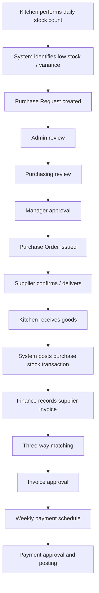

## 5. Workflow Specifications

---

# MASTER DATA

## 5.1 Company Setup

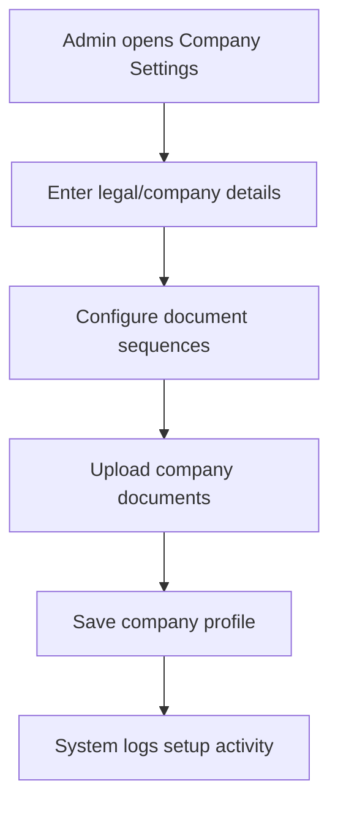

| Section | Specification |
| --- | --- |
| Purpose | Maintain Seri Bako legal identity, company profile, and document numbering basis. |
| Trigger | New implementation setup, company information update, document numbering update. |
| User Roles | Admin performs; Manager/Viewer may read. |
| Preconditions | Admin is authenticated and has company admin permission. |
| User Journey | Admin opens Company Settings, enters company name/registration/tax/contact info, configures document prefixes and number reset behavior, uploads company documents, saves. |
| System Actions | Validates required fields, updates company profile, stores attachments, prepares document sequences, writes activity and audit logs. |
| Validation Rules | Company code/name required; document type unique per company; next number and padding positive; email format valid. |
| Approval Flow | No approval by default; critical changes may require Manager approval in later phase. |
| Status Transitions | Active -> Inactive -> Archived for company-level records where applicable. |
| Stock Impact | None. |
| Finance Impact | Company tax/registration data appears on future PO, GRN, invoice, and payment reports. |
| Notifications | Notify Admin group when legal/tax information changes. |
| Activity Timeline | Company profile updated, logo uploaded, document sequence changed, attachment uploaded. |
| Exception Handling | Duplicate document type blocked; invalid numbering rejected; missing mandatory info prevents save. |
| Attachments Required | Optional company registration, tax certificate, logo. |
| Related Documents | Company profile, document sequence records. |
| Related Database Tables | `companies`, `document_sequences`, `attachments`, `activity_logs`, `audit_logs`. |
| Future Automation Opportunities | Auto-generate company document headers; AutoCount company profile sync. |

## 5.2 Branch Setup

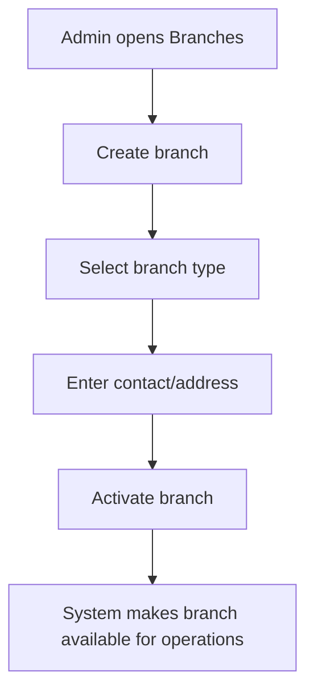

| Section | Specification |
| --- | --- |
| Purpose | Manage operating units such as central kitchen, outlet, event booth, office, or other branch. |
| Trigger | New central kitchen/outlet/event booth/office setup or branch data update. |
| User Roles | Admin creates/updates; Kitchen/Purchasing/Finance read according to scope. |
| Preconditions | Company exists; user has branch management permission. |
| User Journey | Admin adds branch, enters code/name/type/contact/address, saves, activates when ready. |
| System Actions | Checks unique branch code, stores branch, logs activity, exposes branch in scoped filters and assignments. |
| Validation Rules | Branch code/name/type required; branch code unique per company. |
| Approval Flow | Not required for standard branch setup. |
| Status Transitions | Draft/Active -> Inactive -> Archived. |
| Stock Impact | None directly; branch is required context for locations and stock documents. |
| Finance Impact | Branch may appear in purchase/finance reporting and future cost allocation. |
| Notifications | Notify Admin and relevant team leads when branch activated/deactivated. |
| Activity Timeline | Branch created, branch updated, branch activated, branch deactivated. |
| Exception Handling | Cannot archive branch with active locations or open operational documents. |
| Attachments Required | Optional tenancy/premise documents. |
| Related Documents | Branch master record. |
| Related Database Tables | `branches`, `locations`, `staffs`, `attachments`, `activity_logs`, `audit_logs`. |
| Future Automation Opportunities | Branch template creation; default locations per branch type. |

## 5.3 Location Setup

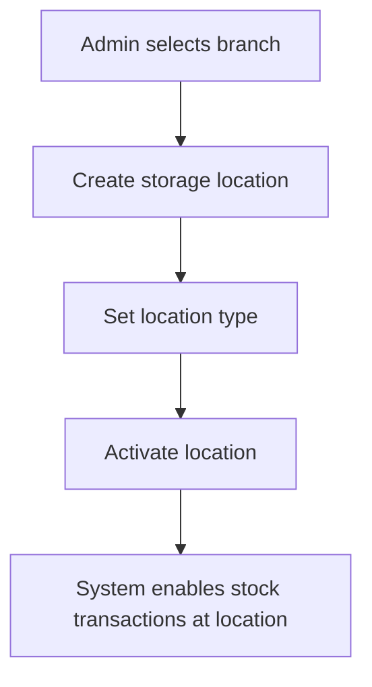

| Section | Specification |
| --- | --- |
| Purpose | Manage storage areas under branches: dry store, chiller, freezer, packaging area, receiving area, production floor, finished goods store. |
| Trigger | New storage area, operational layout change, branch opening. |
| User Roles | Admin manages; Kitchen uses for counts/receiving/production. |
| Preconditions | Branch exists and is active. |
| User Journey | Admin creates location under branch, selects type, enters code/name, activates. |
| System Actions | Validates branch/location, stores location, makes it available in inventory documents. |
| Validation Rules | Location code/name/type/branch required; location code unique per company. |
| Approval Flow | Not required. |
| Status Transitions | Active -> Inactive -> Archived. |
| Stock Impact | New location can receive stock transactions; inactive location cannot be selected for new postings. |
| Finance Impact | Inventory valuation can be reported by location. |
| Notifications | Notify Kitchen lead when new stock location is active. |
| Activity Timeline | Location created, updated, activated, deactivated. |
| Exception Handling | Cannot deactivate/archive location with open count, transfer, receiving, or production document. |
| Attachments Required | Optional layout or storage compliance document. |
| Related Documents | Location master. |
| Related Database Tables | `locations`, `branches`, `stock_transactions`, `attachments`, `activity_logs`, `audit_logs`. |
| Future Automation Opportunities | Temperature log integration for chiller/freezer. |

## 5.4 Staff Management

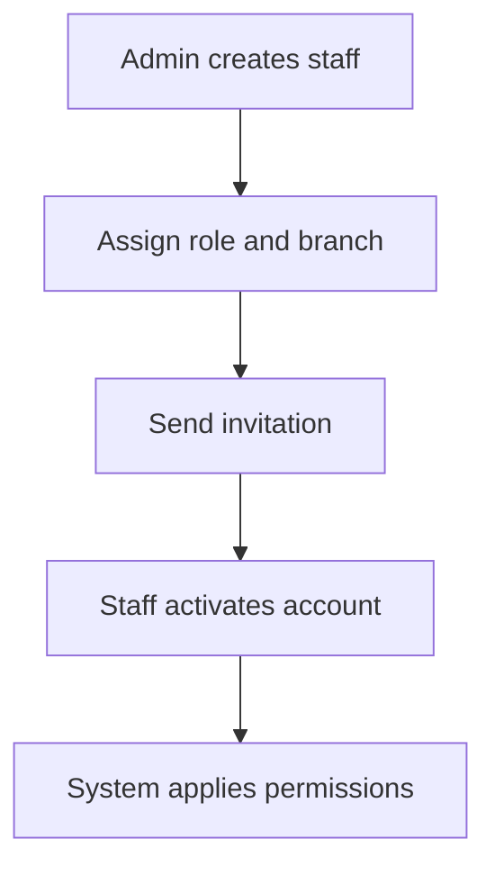

| Section | Specification |
| --- | --- |
| Purpose | Manage system users, branch assignment, and account status. |
| Trigger | New employee, role change, branch reassignment, staff resignation. |
| User Roles | Admin manages; all roles can view own profile. |
| Preconditions | Role exists; branch exists; optional Supabase Auth user exists or invitation is sent. |
| User Journey | Admin creates staff, enters details, assigns role/default branch, sends invite, activates/deactivates as needed. |
| System Actions | Stores staff record, links auth user, applies role permissions, sends invitation notification. |
| Validation Rules | Full name required; email valid; staff code unique per company; auth user unique. |
| Approval Flow | Not required by default. |
| Status Transitions | Invited -> Active -> Inactive -> Archived. |
| Stock Impact | Inactive staff cannot post stock documents. |
| Finance Impact | Inactive staff cannot approve finance documents or post payments. |
| Notifications | Invitation, role change, deactivation notice. |
| Activity Timeline | Staff created, invited, role changed, branch changed, deactivated. |
| Exception Handling | Prevent deactivation if staff is sole admin unless another admin exists. |
| Attachments Required | Optional employment or authorization document. |
| Related Documents | Staff profile. |
| Related Database Tables | `staffs`, `roles`, `role_permissions`, `notifications`, `activity_logs`, `audit_logs`. |
| Future Automation Opportunities | HR system sync; automatic branch/role onboarding templates. |

## 5.5 Role & Permission Management

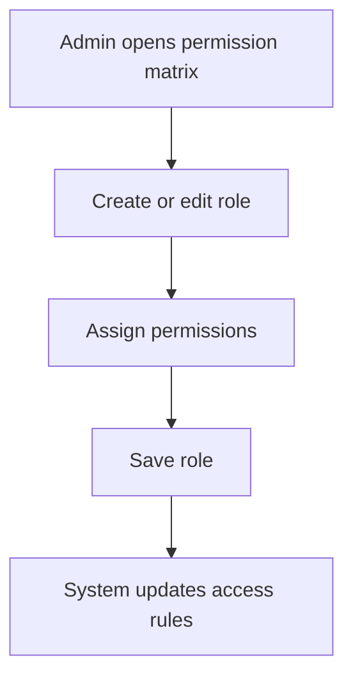

| Section | Specification |
| --- | --- |
| Purpose | Control access to modules, actions, approvals, posting, exports, and admin settings. |
| Trigger | Implementation setup, control change, new role requirement. |
| User Roles | Admin only. |
| Preconditions | Admin has roles admin permission. |
| User Journey | Admin creates role, selects permissions by module/action, saves, assigns to staff. |
| System Actions | Stores role and permission links, recalculates staff access, logs changes. |
| Validation Rules | Role code/name required; role code unique; protected system roles cannot be deleted. |
| Approval Flow | Not required; permission changes are audited. |
| Status Transitions | Active -> Inactive -> Archived. |
| Stock Impact | Determines who can create, submit, approve, and post inventory documents. |
| Finance Impact | Determines who can view/approve invoices and payments. |
| Notifications | Notify affected staff when access changes. |
| Activity Timeline | Role created, permissions updated, role assigned, role deactivated. |
| Exception Handling | Prevent removal of all admin access; prevent deleting role currently assigned to active staff unless reassigned. |
| Attachments Required | None. |
| Related Documents | Role master, permission matrix. |
| Related Database Tables | `roles`, `permissions`, `role_permissions`, `staffs`, `activity_logs`, `audit_logs`. |
| Future Automation Opportunities | Approval-limit-based permissions; branch/location scoped roles. |

## 5.6 Item Management

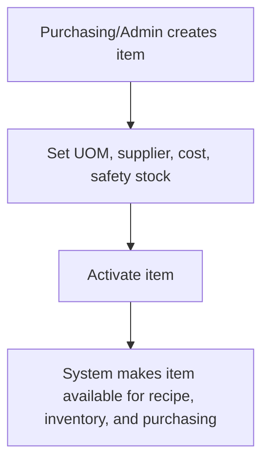

| Section | Specification |
| --- | --- |
| Purpose | Maintain raw material and packaging item master without storing stock balance. |
| Trigger | New ingredient, packaging, supplier item, cost update, category update. |
| User Roles | Admin and Purchasing manage; Kitchen reads; Finance reads cost-related fields. |
| Preconditions | Category exists; supplier optional but recommended. |
| User Journey | User creates/edits item, sets item code, AutoCount code, name, category, UOM, supplier, cost, safety stock, MOQ, lead time, status. |
| System Actions | Validates item, stores master data, updates item availability in recipes/purchasing/inventory. |
| Validation Rules | Item code/name/base UOM required; item code unique; cost/safety/MOQ non-negative; conversion positive. |
| Approval Flow | Not required by default; cost changes can require manager approval in later phase. |
| Status Transitions | Active -> Inactive -> Archived. |
| Stock Impact | No direct stock change; item becomes selectable in stock transactions. |
| Finance Impact | Cost supports recipe costing, inventory valuation, and purchase estimates. |
| Notifications | Notify Purchasing when critical procurement fields change; notify Kitchen if active item deactivated. |
| Activity Timeline | Item created, updated, cost changed, safety stock changed, supplier changed, deactivated. |
| Exception Handling | Cannot archive item used in active recipe, open PR/PO, or non-zero stock without override. |
| Attachments Required | Optional specification, halal certificate, supplier sheet. |
| Related Documents | Item master, supplier item, stock card, recipe lines. |
| Related Database Tables | `items`, `item_categories`, `supplier_items`, `stock_transaction_lines`, `recipe_lines`, `attachments`, `activity_logs`, `audit_logs`. |
| Future Automation Opportunities | Import from AutoCount; supplier catalogue price sync. |

## 5.7 Product Management

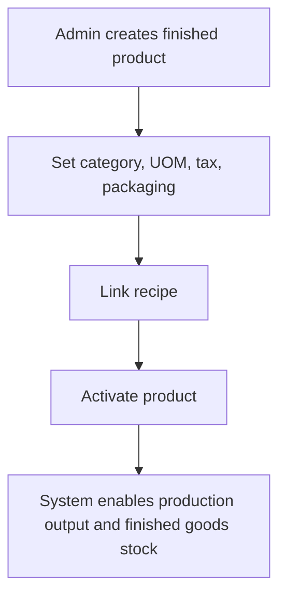

| Section | Specification |
| --- | --- |
| Purpose | Maintain finished goods and packaging/pricing setup. |
| Trigger | New frozen pastry product, packaging change, sales catalogue update. |
| User Roles | Admin manages; Kitchen/Production reads; Finance reads valuation/costing. |
| Preconditions | Product category exists; tax rate optional; recipe required before production. |
| User Journey | User creates product, sets code/name/category/UOM/tax, configures packaging/pricing, activates. |
| System Actions | Validates product, stores packaging, makes product available for recipe and production. |
| Validation Rules | Product code/name/base UOM required; product code unique; qty per pack positive; price non-negative. |
| Approval Flow | Product master approval optional; recipe approval required separately. |
| Status Transitions | Active -> Inactive -> Archived. |
| Stock Impact | No direct stock change; product can receive production output/opening stock. |
| Finance Impact | Product cost and COGS reporting depend on recipe and production usage. |
| Notifications | Notify Kitchen/Production when product or packaging changes. |
| Activity Timeline | Product created, packaging added, price changed, status changed. |
| Exception Handling | Cannot archive product with active recipe, open production job, or non-zero stock without override. |
| Attachments Required | Optional product image, label, spec sheet. |
| Related Documents | Product master, recipe, production job, stock card. |
| Related Database Tables | `products`, `product_categories`, `product_packaging`, `tax_rates`, `recipes`, `stock_transaction_lines`, `attachments`, `activity_logs`, `audit_logs`. |
| Future Automation Opportunities | Product catalogue export; barcode/label generation. |

## 5.8 Supplier Management

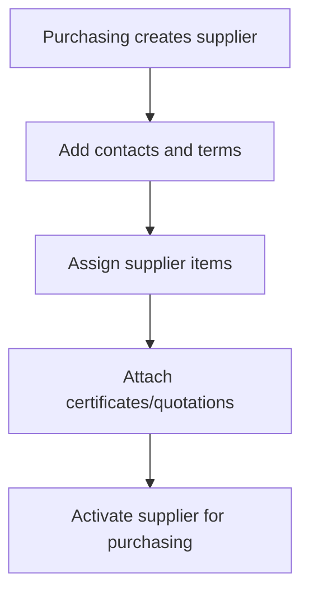

| Section | Specification |
| --- | --- |
| Purpose | Manage supplier records, contacts, assigned items, pricing, MOQ, and lead time. |
| Trigger | New supplier onboarding, price update, contact update, supplier deactivation. |
| User Roles | Purchasing/Admin manage; Finance reads terms/outstanding; Kitchen reads supplier on receiving. |
| Preconditions | Supplier code available; item exists for supplier item assignment. |
| User Journey | Purchasing creates supplier, enters contact/terms/tax details, assigns items with cost/MOQ/lead time, uploads documents, activates. |
| System Actions | Validates supplier and assigned items, stores contacts/catalogue, logs changes. |
| Validation Rules | Supplier code/name required and unique; payment terms non-negative; supplier item conversion positive; unit cost non-negative. |
| Approval Flow | Not required by default; supplier bank detail changes may require approval later. |
| Status Transitions | Active -> Inactive -> Archived. |
| Stock Impact | No direct stock change; supplier selection drives PR/PO/GRN. |
| Finance Impact | Payment terms calculate invoice due date and outstanding supplier reports. |
| Notifications | Notify Purchasing when supplier cost/lead time changes; notify Finance for payment term changes. |
| Activity Timeline | Supplier created, contact added, item assigned, cost changed, certificate uploaded, deactivated. |
| Exception Handling | Inactive supplier cannot be used for new PO; archive blocked if open PO/invoice exists. |
| Attachments Required | Optional SSM, halal certificate, quotation, bank info. |
| Related Documents | Supplier master, supplier item, PO, GRN, invoice, credit note, payment. |
| Related Database Tables | `suppliers`, `supplier_contacts`, `supplier_items`, `purchase_orders`, `supplier_invoices`, `attachments`, `activity_logs`, `audit_logs`. |
| Future Automation Opportunities | Supplier portal, automatic certificate expiry reminders. |

## 5.9 Recipe / BOM Management

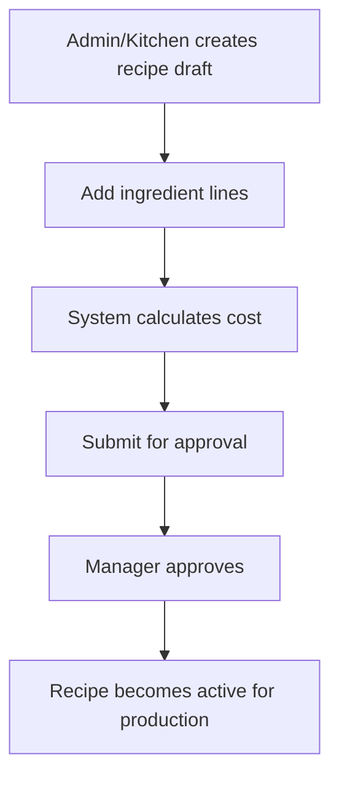

| Section | Specification |
| --- | --- |
| Purpose | Define approved product BOM, ingredient usage, UOM conversion, wastage, and cost. |
| Trigger | New product, recipe revision, cost review, ingredient change. |
| User Roles | Admin/Kitchen creates; Manager approves; Finance/Purchasing reads costing. |
| Preconditions | Product exists; ingredient items exist; UOM conversion known. |
| User Journey | User creates recipe header, adds ingredients, enters recipe UOM/conversion/qty/wastage/cost, reviews total cost, submits for approval. |
| System Actions | Calculates base qty, line cost, total recipe cost, cost per finished unit; creates approval request and version snapshot. |
| Validation Rules | Product required; yield positive; ingredient item active; no duplicate ingredient; qty/conversion positive; wastage non-negative. |
| Approval Flow | Draft -> Pending Approval -> Approved/Rejected. Rejection requires remarks. |
| Status Transitions | Draft -> Pending Approval -> Approved/Active -> Archived; Rejected -> Draft. |
| Stock Impact | None until production job posts usage/output. |
| Finance Impact | Recipe cost supports COGS and product costing. |
| Notifications | Notify Manager for approval; notify Kitchen and Finance when approved or changed. |
| Activity Timeline | Recipe created, ingredient added/removed, cost recalculated, submitted, approved, rejected, versioned. |
| Exception Handling | Cannot use unapproved recipe for production; changing active recipe creates new version. |
| Attachments Required | Optional production method, costing sheet, specification. |
| Related Documents | Recipe, recipe version, recipe cost snapshot, production job. |
| Related Database Tables | `recipes`, `recipe_lines`, `recipe_versions`, `recipe_cost_snapshots`, `approvals`, `approval_steps`, `attachments`, `activity_logs`, `audit_logs`. |
| Future Automation Opportunities | Auto-cost refresh from latest supplier prices; recipe yield variance alerts. |

---

# INVENTORY

## 5.10 Opening Stock

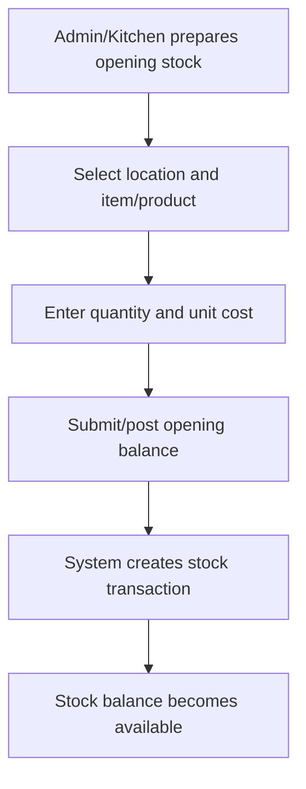

| Section | Specification |
| --- | --- |
| Purpose | Load initial stock balances during go-live without directly editing balances. |
| Trigger | System implementation, new location opening, new stock entity initial load. |
| User Roles | Admin prepares/posts; Kitchen assists count; Manager may approve high-value opening. |
| Preconditions | Active item/product and location exist; document sequence configured. |
| User Journey | User creates opening stock document, selects location, enters item/product quantities and costs, attaches count sheet, posts. |
| System Actions | Creates `opening_balance` stock transaction lines with quantity in and unit cost. |
| Validation Rules | Quantity in must be positive; quantity out must be zero; unit cost non-negative; location required. |
| Approval Flow | Optional Manager approval before posting for go-live controls. |
| Status Transitions | Draft -> Approved -> Posted; Cancelled. |
| Stock Impact | Increases stock for selected item/product/location. |
| Finance Impact | Establishes opening inventory value. |
| Notifications | Notify Admin/Finance when opening stock posted. |
| Activity Timeline | Opening stock created, line added, attachment uploaded, approved, posted. |
| Exception Handling | Duplicate opening stock for same item/product/location requires warning and override. |
| Attachments Required | Opening count sheet required for production use. |
| Related Documents | Opening stock transaction, stock card. |
| Related Database Tables | `stock_transactions`, `stock_transaction_lines`, `locations`, `items`, `products`, `attachments`, `activity_logs`, `audit_logs`. |
| Future Automation Opportunities | Opening balance import template with validation preview. |

## 5.11 Daily Stock Count

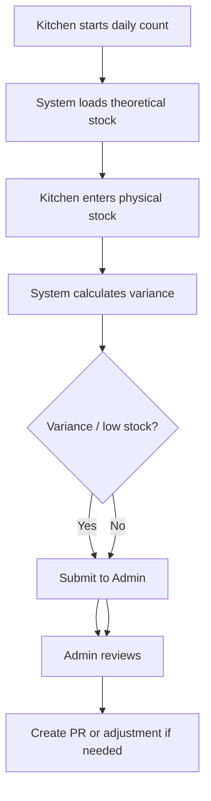

| Section | Specification |
| --- | --- |
| Purpose | Capture nightly/daily physical stock and detect variance or low stock. |
| Trigger | Daily kitchen close, scheduled count, ad-hoc audit count. |
| User Roles | Kitchen counts/submits; Admin reviews; Manager approves high variance adjustment. |
| Preconditions | Active location and countable items/products; theoretical stock available. |
| User Journey | Kitchen selects location, enters physical quantities, reviews variance, submits. Admin reviews exceptions and creates PR or adjustment. |
| System Actions | Loads theoretical qty, calculates variance qty/%, flags tolerance breach, logs count. |
| Validation Rules | Physical qty cannot be negative; duplicate item/product lines not allowed; location required. |
| Approval Flow | Submitted count reviewed by Admin; adjustment from variance may require Manager approval. |
| Status Transitions | Draft -> Submitted -> Approved -> Posted; Rejected -> Draft; Cancelled. |
| Stock Impact | Count itself does not alter stock until approved adjustment is posted. |
| Finance Impact | Variance impacts inventory value only after adjustment posting. |
| Notifications | Notify Admin on submission; notify Manager for high variance; notify Purchasing for low stock. |
| Activity Timeline | Count started, line edited, submitted, variance flagged, reviewed, approved, posted/rejected. |
| Exception Handling | Missing count line flagged; high variance requires remarks; offline count import can be added later. |
| Attachments Required | Optional photo/signed count sheet; required for exceptional variance. |
| Related Documents | Stock count, stock count lines, inventory variance, purchase request, stock adjustment. |
| Related Database Tables | `stock_counts`, `stock_count_lines`, `inventory_variances`, `stock_adjustments`, `purchase_requests`, `attachments`, `activity_logs`, `audit_logs`. |
| Future Automation Opportunities | Mobile scanner count, scheduled count reminders, tolerance-based auto PR draft. |

## 5.12 Stock Adjustment

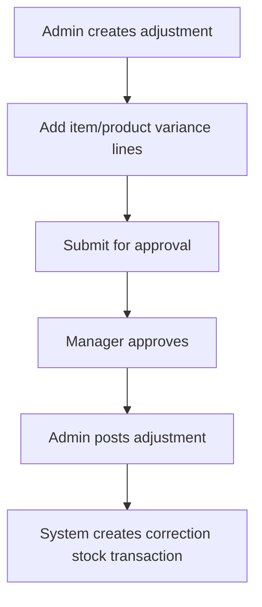

| Section | Specification |
| --- | --- |
| Purpose | Correct stock through approved, auditable stock movements. |
| Trigger | Stock count variance, missing item, correction, extra stock, audit finding. |
| User Roles | Admin creates/posts; Manager approves; Kitchen may request. |
| Preconditions | Item/product and location exist; reason provided. |
| User Journey | Admin creates adjustment, enters correction lines, attaches evidence if needed, submits for Manager approval, posts after approval. |
| System Actions | Creates approval workflow, validates quantities, posts correction transaction on approval. |
| Validation Rules | Reason required; quantity positive; cannot post before approval; one direction per stock line. |
| Approval Flow | Draft -> Pending Approval -> Approved/Rejected. |
| Status Transitions | Draft -> Pending Approval -> Approved -> Posted; Rejected -> Draft; Cancelled. |
| Stock Impact | Posting increases or decreases stock through correction/stock count adjustment transaction. |
| Finance Impact | Changes inventory value based on unit cost and quantity impact. |
| Notifications | Notify Manager for approval; notify Admin/Kitchen when approved/rejected/posted. |
| Activity Timeline | Adjustment created, lines added, submitted, approved, rejected, posted. |
| Exception Handling | Negative resulting stock requires Manager override; high-value adjustment requires attachment. |
| Attachments Required | Required for high-value/high-variance corrections. |
| Related Documents | Stock adjustment, approval, stock transaction, stock card. |
| Related Database Tables | `stock_adjustments`, `stock_transactions`, `stock_transaction_lines`, `approvals`, `approval_steps`, `attachments`, `activity_logs`, `audit_logs`. |
| Future Automation Opportunities | Auto-create adjustment draft from stock count variance. |

## 5.13 Stock Wastage

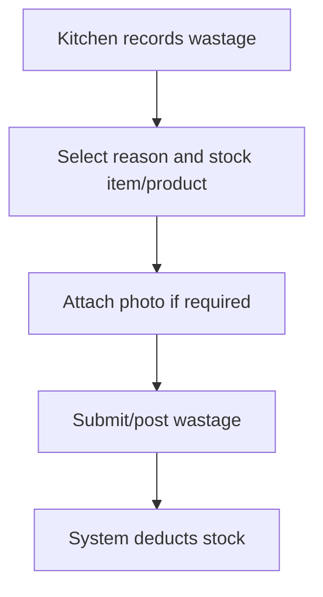

| Section | Specification |
| --- | --- |
| Purpose | Record expired, damaged, missing, or wasted stock. |
| Trigger | Ingredient expiry, production loss, damaged delivery, missing stock. |
| User Roles | Kitchen creates; Admin reviews; Manager notified for abnormal wastage. |
| Preconditions | Active stock entity and location; sufficient stock or approved negative override. |
| User Journey | Kitchen creates wastage document, selects reason/item/product, enters quantity, attaches photo where needed, submits/posts. |
| System Actions | Validates line, creates wastage/damage/missing stock transaction on posting, updates stock card. |
| Validation Rules | Reason required; quantity positive; photo required for damage/expired/supplier claim. |
| Approval Flow | Routine wastage may post by Kitchen/Admin; abnormal wastage requires Manager approval. |
| Status Transitions | Draft -> Submitted/Approved -> Posted; Cancelled. |
| Stock Impact | Decreases stock quantity and inventory value. |
| Finance Impact | Supports wastage expense and COGS analysis. |
| Notifications | Notify Admin for posted wastage; notify Manager if above tolerance. |
| Activity Timeline | Wastage created, attachment uploaded, submitted, approved, posted. |
| Exception Handling | Insufficient stock warning; duplicate wastage for same batch/day requires warning. |
| Attachments Required | Photo required for damage, expiry, supplier claim, abnormal wastage. |
| Related Documents | Stock wastage, stock transaction, production wastage if production-related. |
| Related Database Tables | `stock_wastage`, `stock_transactions`, `stock_transaction_lines`, `production_wastage`, `attachments`, `activity_logs`, `audit_logs`. |
| Future Automation Opportunities | Expiry-based wastage suggestions; supplier claim workflow. |

## 5.14 Stock Transfer

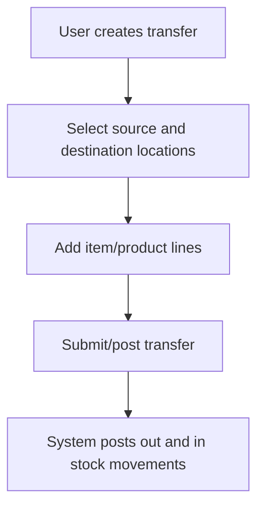

| Section | Specification |
| --- | --- |
| Purpose | Move stock between locations such as dry store to production floor or freezer to dispatch. |
| Trigger | Operational movement, production preparation, branch transfer, event booth stock issue. |
| User Roles | Kitchen/Admin creates/posts; Manager approval optional for inter-branch or high-value transfer. |
| Preconditions | Source and destination locations active and different. |
| User Journey | User creates transfer, selects locations, adds item/product lines, submits/posts, prints transfer note if needed. |
| System Actions | Validates stock and locations, creates paired out/in transfer stock transaction lines. |
| Validation Rules | Source/destination required and different; quantity positive; item/product required. |
| Approval Flow | Optional for inter-branch/high-value transfers. |
| Status Transitions | Draft -> Submitted/Approved -> Posted; Cancelled. |
| Stock Impact | Decreases source location and increases destination location. Total company stock unchanged. |
| Finance Impact | Inventory value transfers by location; total value unchanged. |
| Notifications | Notify destination location when transfer posted. |
| Activity Timeline | Transfer created, lines added, submitted, posted, cancelled. |
| Exception Handling | Insufficient source stock warning; destination inactive blocked. |
| Attachments Required | Optional signed transfer note. |
| Related Documents | Stock transfer, transfer note, stock card. |
| Related Database Tables | `stock_transfers`, `stock_transfer_lines`, `stock_transactions`, `stock_transaction_lines`, `attachments`, `activity_logs`, `audit_logs`. |
| Future Automation Opportunities | Barcode transfer scanning; dispatch route transfer templates. |

## 5.15 Low Stock Monitoring

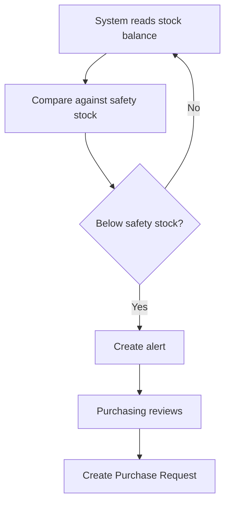

| Section | Specification |
| --- | --- |
| Purpose | Detect items below safety stock and initiate replenishment. |
| Trigger | Dashboard refresh, stock posting, scheduled check, stock count submission. |
| User Roles | System monitors; Purchasing/Admin acts; Kitchen views. |
| Preconditions | Item has safety stock and stock control enabled. |
| User Journey | User opens low stock dashboard, reviews items, creates PR or dismisses with reason. |
| System Actions | Calculates current stock from view, compares with safety stock, flags low stock. |
| Validation Rules | Safety stock non-negative; low stock applies to items only until product safety stock is added. |
| Approval Flow | No approval for alert; PR generated from alert follows PR approval. |
| Status Transitions | Normal -> Low Stock -> PR Created/Resolved. |
| Stock Impact | None until PO/GRN posting. |
| Finance Impact | Estimated replenishment cost may appear in purchase planning. |
| Notifications | Notify Purchasing and Kitchen lead for low stock. |
| Activity Timeline | Low stock alert created, PR generated, alert resolved. |
| Exception Handling | Suppress duplicate active alerts for same item/location; allow snooze with reason. |
| Attachments Required | None. |
| Related Documents | Low stock alert, purchase request, stock balance. |
| Related Database Tables | `items`, `stock_balances_view`, `notifications`, `purchase_requests`, `activity_logs`. |
| Future Automation Opportunities | Auto-create PR draft based on MOQ/lead time/safety stock. |

## 5.16 Inventory Valuation

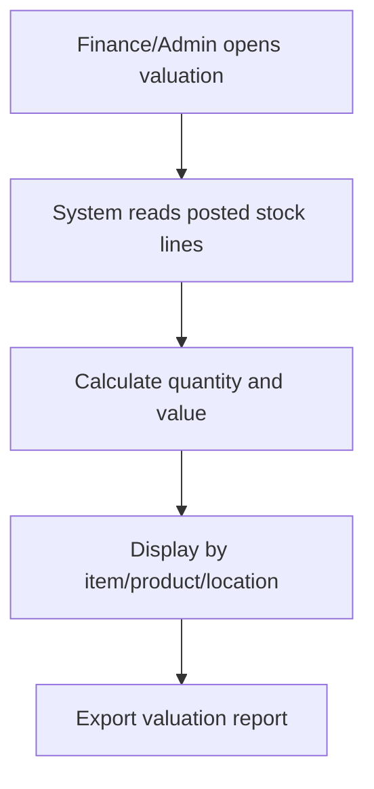

| Section | Specification |
| --- | --- |
| Purpose | Report inventory quantity and value by item/product/location. |
| Trigger | Month end, finance review, stock audit, management reporting. |
| User Roles | Finance/Admin reads/exports; Manager reviews. |
| Preconditions | Posted stock transactions with unit costs exist. |
| User Journey | User selects date/location/category, reviews inventory value, exports report. |
| System Actions | Aggregates posted stock lines, calculates quantity and value. |
| Validation Rules | Date range valid; user has report permission. |
| Approval Flow | Not applicable. |
| Status Transitions | Report only. |
| Stock Impact | None. |
| Finance Impact | Supports month-end inventory valuation and COGS review. |
| Notifications | Optional scheduled month-end reminder. |
| Activity Timeline | Valuation viewed/exported. |
| Exception Handling | Missing unit cost highlighted for correction. |
| Attachments Required | None. |
| Related Documents | Stock balance, stock card, inventory valuation report. |
| Related Database Tables | `stock_balances_view`, `stock_card_view`, `stock_transactions`, `stock_transaction_lines`, `items`, `products`, `locations`. |
| Future Automation Opportunities | Weighted average costing, month-end valuation snapshot, AutoCount journal export. |

---

# PRODUCTION

## 5.17 Production Planning

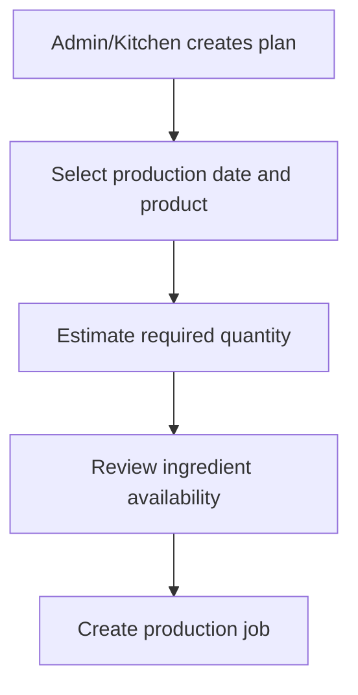

| Section | Specification |
| --- | --- |
| Purpose | Plan finished goods production demand before execution. |
| Trigger | Sales forecast, outlet/event demand, freezer replenishment, weekly production schedule. |
| User Roles | Admin/Kitchen creates; Manager reviews if needed. |
| Preconditions | Product active; approved recipe available for planned product. |
| User Journey | User creates plan, selects product/date/location/quantity, reviews recipe and stock availability, creates job. |
| System Actions | Checks recipe availability, estimates ingredient requirements, highlights shortages. |
| Validation Rules | Product required; planned qty positive; recipe must be approved for job creation. |
| Approval Flow | Optional planning approval; production job controls execution. |
| Status Transitions | Planned -> Released/In Job -> Completed/Cancelled. |
| Stock Impact | None until ingredient issue/output posting. |
| Finance Impact | Estimated production cost visible from recipe. |
| Notifications | Notify Kitchen when plan is released. |
| Activity Timeline | Plan created, shortage detected, job created, plan completed/cancelled. |
| Exception Handling | Product without approved recipe cannot proceed to job. |
| Attachments Required | Optional production schedule. |
| Related Documents | Production plan, production job, recipe. |
| Related Database Tables | `production_plans`, `production_jobs`, `recipes`, `recipe_lines`, `stock_balances_view`, `activity_logs`, `audit_logs`. |
| Future Automation Opportunities | Demand forecast import, automatic ingredient shortage PR. |

## 5.18 Production Job

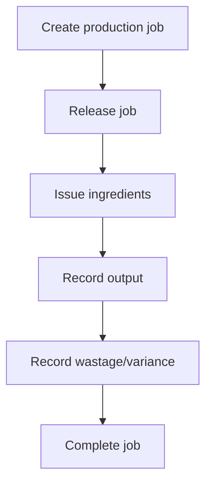

| Section | Specification |
| --- | --- |
| Purpose | Control execution of production using approved recipe. |
| Trigger | Production plan release or manual production need. |
| User Roles | Kitchen executes; Admin supervises; Manager reviews abnormal variance. |
| Preconditions | Active product, approved recipe, active production location. |
| User Journey | User creates job, releases, issues ingredients, records finished output/batches, records wastage/variance, completes job. |
| System Actions | Copies recipe lines into planned job lines, calculates planned usage, creates usage/output transactions when posted. |
| Validation Rules | Planned qty positive; approved recipe required; cannot complete without output. |
| Approval Flow | Abnormal variance may require Manager approval before completion. |
| Status Transitions | Planned -> Released -> In Progress -> Completed; Cancelled. |
| Stock Impact | Usage decreases ingredients; output increases finished goods. |
| Finance Impact | Supports COGS, production variance, finished goods valuation. |
| Notifications | Notify Kitchen when job released; notify Manager for abnormal variance. |
| Activity Timeline | Job created, released, ingredient issued, output posted, wastage recorded, completed. |
| Exception Handling | Ingredient shortage blocks or warns based on configuration; recipe version locked at job creation. |
| Attachments Required | Optional production sheet, QC form, batch photo. |
| Related Documents | Production plan, production job, usage transaction, output transaction. |
| Related Database Tables | `production_jobs`, `production_job_lines`, `production_outputs`, `production_wastage`, `production_variances`, `stock_transactions`, `stock_transaction_lines`, `recipes`. |
| Future Automation Opportunities | Barcode batch issue/output; production tablet mode. |

## 5.19 Ingredient Issue

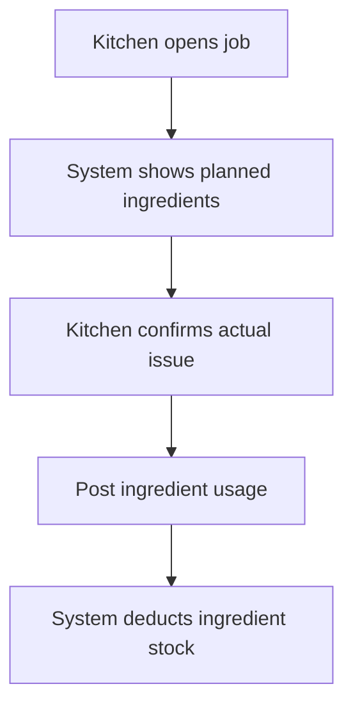

| Section | Specification |
| --- | --- |
| Purpose | Deduct raw materials/packaging consumed by production. |
| Trigger | Production job starts or ingredient is moved to production floor. |
| User Roles | Kitchen posts; Admin monitors. |
| Preconditions | Production job released; ingredients available or override allowed. |
| User Journey | Kitchen reviews planned ingredient list, enters actual issue qty, posts usage. |
| System Actions | Creates `production_usage` stock transaction lines with quantity out. |
| Validation Rules | Actual qty non-negative; item active; location required; negative stock override requires permission. |
| Approval Flow | Not required unless shortage/override exceeds tolerance. |
| Status Transitions | Job Released -> In Progress after first issue. |
| Stock Impact | Decreases ingredient item stock. |
| Finance Impact | Captures production material cost. |
| Notifications | Notify Admin if actual usage exceeds recipe tolerance. |
| Activity Timeline | Ingredient issue drafted, actual qty updated, usage posted. |
| Exception Handling | Short stock warning; substitute ingredient requires authorized adjustment or recipe deviation record. |
| Attachments Required | Optional issue sheet. |
| Related Documents | Production job, stock transaction, stock card. |
| Related Database Tables | `production_job_lines`, `stock_transactions`, `stock_transaction_lines`, `inventory_variances`, `activity_logs`. |
| Future Automation Opportunities | Auto-issue based on BOM; weigh-scale integration. |

## 5.20 Production Output

```mermaid
flowchart TD
  A["Kitchen records finished output"]
  B["Enter product, qty, batch"]
  C["Post output"]
  D["System increases finished goods stock"]
  A --> B --> C --> D
```

| Section | Specification |
| --- | --- |
| Purpose | Record finished goods produced from a production job. |
| Trigger | Batch completed, product packed, freezer stock-in. |
| User Roles | Kitchen posts; Admin/Manager reviews. |
| Preconditions | Production job in progress; product active; output location active. |
| User Journey | Kitchen enters output qty/UOM/batch, posts output, reviews job completion status. |
| System Actions | Creates `production_output` stock transaction line with quantity in for product. |
| Validation Rules | Output qty positive; product required; batch no recommended; cannot post to inactive location. |
| Approval Flow | Not required unless variance beyond tolerance. |
| Status Transitions | In Progress -> Completed when output and variance review complete. |
| Stock Impact | Increases finished goods product stock. |
| Finance Impact | Adds finished goods inventory value based on production cost method. |
| Notifications | Notify Admin/Manager if output lower than planned beyond tolerance. |
| Activity Timeline | Output recorded, batch assigned, output posted. |
| Exception Handling | Output exceeding planned qty prompts confirmation and variance logging. |
| Attachments Required | Optional QC/batch sheet. |
| Related Documents | Production job, production output, stock transaction. |
| Related Database Tables | `production_outputs`, `products`, `stock_transactions`, `stock_transaction_lines`, `activity_logs`. |
| Future Automation Opportunities | Label printing, batch expiry calculation. |

## 5.21 Production Wastage

```mermaid
flowchart TD
  A["Kitchen records production wastage"]
  B["Select item/product and reason"]
  C["Enter quantity"]
  D["System logs wastage"]
  E["Manager notified if abnormal"]
  A --> B --> C --> D --> E
```

| Section | Specification |
| --- | --- |
| Purpose | Capture wastage occurring during production. |
| Trigger | Dough loss, filling spill, packaging damage, rejected finished goods. |
| User Roles | Kitchen records; Admin reviews; Manager approves abnormal loss. |
| Preconditions | Production job exists. |
| User Journey | Kitchen selects production job, item/product, wastage qty/reason, attaches photo if abnormal, saves/posts. |
| System Actions | Logs production wastage; creates stock wastage transaction if stock has not already been deducted. |
| Validation Rules | Quantity positive; reason required; item or product required. |
| Approval Flow | Abnormal wastage requires Manager approval. |
| Status Transitions | Recorded -> Reviewed/Approved. |
| Stock Impact | May decrease ingredient/product stock depending on timing of issue/output. |
| Finance Impact | Supports wastage cost and production variance. |
| Notifications | Notify Manager if wastage exceeds tolerance. |
| Activity Timeline | Wastage recorded, attachment uploaded, reviewed, approved. |
| Exception Handling | Prevent double deduction if wastage is already included in issued ingredient variance. |
| Attachments Required | Required for abnormal damage/rejection. |
| Related Documents | Production job, stock wastage, production variance. |
| Related Database Tables | `production_wastage`, `stock_wastage`, `stock_transactions`, `stock_transaction_lines`, `attachments`, `activity_logs`. |
| Future Automation Opportunities | Tolerance-based auto approval; root cause analytics. |

## 5.22 Production Variance

```mermaid
flowchart TD
  A["System compares planned vs actual"]
  B["Calculate ingredient/output variance"]
  C{"Above tolerance?"}
  D["Manager review"]
  E["Complete job"]
  A --> B --> C
  C -->|Yes| D --> E
  C -->|No| E
```

| Section | Specification |
| --- | --- |
| Purpose | Measure planned vs actual usage and output. |
| Trigger | Ingredient issue, output posting, job completion. |
| User Roles | System calculates; Kitchen explains; Manager reviews high variance. |
| Preconditions | Production job has planned and actual quantities. |
| User Journey | User reviews variance screen, adds remarks for high variance, submits for review if needed. |
| System Actions | Calculates variance qty/% and flags tolerance breaches. |
| Validation Rules | Variance requires explanation if over tolerance. |
| Approval Flow | Manager approval required for abnormal variance before completion. |
| Status Transitions | Draft variance -> Reviewed -> Approved/Accepted. |
| Stock Impact | Variance itself does not move stock; related issue/output postings already do. |
| Finance Impact | Feeds COGS and production efficiency reporting. |
| Notifications | Notify Manager for abnormal variance. |
| Activity Timeline | Variance calculated, remarks added, reviewed, approved. |
| Exception Handling | Missing actual usage/output blocks final variance calculation. |
| Attachments Required | Optional investigation notes; required for severe variance. |
| Related Documents | Production job, production variance, wastage. |
| Related Database Tables | `production_variances`, `production_job_lines`, `production_outputs`, `production_wastage`, `activity_logs`. |
| Future Automation Opportunities | Standard yield dashboards; automatic root cause prompts. |

## 5.23 Finished Goods Stock-In

```mermaid
flowchart TD
  A["Production output approved/postable"]
  B["Select finished goods location"]
  C["Post stock-in"]
  D["System updates product stock card"]
  A --> B --> C --> D
```

| Section | Specification |
| --- | --- |
| Purpose | Receive completed products into finished goods storage. |
| Trigger | Production output ready for freezer/dispatch storage. |
| User Roles | Kitchen posts; Admin monitors; Finance reads valuation. |
| Preconditions | Production output exists; finished goods location active. |
| User Journey | Kitchen selects finished goods location, confirms batch/qty, posts stock-in. |
| System Actions | Creates product stock transaction line with quantity in and cost. |
| Validation Rules | Product active; quantity positive; location required. |
| Approval Flow | Not required unless variance abnormal. |
| Status Transitions | Output Draft -> Posted; Job may become Completed. |
| Stock Impact | Increases product stock. |
| Finance Impact | Increases finished goods inventory value. |
| Notifications | Notify Sales/Operations in future when finished goods become available. |
| Activity Timeline | Finished goods stocked in, batch posted. |
| Exception Handling | Batch no missing warning; duplicate batch warning. |
| Attachments Required | Optional QC release. |
| Related Documents | Production output, stock transaction, stock card. |
| Related Database Tables | `production_outputs`, `stock_transactions`, `stock_transaction_lines`, `products`, `locations`, `activity_logs`. |
| Future Automation Opportunities | Auto stock-in after output posting; QC hold/release workflow. |

---

# PURCHASING

## 5.24 Purchase Request

```mermaid
flowchart TD
  A["Kitchen/Admin creates PR"]
  B["Add required items"]
  C["Submit PR"]
  D["Admin Review"]
  E["Purchasing Review"]
  F["Manager Approval"]
  A --> B --> C --> D --> E --> F
```

| Section | Specification |
| --- | --- |
| Purpose | Request purchase of ingredients/packaging from low stock, stock count, or operational need. |
| Trigger | Low stock, daily stock count, production plan shortage, manual request. |
| User Roles | Kitchen/Admin creates; Admin reviews; Purchasing reviews; Manager approves. |
| Preconditions | Active item exists; requester has PR permission. |
| User Journey | User creates PR, adds item qty/UOM/required date/remarks, submits for review. |
| System Actions | Generates PR number, validates lines, creates approval/review tasks, logs activity. |
| Validation Rules | At least one line; qty positive; required date valid; active item only. |
| Approval Flow | Submitted -> Admin Review -> Purchasing Review -> Manager Approval -> Approved/Rejected. |
| Status Transitions | Draft -> Submitted -> Admin Review -> Purchasing Review -> Pending Approval -> Approved -> Converted; Rejected/Cancelled. |
| Stock Impact | None until PO receiving is posted. |
| Finance Impact | Estimated purchase requirement; no payable impact. |
| Notifications | Admin notified on submission; Purchasing notified after admin review; Manager notified for approval. |
| Activity Timeline | PR created, line added, submitted, reviewed, approved, rejected, converted. |
| Exception Handling | Duplicate open PR for same item/location warns user; requested qty below MOQ warns Purchasing. |
| Attachments Required | Optional stock count sheet or supporting note. |
| Related Documents | Stock count, low stock alert, PR, PO. |
| Related Database Tables | `purchase_requests`, `purchase_request_lines`, `items`, `approvals`, `approval_steps`, `notifications`, `activity_logs`, `audit_logs`. |
| Future Automation Opportunities | Auto PR draft from low stock and production shortage. |

## 5.25 Admin Review

```mermaid
flowchart TD
  A["Admin receives PR task"]
  B["Check stock/request reason"]
  C{"Valid request?"}
  D["Forward to Purchasing"]
  E["Reject/return with remarks"]
  A --> B --> C
  C -->|Yes| D
  C -->|No| E
```

| Section | Specification |
| --- | --- |
| Purpose | Validate operational need before purchasing review. |
| Trigger | PR submitted by Kitchen/Admin. |
| User Roles | Admin reviews. |
| Preconditions | PR status submitted/admin review. |
| User Journey | Admin opens PR, checks stock count/low stock/history, approves for purchasing review or rejects with remarks. |
| System Actions | Updates review status, records reviewer, sends next notification. |
| Validation Rules | Rejection requires remarks; cannot forward PR with zero lines. |
| Approval Flow | Admin review is the first PR workflow gate. |
| Status Transitions | Submitted -> Admin Review -> Purchasing Review or Rejected. |
| Stock Impact | None. |
| Finance Impact | None. |
| Notifications | Notify Purchasing when forwarded; notify requester if rejected. |
| Activity Timeline | Admin review started, admin approved/rejected, remarks captured. |
| Exception Handling | Admin can request requester clarification without closing PR in later phase. |
| Attachments Required | Optional supporting evidence. |
| Related Documents | PR, stock count, low stock alert. |
| Related Database Tables | `purchase_requests`, `approval_steps`, `activity_logs`, `notifications`. |
| Future Automation Opportunities | Auto-check current stock, open PO, and average usage before review. |

## 5.26 Purchasing Review

```mermaid
flowchart TD
  A["Purchasing receives PR"]
  B["Verify supplier/MOQ/lead time/cost"]
  C["Adjust supplier or qty if needed"]
  D["Submit to Manager"]
  A --> B --> C --> D
```

| Section | Specification |
| --- | --- |
| Purpose | Convert an operational request into a commercially valid purchase requirement. |
| Trigger | Admin forwards PR. |
| User Roles | Purchasing reviews; Manager approves after review. |
| Preconditions | Supplier and supplier item setup exist or are created. |
| User Journey | Purchasing verifies supplier, price, MOQ, lead time, existing open PO, adjusts recommendation, submits to Manager. |
| System Actions | Shows supplier catalogue, open PO, stock level, estimated line total, and MOQ warnings. |
| Validation Rules | Supplier required for PO conversion; qty should respect MOQ unless override reason provided. |
| Approval Flow | Purchasing review precedes Manager approval. |
| Status Transitions | Purchasing Review -> Pending Approval -> Approved/Rejected. |
| Stock Impact | None. |
| Finance Impact | Estimated purchase amount prepared. |
| Notifications | Notify Manager when ready for approval; notify Admin if supplier setup missing. |
| Activity Timeline | Purchasing review started, supplier assigned, qty/cost adjusted, submitted. |
| Exception Handling | Missing supplier blocks PO conversion but not PR review note. |
| Attachments Required | Optional quotation. |
| Related Documents | PR, supplier, supplier item, PO. |
| Related Database Tables | `purchase_requests`, `purchase_request_lines`, `supplier_items`, `suppliers`, `approvals`, `activity_logs`. |
| Future Automation Opportunities | Supplier recommendation based on price history and lead time. |

## 5.27 Manager Approval

```mermaid
flowchart TD
  A["Manager opens approval"]
  B["Review request/cost/supplier"]
  C{"Approve?"}
  D["Approved"]
  E["Rejected with remarks"]
  A --> B --> C
  C -->|Yes| D
  C -->|No| E
```

| Section | Specification |
| --- | --- |
| Purpose | Authorize purchasing or controlled operational documents. |
| Trigger | PR, PO, recipe, adjustment, invoice, or payment schedule submitted. |
| User Roles | Manager approves/rejects. |
| Preconditions | Approval task assigned to Manager role/staff. |
| User Journey | Manager opens task, reviews document, attachments, timeline, approves or rejects with remarks. |
| System Actions | Records decision, updates document approval status, notifies next role/requester. |
| Validation Rules | Rejection remarks required; approval blocked if validation errors exist. |
| Approval Flow | Configured by approval engine; may include one or multiple steps. |
| Status Transitions | Pending Approval -> Approved or Rejected. |
| Stock Impact | Approval alone does not move stock unless followed by posting. |
| Finance Impact | Approval can authorize financial obligation or payment execution depending on document. |
| Notifications | Notify requester and next workflow role after decision. |
| Activity Timeline | Approval requested, approved/rejected, remarks recorded. |
| Exception Handling | Delegation/escalation in later phase; expired task reminders. |
| Attachments Required | Required where source workflow requires evidence. |
| Related Documents | Any approval-enabled document. |
| Related Database Tables | `approvals`, `approval_steps`, source document table, `notifications`, `activity_logs`, `audit_logs`. |
| Future Automation Opportunities | Approval limits by amount, branch, category, or variance %. |

## 5.28 Purchase Order

```mermaid
flowchart TD
  A["Purchasing creates PO"]
  B["Select supplier and items"]
  C["Submit for approval"]
  D["Manager approves"]
  E["Send PO to supplier"]
  F["Track pending delivery"]
  A --> B --> C --> D --> E --> F
```

| Section | Specification |
| --- | --- |
| Purpose | Create official supplier order with quantity, price, delivery, and pending tracking. |
| Trigger | Approved PR conversion or manual purchase need. |
| User Roles | Purchasing creates/sends; Manager approves; Kitchen receives; Finance reads. |
| Preconditions | Active supplier, active items, supplier item/cost available or manual price entered. |
| User Journey | Purchasing creates PO, adds lines, confirms price/qty/delivery, submits, Manager approves, Purchasing sends to supplier. |
| System Actions | Generates PO number, calculates line totals and pending qty, creates approval, updates status. |
| Validation Rules | Supplier required; qty ordered positive; unit price non-negative; at least one line. |
| Approval Flow | Draft -> Pending Approval -> Approved/Rejected. |
| Status Transitions | Draft -> Pending Approval -> Approved -> Sent -> Partial Received -> Received -> Closed; Rejected/Cancelled. |
| Stock Impact | None until GRN posted. |
| Finance Impact | Creates expected purchase commitment; not payable until invoice. |
| Notifications | Notify Manager for approval; notify Kitchen of expected delivery; notify Purchasing for pending delivery. |
| Activity Timeline | PO created, line added, submitted, approved, sent, partially received, closed. |
| Exception Handling | Supplier inactive blocks; cost variance from catalogue warns; cancellation requires remarks. |
| Attachments Required | Optional supplier quotation; PO PDF generated/attached in later phase. |
| Related Documents | PR, PO, GRN, supplier invoice, three-way match. |
| Related Database Tables | `purchase_orders`, `purchase_order_lines`, `purchase_requests`, `suppliers`, `items`, `approvals`, `attachments`, `activity_logs`, `audit_logs`. |
| Future Automation Opportunities | Email/WhatsApp supplier sending; supplier acknowledgment portal. |

## 5.29 Supplier Confirmation

```mermaid
flowchart TD
  A["PO sent to supplier"]
  B["Supplier confirms availability/date"]
  C["Purchasing updates confirmation"]
  D["Kitchen notified of expected delivery"]
  A --> B --> C --> D
```

| Section | Specification |
| --- | --- |
| Purpose | Track supplier acknowledgment and expected delivery before receiving. |
| Trigger | PO sent. |
| User Roles | Purchasing records; Kitchen views. |
| Preconditions | PO approved and sent. |
| User Journey | Purchasing records supplier confirmation date, expected delivery, partial/short notice if known. |
| System Actions | Updates PO delivery metadata and notifications. |
| Validation Rules | Confirmation only allowed for approved/sent PO. |
| Approval Flow | Not required. |
| Status Transitions | Sent -> Confirmed placeholder -> Awaiting Delivery. |
| Stock Impact | None. |
| Finance Impact | None. |
| Notifications | Notify Kitchen and Admin of confirmed delivery date. |
| Activity Timeline | PO confirmation recorded, expected delivery updated. |
| Exception Handling | Supplier cannot fulfill: Purchasing revises/cancels line and may create replacement PO. |
| Attachments Required | Optional supplier confirmation screenshot/email. |
| Related Documents | PO, supplier confirmation, future delivery schedule. |
| Related Database Tables | `purchase_orders`, `purchase_order_lines`, `attachments`, `activity_logs`, `notifications`. |
| Future Automation Opportunities | Supplier portal confirmation; WhatsApp/email parse. |

## 5.30 Partial Delivery

```mermaid
flowchart TD
  A["Supplier delivers partial quantity"]
  B["Kitchen receives actual qty"]
  C["System updates received qty"]
  D["Pending qty remains open"]
  E["Purchasing follows up"]
  A --> B --> C --> D --> E
```

| Section | Specification |
| --- | --- |
| Purpose | Support receiving less than ordered quantity while keeping pending balance open. |
| Trigger | Supplier delivers partial quantity. |
| User Roles | Kitchen records receiving; Purchasing follows up; Finance reads received qty. |
| Preconditions | PO approved/sent; PO line has pending qty. |
| User Journey | Kitchen creates GRN, enters actual received qty, posts; purchasing monitors pending qty. |
| System Actions | Posts received stock, updates PO line qty_received and qty_pending, sets PO status partial_received. |
| Validation Rules | Received qty positive and not greater than pending qty unless override. |
| Approval Flow | Not required unless over-receiving. |
| Status Transitions | Sent -> Partial Received -> Received when pending qty reaches zero. |
| Stock Impact | Increases stock only for received quantity. |
| Finance Impact | Invoice approval limited to received quantity. |
| Notifications | Notify Purchasing for pending balance; notify Finance when GRN posted. |
| Activity Timeline | Partial delivery received, pending qty updated, PO status changed. |
| Exception Handling | Short delivery with supplier note can remain open or be cancelled by purchasing. |
| Attachments Required | Delivery order required. |
| Related Documents | PO, GRN, invoice matching. |
| Related Database Tables | `purchase_orders`, `purchase_order_lines`, `goods_receivings`, `goods_receiving_lines`, `stock_transactions`, `stock_transaction_lines`, `notifications`, `activity_logs`. |
| Future Automation Opportunities | Auto reminder to supplier for pending balance. |

## 5.31 Goods Receiving

```mermaid
flowchart TD
  A["Kitchen creates GRN"]
  B["Select PO and supplier"]
  C["Enter received qty/batch/expiry"]
  D["Attach delivery order"]
  E["Post GRN"]
  F["System posts purchase stock"]
  A --> B --> C --> D --> E --> F
```

| Section | Specification |
| --- | --- |
| Purpose | Record supplier delivery and increase inventory for accepted goods. |
| Trigger | Supplier delivery arrives. |
| User Roles | Kitchen receives/posts; Purchasing monitors; Finance uses for matching. |
| Preconditions | Supplier exists; location active; PO exists unless allowed for direct receiving. |
| User Journey | Kitchen selects PO/supplier, enters received items/qty/batch/expiry, uploads delivery order, posts. |
| System Actions | Creates GRN, posts purchase stock transaction, updates PO received/pending quantities, notifies Finance. |
| Validation Rules | Received qty positive; location required; delivery order required; cannot receive against closed/cancelled PO. |
| Approval Flow | Posting can be direct by Kitchen or require Admin approval depending on rule. |
| Status Transitions | Draft -> Posted; Cancelled. |
| Stock Impact | Increases item stock at receiving location. |
| Finance Impact | Creates received quantity basis for invoice approval. |
| Notifications | Notify Finance after posting; notify Purchasing for partial or over delivery. |
| Activity Timeline | GRN created, line received, delivery order uploaded, posted, PO pending updated. |
| Exception Handling | Damaged/rejected items not posted as accepted stock; create rejected delivery/return flow. |
| Attachments Required | Delivery order required; damage photos if applicable. |
| Related Documents | PO, GRN, stock transaction, supplier invoice. |
| Related Database Tables | `goods_receivings`, `goods_receiving_lines`, `purchase_orders`, `purchase_order_lines`, `stock_transactions`, `stock_transaction_lines`, `attachments`, `activity_logs`. |
| Future Automation Opportunities | Barcode receiving; OCR delivery order; expiry alerts. |

## 5.32 Rejected Delivery

```mermaid
flowchart TD
  A["Delivery inspected"]
  B{"Acceptable?"}
  C["Receive accepted qty"]
  D["Reject damaged/wrong qty"]
  E["Notify Purchasing/Supplier"]
  F["Attach evidence"]
  A --> B
  B -->|Yes| C
  B -->|No| D --> E --> F
```

| Section | Specification |
| --- | --- |
| Purpose | Record supplier delivery that is damaged, wrong, expired, or rejected. |
| Trigger | Kitchen inspection finds delivery issue. |
| User Roles | Kitchen records; Purchasing communicates with supplier; Manager notified if high value. |
| Preconditions | Delivery exists; supplier/PO known where possible. |
| User Journey | Kitchen records rejected qty/reason, attaches photos/DO, Purchasing follows up for replacement/credit. |
| System Actions | Logs rejected delivery, prevents rejected quantity from increasing stock, creates supplier follow-up notification. |
| Validation Rules | Rejection reason and evidence required; rejected qty positive. |
| Approval Flow | Manager approval required for high-value rejection or supplier dispute. |
| Status Transitions | Draft -> Submitted -> Resolved/Returned/Cancelled. |
| Stock Impact | Rejected quantity does not increase stock. If already received, supplier return deducts stock. |
| Finance Impact | Prevents invoice approval for rejected quantity; may create credit note requirement. |
| Notifications | Notify Purchasing immediately; notify Finance if invoice exists. |
| Activity Timeline | Rejection recorded, evidence attached, supplier notified, resolved. |
| Exception Handling | If supplier replaces goods, receive replacement under same/new GRN reference. |
| Attachments Required | Damage/wrong-item photo and delivery order required. |
| Related Documents | PO, GRN, supplier return, credit note. |
| Related Database Tables | `goods_receivings`, `goods_receiving_lines`, `stock_wastage`, `stock_transactions`, `attachments`, `notifications`, `activity_logs`. |
| Future Automation Opportunities | Supplier claim workflow and claim aging report. |

## 5.33 Supplier Return

```mermaid
flowchart TD
  A["User creates supplier return"]
  B["Select supplier/GRN/item"]
  C["Enter return qty and reason"]
  D["Post return"]
  E["System deducts stock and notifies Finance"]
  A --> B --> C --> D --> E
```

| Section | Specification |
| --- | --- |
| Purpose | Return accepted stock to supplier and deduct inventory. |
| Trigger | Damaged discovered after receiving, wrong item, supplier recall, quality issue. |
| User Roles | Kitchen/Admin creates; Purchasing coordinates supplier; Finance handles credit note. |
| Preconditions | Stock exists; supplier/GRN reference available. |
| User Journey | User selects supplier/GRN/item, enters qty/reason, attaches evidence, posts return. |
| System Actions | Creates return supplier stock transaction with quantity out, notifies Finance for credit note. |
| Validation Rules | Return qty positive; cannot exceed available stock unless override; reason required. |
| Approval Flow | Manager approval required for high-value returns. |
| Status Transitions | Draft -> Approved -> Posted; Cancelled. |
| Stock Impact | Decreases item stock. |
| Finance Impact | Triggers credit note request or invoice adjustment. |
| Notifications | Notify Purchasing and Finance when supplier return posted. |
| Activity Timeline | Return created, evidence uploaded, approved, posted. |
| Exception Handling | If invoice already approved, require credit note workflow. |
| Attachments Required | Return note/evidence required. |
| Related Documents | GRN, supplier return, credit note, invoice. |
| Related Database Tables | `stock_transactions`, `stock_transaction_lines`, `goods_receivings`, `supplier_credit_notes`, `attachments`, `activity_logs`, `notifications`. |
| Future Automation Opportunities | Supplier return document printout and credit note matching. |

---

# FINANCE

## 5.34 Supplier Invoice

```mermaid
flowchart TD
  A["Finance uploads invoice"]
  B["Select supplier and PO"]
  C["Enter invoice lines"]
  D["Link PO and GRN lines"]
  E["Run matching"]
  F["Submit for approval"]
  A --> B --> C --> D --> E --> F
```

| Section | Specification |
| --- | --- |
| Purpose | Record supplier invoice and prepare payable after matching. |
| Trigger | Supplier invoice received by email, hardcopy, or with delivery. |
| User Roles | Finance creates; Manager/Finance approver approves; Purchasing assists mismatch. |
| Preconditions | Supplier exists; GRN/PO exists for controlled purchases. |
| User Journey | Finance uploads invoice, enters header/lines, links PO/GRN lines, runs matching, submits approval. |
| System Actions | Stores invoice, calculates totals, creates matching rows, blocks approval if quantity exceeds received. |
| Validation Rules | Invoice no unique per supplier; invoice/due dates valid; qty positive; line total calculated. |
| Approval Flow | Draft -> Pending Matching -> Pending Approval -> Approved/Rejected. |
| Status Transitions | Draft -> Pending Matching -> Pending Approval -> Approved -> Scheduled -> Paid; Rejected/Cancelled. |
| Stock Impact | None; stock already impacted by GRN. |
| Finance Impact | Approved invoice creates supplier outstanding and payment schedule eligibility. |
| Notifications | Notify Manager for approval; notify Purchasing for mismatch; notify Finance if rejected. |
| Activity Timeline | Invoice uploaded, lines entered, matching run, submitted, approved, rejected, scheduled. |
| Exception Handling | Missing GRN/PO blocks normal approval; override requires Manager approval and reason. |
| Attachments Required | Supplier invoice required. |
| Related Documents | PO, GRN, three-way match, credit note, payment schedule. |
| Related Database Tables | `supplier_invoices`, `supplier_invoice_lines`, `three_way_matches`, `purchase_order_lines`, `goods_receiving_lines`, `attachments`, `approvals`, `activity_logs`. |
| Future Automation Opportunities | OCR invoice capture and automatic line matching. |

## 5.35 Three-Way Matching

```mermaid
flowchart TD
  A["System compares PO line"]
  B["Compare GRN received qty"]
  C["Compare invoice qty/price"]
  D{"Invoice qty <= received qty?"}
  E["Matched"]
  F["Mismatch / hold invoice"]
  A --> B --> C --> D
  D -->|Yes| E
  D -->|No| F
```

| Section | Specification |
| --- | --- |
| Purpose | Ensure invoice is valid against ordered and received quantities. |
| Trigger | Invoice line saved or matching action run. |
| User Roles | Finance runs; Purchasing resolves supplier/qty issues; Manager approves overrides. |
| Preconditions | Invoice line linked to PO line and GRN line where available. |
| User Journey | Finance runs match, reviews matched/mismatched rows, sends exception to Purchasing/Manager if needed. |
| System Actions | Calculates PO qty, received qty, invoice qty, match flag; blocks approval when invoice qty exceeds received qty. |
| Validation Rules | Invoice qty must not exceed received qty for approval; linked item must match PO/GRN. |
| Approval Flow | Matched invoice can proceed to approval; mismatch requires resolution or override approval. |
| Status Transitions | Pending Matching -> Matched/Pending Approval or Mismatch/Rejected. |
| Stock Impact | None. |
| Finance Impact | Determines whether invoice can become payable. |
| Notifications | Notify Purchasing for quantity mismatch; notify Manager for override request. |
| Activity Timeline | Match run, matched, mismatch found, resolved, override approved. |
| Exception Handling | Price mismatch may be allowed with approval; quantity over received blocked unless corrected. |
| Attachments Required | Required for override/mismatch resolution. |
| Related Documents | Supplier invoice, PO, GRN, credit note. |
| Related Database Tables | `three_way_matches`, `supplier_invoice_lines`, `purchase_order_lines`, `goods_receiving_lines`, `approvals`, `activity_logs`. |
| Future Automation Opportunities | Auto-match exact lines and exception-only review queue. |

## 5.36 Credit Note

```mermaid
flowchart TD
  A["Finance receives credit note"]
  B["Link supplier/invoice/return"]
  C["Enter amount and reason"]
  D["Approve/apply credit"]
  E["Reduce outstanding"]
  A --> B --> C --> D --> E
```

| Section | Specification |
| --- | --- |
| Purpose | Record supplier credits for returns, price differences, rejected goods, or invoice corrections. |
| Trigger | Supplier issues credit note. |
| User Roles | Finance creates; Manager approves if required; Purchasing references supplier dispute. |
| Preconditions | Supplier exists; related invoice/return available where applicable. |
| User Journey | Finance creates credit note, links invoice/supplier return, enters amount/reason, attaches document, applies. |
| System Actions | Stores credit note, reduces outstanding amount in finance reporting logic. |
| Validation Rules | Amount positive; supplier required; credit note no unique per supplier. |
| Approval Flow | Optional Manager approval for high-value credit. |
| Status Transitions | Draft -> Approved/Applied -> Closed; Cancelled. |
| Stock Impact | None directly; return stock impact handled by supplier return. |
| Finance Impact | Reduces supplier outstanding or offsets payment schedule. |
| Notifications | Notify Finance/Manager for approval or when applied. |
| Activity Timeline | Credit note created, attachment uploaded, approved, applied. |
| Exception Handling | Credit note without related invoice allowed only with reason. |
| Attachments Required | Supplier credit note required. |
| Related Documents | Supplier invoice, supplier return, payment schedule. |
| Related Database Tables | `supplier_credit_notes`, `supplier_invoices`, `payment_schedule_lines`, `attachments`, `activity_logs`, `audit_logs`. |
| Future Automation Opportunities | Auto-apply credit notes to oldest outstanding invoice. |

## 5.37 Weekly Payment Planning

```mermaid
flowchart TD
  A["Finance opens weekly planner"]
  B["System lists approved due invoices"]
  C["Finance selects invoices"]
  D["System calculates cash required"]
  E["Submit schedule for approval"]
  A --> B --> C --> D --> E
```

| Section | Specification |
| --- | --- |
| Purpose | Plan supplier payments by week and manage cash requirement. |
| Trigger | Weekly finance cycle, due invoices, supplier payment run. |
| User Roles | Finance creates; Manager approves. |
| Preconditions | Approved supplier invoices exist. |
| User Journey | Finance selects week, reviews due invoices, adds payment lines, checks cash required, submits. |
| System Actions | Calculates weekly cash requirement and supplier outstanding, creates schedule lines. |
| Validation Rules | Week start/end valid; payment amount positive; invoice must be approved; paid amount cannot exceed amount. |
| Approval Flow | Pending -> Submitted/Pending Approval -> Approved. |
| Status Transitions | Pending -> Scheduled -> Partially Paid -> Paid; Overdue/Cancelled. |
| Stock Impact | None. |
| Finance Impact | Creates payment plan and cash requirement. |
| Notifications | Notify Manager for approval; notify Finance for overdue lines. |
| Activity Timeline | Schedule created, invoice added, amount changed, submitted, approved. |
| Exception Handling | Duplicate invoice in active schedule blocked; overdue invoices highlighted. |
| Attachments Required | Optional planning support; payment proof required at posting. |
| Related Documents | Supplier invoice, payment schedule, supplier outstanding. |
| Related Database Tables | `payment_schedules`, `payment_schedule_lines`, `supplier_invoices`, `supplier_outstanding_view`, `weekly_cash_required_view`, `approvals`, `activity_logs`. |
| Future Automation Opportunities | Auto-build weekly schedule from due invoices and cash limit. |

## 5.38 Payment Approval

```mermaid
flowchart TD
  A["Manager opens payment schedule"]
  B["Review supplier/payment list"]
  C{"Approve payment?"}
  D["Approved for payment"]
  E["Rejected with remarks"]
  A --> B --> C
  C -->|Yes| D
  C -->|No| E
```

| Section | Specification |
| --- | --- |
| Purpose | Authorize planned supplier payments. |
| Trigger | Finance submits weekly payment schedule. |
| User Roles | Manager approves; Finance executes after approval. |
| Preconditions | Payment schedule submitted and contains approved invoices. |
| User Journey | Manager reviews schedule, supplier outstanding, invoice attachments, approves or rejects. |
| System Actions | Updates approval status, notifies Finance, locks approved schedule amounts except authorized edits. |
| Validation Rules | Rejection remarks required; cannot approve schedule with invalid or unapproved invoice. |
| Approval Flow | Pending Approval -> Approved/Rejected. |
| Status Transitions | Scheduled/Pending Approval -> Approved; Rejected -> Pending. |
| Stock Impact | None. |
| Finance Impact | Authorizes payment execution but does not mark paid until posting. |
| Notifications | Notify Finance of decision. |
| Activity Timeline | Payment approval requested, approved/rejected, remarks recorded. |
| Exception Handling | Manager can partially approve in later phase; current scope approves whole schedule. |
| Attachments Required | Optional; source invoice attachments visible. |
| Related Documents | Payment schedule, supplier invoices. |
| Related Database Tables | `payment_schedules`, `payment_schedule_lines`, `approvals`, `approval_steps`, `notifications`, `activity_logs`. |
| Future Automation Opportunities | Approval limits by weekly cash amount. |

## 5.39 Payment Posting

```mermaid
flowchart TD
  A["Finance executes payment"]
  B["Enter paid amount/date"]
  C["Upload payment proof"]
  D["Mark paid/partially paid"]
  E["System updates outstanding"]
  A --> B --> C --> D --> E
```

| Section | Specification |
| --- | --- |
| Purpose | Record actual supplier payment and reduce outstanding. |
| Trigger | Bank transfer/cash/cheque payment completed. |
| User Roles | Finance posts; Manager views. |
| Preconditions | Payment schedule approved or payment posting permission allows direct update. |
| User Journey | Finance opens schedule line, enters paid amount/date, uploads proof, marks paid/partial. |
| System Actions | Updates paid amount/status, recalculates outstanding and weekly cash required. |
| Validation Rules | Paid amount positive and not above scheduled amount; payment proof required; paid date required. |
| Approval Flow | Payment approval should precede posting. |
| Status Transitions | Scheduled -> Partially Paid -> Paid; Overdue if due date passes. |
| Stock Impact | None. |
| Finance Impact | Reduces supplier outstanding and cash required. |
| Notifications | Notify Manager when payment posted; notify Finance if proof missing. |
| Activity Timeline | Payment proof uploaded, paid amount entered, payment marked paid. |
| Exception Handling | Overpayment blocked unless credit/prepayment workflow exists later. |
| Attachments Required | Payment proof required. |
| Related Documents | Payment schedule, supplier invoice, credit note. |
| Related Database Tables | `payment_schedule_lines`, `payment_schedules`, `supplier_invoices`, `attachments`, `activity_logs`, `audit_logs`. |
| Future Automation Opportunities | Bank statement import and payment reconciliation. |

## 5.40 Outstanding Supplier Monitoring

```mermaid
flowchart TD
  A["Finance opens outstanding report"]
  B["System calculates invoice less paid"]
  C["Group by supplier/due date"]
  D{"Overdue?"}
  E["Notify Finance"]
  A --> B --> C --> D
  D -->|Yes| E
```

| Section | Specification |
| --- | --- |
| Purpose | Monitor unpaid supplier invoices and overdue payments. |
| Trigger | Finance dashboard, weekly planning, month-end review. |
| User Roles | Finance/Admin/Manager reads; Finance acts. |
| Preconditions | Approved/scheduled supplier invoices exist. |
| User Journey | Finance reviews outstanding by supplier, due date, aging, exports or creates payment schedule. |
| System Actions | Calculates invoice amount, paid amount, outstanding amount, overdue status. |
| Validation Rules | Report date valid; user has finance permission. |
| Approval Flow | Not applicable for monitoring. |
| Status Transitions | Invoice Approved -> Scheduled -> Partially Paid -> Paid/Overdue. |
| Stock Impact | None. |
| Finance Impact | Provides payable liability and cash planning. |
| Notifications | Notify Finance for overdue items; notify Manager for large overdue amount. |
| Activity Timeline | Outstanding report viewed/exported. |
| Exception Handling | Missing due date highlighted; invoice without schedule appears unscheduled. |
| Attachments Required | None. |
| Related Documents | Supplier invoices, payment schedule, credit notes. |
| Related Database Tables | `supplier_outstanding_view`, `supplier_invoices`, `payment_schedule_lines`, `supplier_credit_notes`, `suppliers`. |
| Future Automation Opportunities | Aging buckets, payment priority scoring. |

---

# REPORTS

## 5.41 Stock Report

```mermaid
flowchart TD
  A["User selects stock report"]
  B["Choose filters"]
  C["System reads stock views"]
  D["Display/export report"]
  A --> B --> C --> D
```

| Section | Specification |
| --- | --- |
| Purpose | Report stock balance, stock card, stock count, wastage, adjustment, transfer, variance, and valuation. |
| Trigger | Operations review, stock audit, month-end. |
| User Roles | Admin/Kitchen/Finance/Manager read based on permissions. |
| Preconditions | User has report permission. |
| User Journey | User selects report, filters branch/location/item/date/status, views and exports. |
| System Actions | Reads stock views/source documents, calculates quantity/value/variance. |
| Validation Rules | Date range valid; export permission required. |
| Approval Flow | None. |
| Status Transitions | Report only. |
| Stock Impact | None. |
| Finance Impact | Valuation and wastage reports support finance review. |
| Notifications | Optional scheduled report notifications later. |
| Activity Timeline | Report viewed/exported. |
| Exception Handling | Missing cost/negative stock highlighted. |
| Attachments Required | None. |
| Related Documents | Stock transaction, count, adjustment, wastage, transfer. |
| Related Database Tables | `stock_balances_view`, `stock_card_view`, `stock_counts`, `stock_adjustments`, `stock_wastage`, `stock_transfers`, `inventory_variances`. |
| Future Automation Opportunities | Scheduled stock report email. |

## 5.42 Purchase Report

```mermaid
flowchart TD
  A["User opens purchase report"]
  B["Filter supplier/date/status"]
  C["System summarizes PR/PO/GRN"]
  D["Export purchase analysis"]
  A --> B --> C --> D
```

| Section | Specification |
| --- | --- |
| Purpose | Analyze purchase requests, orders, received quantities, pending deliveries, and supplier price history. |
| Trigger | Purchasing review, manager review, month-end. |
| User Roles | Purchasing/Admin/Manager/Finance read; export by permission. |
| Preconditions | Purchase documents exist. |
| User Journey | User filters by supplier/date/item/status, reviews order/receiving performance, exports. |
| System Actions | Aggregates PR, PO, PO lines, GRN, price and pending quantity. |
| Validation Rules | Date range valid; user has purchase report permission. |
| Approval Flow | None. |
| Status Transitions | Report only. |
| Stock Impact | None directly; report shows receiving stock impact. |
| Finance Impact | Supports expected cash requirement and supplier analysis. |
| Notifications | None directly. |
| Activity Timeline | Purchase report viewed/exported. |
| Exception Handling | Open overdue PO highlighted. |
| Attachments Required | None. |
| Related Documents | PR, PO, GRN. |
| Related Database Tables | `purchase_requests`, `purchase_request_lines`, `purchase_orders`, `purchase_order_lines`, `goods_receivings`, `goods_receiving_lines`, `suppliers`, `items`. |
| Future Automation Opportunities | Supplier OTIF and price trend dashboards. |

## 5.43 Supplier Report

```mermaid
flowchart TD
  A["User opens supplier report"]
  B["Select supplier metrics"]
  C["System calculates price/outstanding/delivery"]
  D["Display/export"]
  A --> B --> C --> D
```

| Section | Specification |
| --- | --- |
| Purpose | Review supplier master, item pricing, delivery history, outstanding balances, and credit notes. |
| Trigger | Supplier review, finance review, contract negotiation. |
| User Roles | Purchasing/Finance/Admin/Manager. |
| Preconditions | Supplier records exist. |
| User Journey | User filters supplier/date/item, reviews price history/delivery/invoice/outstanding. |
| System Actions | Combines supplier items, PO, GRN, invoices, payments, credit notes. |
| Validation Rules | User must have relevant supplier/finance permissions for financial values. |
| Approval Flow | None. |
| Status Transitions | Report only. |
| Stock Impact | None. |
| Finance Impact | Shows outstanding and payment behavior. |
| Notifications | None directly. |
| Activity Timeline | Supplier report viewed/exported. |
| Exception Handling | Missing supplier item mapping highlighted. |
| Attachments Required | None. |
| Related Documents | Supplier, supplier item, PO, GRN, invoice, payment. |
| Related Database Tables | `suppliers`, `supplier_items`, `supplier_outstanding_view`, `purchase_orders`, `goods_receivings`, `supplier_invoices`, `payment_schedule_lines`. |
| Future Automation Opportunities | Supplier scorecard. |

## 5.44 Production Report

```mermaid
flowchart TD
  A["User opens production report"]
  B["Filter product/job/date"]
  C["System summarizes plan, usage, output, variance"]
  D["Export production history"]
  A --> B --> C --> D
```

| Section | Specification |
| --- | --- |
| Purpose | Review production history, ingredient usage, finished output, wastage, and variance. |
| Trigger | Production review, costing analysis, quality review. |
| User Roles | Kitchen/Admin/Manager/Finance. |
| Preconditions | Production jobs exist. |
| User Journey | User filters by product/date/status/location, reviews planned vs actual and exports. |
| System Actions | Aggregates production plans, jobs, job lines, outputs, wastage, variance. |
| Validation Rules | Date range valid; report permission required. |
| Approval Flow | None. |
| Status Transitions | Report only. |
| Stock Impact | Displays related ingredient deductions and finished goods stock-in. |
| Finance Impact | Supports COGS and production efficiency. |
| Notifications | None directly. |
| Activity Timeline | Production report viewed/exported. |
| Exception Handling | Jobs missing output or usage are highlighted. |
| Attachments Required | None. |
| Related Documents | Production plan/job/output/wastage/variance. |
| Related Database Tables | `production_plans`, `production_jobs`, `production_job_lines`, `production_outputs`, `production_wastage`, `production_variances`, `stock_card_view`. |
| Future Automation Opportunities | Yield trend and variance root-cause analytics. |

## 5.45 COGS Report

```mermaid
flowchart TD
  A["Finance opens COGS report"]
  B["Select product/date"]
  C["System reads recipe and production costs"]
  D["Calculate cost per unit and variance"]
  A --> B --> C --> D
```

| Section | Specification |
| --- | --- |
| Purpose | Estimate and analyze cost of goods sold from recipe cost and actual production usage. |
| Trigger | Month-end, pricing review, product profitability review. |
| User Roles | Finance/Admin/Manager. |
| Preconditions | Approved recipe and/or production usage data exists. |
| User Journey | User selects product/date range, reviews standard recipe cost vs actual production cost. |
| System Actions | Calculates recipe cost, actual usage cost, output qty, cost per unit, variance. |
| Validation Rules | Product/date required; missing cost highlighted. |
| Approval Flow | None. |
| Status Transitions | Report only. |
| Stock Impact | None; report reads historical transactions. |
| Finance Impact | Supports pricing, margin, and accounting review. |
| Notifications | Optional alert for cost increase beyond threshold. |
| Activity Timeline | COGS report viewed/exported. |
| Exception Handling | Missing recipe/cost data highlighted. |
| Attachments Required | None. |
| Related Documents | Recipe, production job, stock transaction, cost snapshot. |
| Related Database Tables | `recipes`, `recipe_lines`, `recipe_cost_snapshots`, `production_jobs`, `production_job_lines`, `production_outputs`, `stock_transaction_lines`. |
| Future Automation Opportunities | Monthly COGS snapshot and AutoCount journal export. |

## 5.46 Finance Report

```mermaid
flowchart TD
  A["Finance opens report"]
  B["Select invoices/payments/week"]
  C["System calculates outstanding and cash required"]
  D["Export finance report"]
  A --> B --> C --> D
```

| Section | Specification |
| --- | --- |
| Purpose | Report supplier invoices, three-way matching, payment schedules, outstanding suppliers, and weekly cash required. |
| Trigger | Weekly payment meeting, month-end, audit. |
| User Roles | Finance/Admin/Manager. |
| Preconditions | Finance documents exist. |
| User Journey | User filters by supplier/week/status, reviews invoice approval and payment status, exports. |
| System Actions | Aggregates invoice totals, paid amount, outstanding, cash required, overdue status. |
| Validation Rules | Finance report permission required; date filters valid. |
| Approval Flow | None. |
| Status Transitions | Report only. |
| Stock Impact | None. |
| Finance Impact | Provides cash planning and supplier payable position. |
| Notifications | Optional scheduled finance report. |
| Activity Timeline | Finance report viewed/exported. |
| Exception Handling | Unmatched approved invoice highlighted as control exception. |
| Attachments Required | None. |
| Related Documents | Invoice, credit note, payment schedule. |
| Related Database Tables | `supplier_invoices`, `supplier_invoice_lines`, `three_way_matches`, `supplier_credit_notes`, `payment_schedules`, `payment_schedule_lines`, `supplier_outstanding_view`, `weekly_cash_required_view`. |
| Future Automation Opportunities | Aging report and payment forecast dashboard. |

---

# SYSTEM

## 5.47 Notifications

```mermaid
flowchart TD
  A["Workflow event occurs"]
  B["System identifies recipients"]
  C["Create notification"]
  D["User opens notification"]
  E["Navigate to source document"]
  A --> B --> C --> D --> E
```

| Section | Specification |
| --- | --- |
| Purpose | Alert users about tasks, approvals, exceptions, overdue actions, and workflow changes. |
| Trigger | Workflow events such as submission, approval, posting, mismatch, low stock, overdue payment. |
| User Roles | System creates; users read/action. |
| Preconditions | Recipient staff active and has permission to source document. |
| User Journey | User receives notification, opens it, navigates to source document, completes action. |
| System Actions | Creates notification with entity link, marks read when opened, respects permissions. |
| Validation Rules | Notification requires title, recipient/scope, entity reference where applicable. |
| Approval Flow | None. |
| Status Transitions | Unread -> Read; Sent for external channels. |
| Stock Impact | None. |
| Finance Impact | None directly; supports timely finance action. |
| Notifications | This workflow creates notifications. |
| Activity Timeline | Notification created/read/opened. |
| Exception Handling | If recipient inactive, notify role fallback or admin. |
| Attachments Required | None. |
| Related Documents | Any source document. |
| Related Database Tables | `notifications`, `staffs`, source document tables, `activity_logs`. |
| Future Automation Opportunities | Email/WhatsApp/push notifications, escalation reminders. |

## 5.48 Attachments

```mermaid
flowchart TD
  A["User uploads file"]
  B["System validates file"]
  C["Link to entity"]
  D["Store metadata"]
  E["Show in document timeline"]
  A --> B --> C --> D --> E
```

| Section | Specification |
| --- | --- |
| Purpose | Store supporting documents for operational and finance records. |
| Trigger | User uploads delivery order, invoice, proof, certificate, photo, or sheet. |
| User Roles | Users with source document permission upload/view; Admin manages. |
| Preconditions | Source document exists or draft entity exists. |
| User Journey | User opens document, uploads file, file appears in attachment tab and timeline. |
| System Actions | Validates file type/size, stores file path/metadata, links entity type/id, logs upload. |
| Validation Rules | Required attachments enforced by workflow; file type/size allowed; source access required. |
| Approval Flow | Attachment can support approval but does not require approval itself. |
| Status Transitions | Uploaded -> Deleted/Archived if removed by permission. |
| Stock Impact | None. |
| Finance Impact | Invoice/payment proof attachments support finance controls. |
| Notifications | Notify reviewer if required attachment added after rejection. |
| Activity Timeline | Attachment uploaded, viewed, removed. |
| Exception Handling | Missing required attachment blocks workflow submission/posting. |
| Attachments Required | Workflow-specific. |
| Related Documents | All operational documents. |
| Related Database Tables | `attachments`, source document tables, `activity_logs`, `audit_logs`. |
| Future Automation Opportunities | OCR extraction, document classification, certificate expiry alert. |

## 5.49 Approval Engine

```mermaid
flowchart TD
  A["Document submitted"]
  B["System creates approval"]
  C["Assign approval step"]
  D["Approver decides"]
  E{"Approved?"}
  F["Next step or final approval"]
  G["Rejected to requester"]
  A --> B --> C --> D --> E
  E -->|Yes| F
  E -->|No| G
```

| Section | Specification |
| --- | --- |
| Purpose | Standardize approval for controlled documents. |
| Trigger | Submit recipe, adjustment, PR, PO, invoice, payment schedule, or exception override. |
| User Roles | Requester submits; assigned approver decides; System manages status. |
| Preconditions | Document is valid for submission; approval rule/role exists. |
| User Journey | User submits document; approver receives task; approver approves/rejects; document status updates. |
| System Actions | Creates approval header/steps, updates source approval status, sends notifications, logs decision. |
| Validation Rules | Invalid document cannot be submitted; rejection requires remarks; approver must have permission. |
| Approval Flow | Single or multi-step approval depending on workflow. |
| Status Transitions | Draft -> Pending Approval -> Approved/Rejected/Cancelled. |
| Stock Impact | Approval enables posting for stock documents but does not post by itself. |
| Finance Impact | Approval enables invoice/payment status progression. |
| Notifications | Notify approver on assignment; notify requester on decision; escalate in later phase. |
| Activity Timeline | Approval requested, step assigned, approved/rejected, completed. |
| Exception Handling | Missing approver routes to Admin; stale tasks appear on dashboard. |
| Attachments Required | Enforced by source workflow. |
| Related Documents | Approval-enabled source documents. |
| Related Database Tables | `approvals`, `approval_steps`, source document tables, `notifications`, `activity_logs`, `audit_logs`. |
| Future Automation Opportunities | Amount-based approval matrix, automatic delegation, SLA escalation. |

## 5.50 Activity Timeline

```mermaid
flowchart TD
  A["User/system action occurs"]
  B["Create activity log"]
  C["Display on document timeline"]
  D["Support audit/review"]
  A --> B --> C --> D
```

| Section | Specification |
| --- | --- |
| Purpose | Provide user-readable history of each document. |
| Trigger | Create, update, submit, approve, reject, post, upload, cancel, export where relevant. |
| User Roles | System creates; users view based on source permission. |
| Preconditions | Source entity exists. |
| User Journey | User opens document detail and sees chronological activity. |
| System Actions | Writes message, metadata, user, timestamp, entity type/id. |
| Validation Rules | Entity type/id required; activity message required. |
| Approval Flow | None. |
| Status Transitions | Append-only. |
| Stock Impact | None. |
| Finance Impact | None, but supports finance audit. |
| Notifications | None directly. |
| Activity Timeline | This is the timeline source. |
| Exception Handling | Failed activity write should not silently hide critical workflow action; system should retry/log. |
| Attachments Required | None. |
| Related Documents | All documents. |
| Related Database Tables | `activity_logs`, source document tables, `staffs`. |
| Future Automation Opportunities | Timeline comments and mentions. |

## 5.51 Audit Log

```mermaid
flowchart TD
  A["Database record changes"]
  B["System captures old/new values"]
  C["Write audit log"]
  D["Admin reviews if needed"]
  A --> B --> C --> D
```

| Section | Specification |
| --- | --- |
| Purpose | Preserve technical audit trail for compliance and troubleshooting. |
| Trigger | Insert, update, soft delete, approval, post, override. |
| User Roles | System creates; Admin views; Manager/Finance may view relevant audits. |
| Preconditions | Audited table operation occurs. |
| User Journey | Admin opens audit log, filters by table/user/date/record, reviews changes. |
| System Actions | Stores table, record id, action, old data, new data, changed by, timestamp. |
| Validation Rules | Audit log is append-only; normal users cannot edit/delete. |
| Approval Flow | None. |
| Status Transitions | Append-only. |
| Stock Impact | None directly; stock-related changes are traceable. |
| Finance Impact | Finance-sensitive changes are traceable. |
| Notifications | Future suspicious-change alert. |
| Activity Timeline | Audit viewed/exported activity logged separately. |
| Exception Handling | Audit write failures are critical system errors. |
| Attachments Required | None. |
| Related Documents | All source records. |
| Related Database Tables | `audit_logs`, source document tables. |
| Future Automation Opportunities | Anomaly detection and compliance exports. |

## 5.52 Document Number Generation

```mermaid
flowchart TD
  A["User creates new document"]
  B["System reads document sequence"]
  C["Generate prefix + padded number"]
  D["Assign document number"]
  E["Increment next number"]
  A --> B --> C --> D --> E
```

| Section | Specification |
| --- | --- |
| Purpose | Generate consistent numbers for PO, GRN, invoice, stock count, production job, payment schedule, and future documents. |
| Trigger | New document creation. |
| User Roles | System generates; Admin configures sequence. |
| Preconditions | Active document sequence exists for company/document type. |
| User Journey | User clicks create; document number is assigned automatically or on save. |
| System Actions | Locks/reads sequence, generates number, assigns to document, increments next number, applies reset frequency. |
| Validation Rules | Prefix required; next number/padding positive; document type unique per company. |
| Approval Flow | Not applicable. |
| Status Transitions | Sequence Active -> Inactive/Archived. |
| Stock Impact | None. |
| Finance Impact | Ensures traceable finance documents. |
| Notifications | Notify Admin if sequence missing or near configured threshold in later phase. |
| Activity Timeline | Document number generated; sequence changed. |
| Exception Handling | Missing sequence blocks creation or uses temporary draft number depending on configuration. |
| Attachments Required | None. |
| Related Documents | All numbered documents. |
| Related Database Tables | `document_sequences`, source document tables, `activity_logs`, `audit_logs`. |
| Future Automation Opportunities | Branch-specific sequences, fiscal-year reset, AutoCount numbering alignment. |

## 6. Workflow Control Matrix

| Workflow Area | Creates Document | Approval Required | Stock Impact | Finance Impact |
| --- | --- | --- | --- | --- |
| Daily Stock Count | Stock count | Admin/Manager for variance | Only after adjustment | Variance valuation after posting |
| Purchase Request | PR | Admin, Purchasing, Manager | None | Estimated purchase |
| Purchase Order | PO | Manager | None | Purchase commitment |
| Goods Receiving | GRN + stock transaction | Optional | Increases item stock | Supports invoice matching |
| Supplier Invoice | Invoice + match | Finance/Manager | None | Creates payable when approved |
| Payment Schedule | Payment schedule | Manager | None | Plans cash requirement |
| Production Job | Production job | Variance-based | Ingredient out/product in | COGS/finished goods value |
| Stock Adjustment | Adjustment + stock transaction | Manager | Increases/decreases stock | Changes inventory value |
| Stock Wastage | Wastage + stock transaction | Tolerance-based | Decreases stock | Wastage cost |
| Stock Transfer | Transfer + stock transaction | Optional | Moves stock location | Value location transfer |

## 7. Development Rule

All future implementation must trace each feature, page action, validation, status change, notification, stock posting, finance posting, and activity log back to this workflow specification. If a future requirement conflicts with this document, this document must be revised and approved before implementation.

